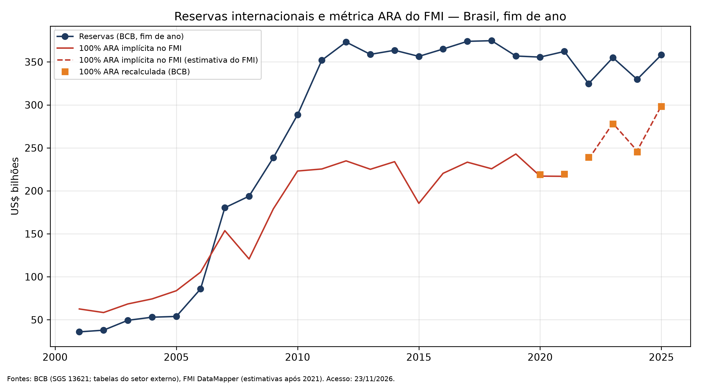
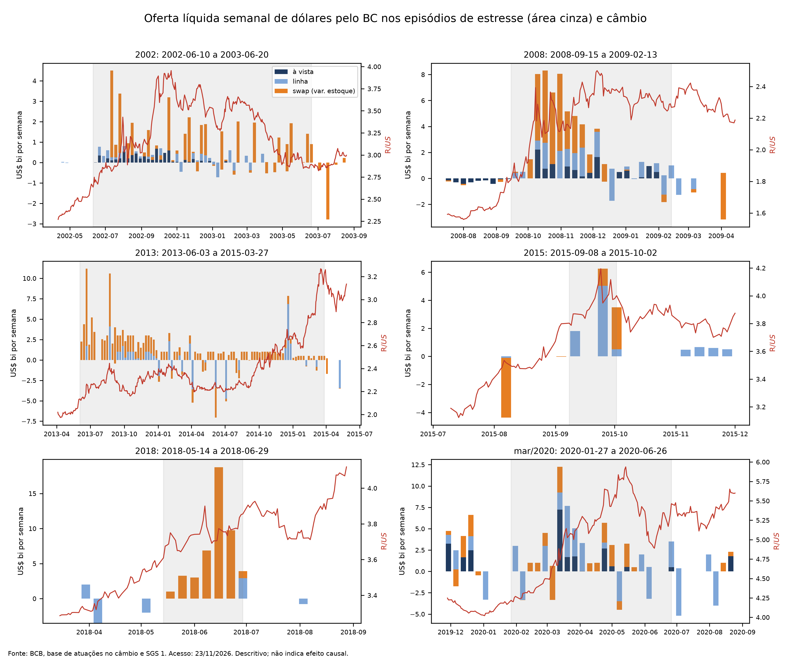
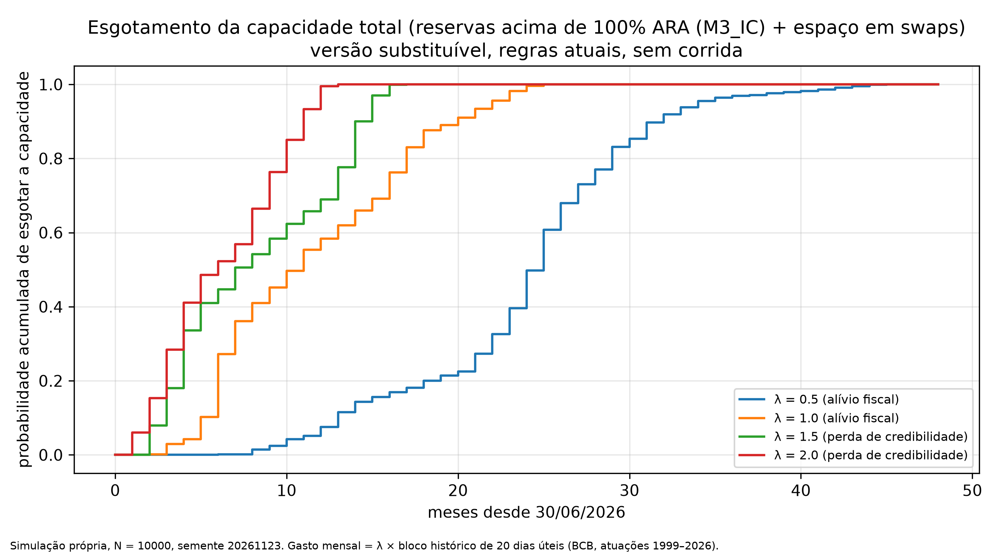
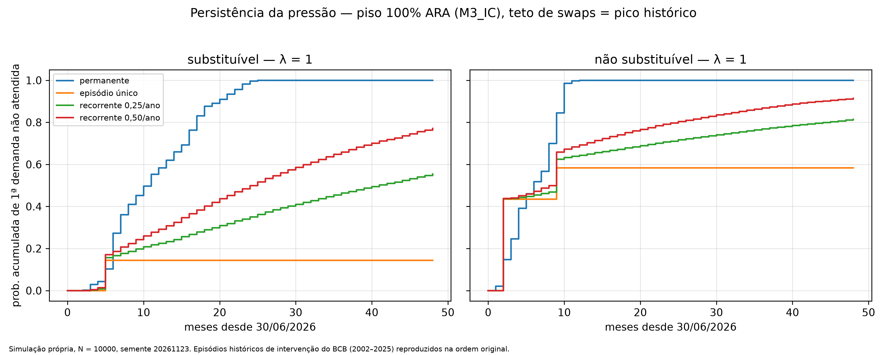

# Relatório de resultados — capacidade de intervenção do BC sob o corte de Selic proposto por André Lara Resende

Gerado em 24/11/2026 11:56 por `03_Codigo/08_relatorio.py`. Todos os números saem das tabelas em `04_Resultados/tabelas/` (CSV sem arredondamento). Unidades: US$ bilhões (2 casas), percentuais (2 casas), meses (blocos de 20 dias úteis).

> **Status: v3.2 (24/11/2026).** Pergunta do estudo fechada: as reservas e os swaps são munição suficiente para suavizar o câmbio na transição proposta, e sob que intensidade e persistência a capacidade se esgota? Acrescentados: incerteza por bootstrap de episódios, custo cambial dos swaps, referência externa (base WPFXI do FMI) e testes das funções centrais (9 testes, `03_Codigo/tests`). Cenário (c) passa a exploratório (apêndice): o mecanismo δ não tem base empírica.

> **v3.1 (24/11/2026).** Decisões do Pedro aplicadas: piso M3 + intercompanhia confirmado; regra escrita de episódios com teste de robustez; ARA dinâmica como sensibilidade; cenário (b) refeito como fluxo ancorado na conversão das exportações; m_b = 6, 12, 24; f = 0; 0,5; 1; corrida só no modelo permanente; lado fiscal fora do artigo. Pressupostos explícitos na seção 0.

> **v3 (24/11/2026), após a auditoria da segunda rodada (ChatGPT).** Mudanças em relação à v2: piso pela especificação M3 + DCP com intercompanhia (seção 5), episódio de 2018 incluído (seção 6), devolução das linhas em aberto, persistência da pressão como dimensão explícita (seção 8b), surpresas do Copom pelo Focus (seção 7) e validação do estoque de swaps contra a série oficial (seção 4). As grades de hipótese ainda precisam da confirmação do Pedro. Nada aqui é efeito causal.

## 0. Pressupostos do estudo (ceteris paribus)

Os resultados valem sob as hipóteses abaixo. Elas não descrevem o que aconteceria de fato; isolam a pergunta sobre a capacidade de intervenção.

- A pressão gerada pela política é representada por episódios históricos de intervenção do BCB (2002–2025), multiplicados por λ; a composição entre à vista, linhas e swaps segue a do episódio.
- Fora dos episódios, a demanda por intervenção é zero: o BC não vende nem compra dólares.
- Juros externos, preços de commodities, apetite global a risco e política fiscal ficam como estão; o estudo não modela como reagiriam à política.
- Não há retroalimentação: o câmbio simulado não altera inflação, Selic, resultado fiscal nem a própria pressão.
- As regras de intervenção do BC (instrumentos, prazos das linhas, rolagem de swaps) seguem o padrão histórico de cada episódio.
- O piso de reservas é estático na base (100% da ARA em 30/06/2026); a ARA dinâmica é sensibilidade.
- O teto de swaps é o pico histórico (preferência revelada); outras escalas são sensibilidade.
- Cenário (b): a conversão adicional das exportações entra como fluxo nas reservas e não muda a pressão nem o comportamento dos demais agentes.
- Cenário (c), exploratório: a desindexação reduz a pressão na proporção δ a partir do mês 13, sem outros efeitos. Fica em apêndice: o mecanismo não tem base empírica.
- O tamanho do corte de juros não é ligado à pressão por estimativa: λ e a frequência de episódios são cenários.

## 1. Resumo numérico

**Data de referência:** 2026-06-30 (último fim de trimestre com todos os componentes da ARA publicados). Reservas: US$ 367,56 bi. Swaps em aberto: US$ 93,25 bi. Teto de swaps (pico histórico, 2015-03-31): US$ 114,92 bi. Razão reservas/ARA recalculada (M3_IC): 1,121.

| Piso | Piso (US$ bi) | Folga em reservas (US$ bi) | Espaço em swaps (US$ bi) | Folga + espaço (US$ bi) | Capacidade utilizável (US$ bi) |
| --- | --- | --- | --- | --- | --- |
| 100% ARA (recalculada) | 327,95 | 39,61 | 21,67 | 61,28 | 61,28 |
| 120% ARA (recalculada) | 393,54 | -25,98 | 21,67 | -4,31 | 21,67 |
| 150% ARA (recalculada) | 491,92 | -124,36 | 21,67 | -102,70 | 21,67 |
| Greenspan-Guidotti (DCP com intercompanhia) | 224,43 | 143,13 | 21,67 | 164,80 | 164,80 |
| 100% ARA (M4 sem intercompanhia, regra v2 — sensibilidade) | 336,55 | 31,01 | 21,67 | 52,68 | 52,68 |

Folga negativa = reservas já abaixo do piso na data de referência. Capacidade utilizável = folga (só se positiva) + espaço em swaps; é o que a simulação usa.

**Meses até a primeira demanda não atendida (T_F), piso 100% ARA (M3_IC), regras atuais, sem corrida.** Célula: mediana (p10–p90) entre as trajetórias que esgotam; P = probabilidade de esgotar até o horizonte H.

| λ | Versão | H = 12 meses | H = 24 meses | H = 36 meses | H = 48 meses |
| --- | --- | --- | --- | --- | --- |
| 0,5 | substituível | 10 (8–12); P = 7,5% | 21 (11–24); P = 49,7% | 24 (13–31); P = 96,9% | 25 (13–32); P = 100,0% |
| 0,5 | não substituível | 7 (4–11); P = 58,4% | 10 (5–18); P = 100,0% | 10 (5–18); P = 100,0% | 10 (5–18); P = 100,0% |
| 1,0 | substituível | 7 (5–11); P = 58,3% | 11 (5–20); P = 99,6% | 11 (5–20); P = 100,0% | 11 (5–20); P = 100,0% |
| 1,0 | não substituível | 6 (2–10); P = 100,0% | 6 (2–10); P = 100,0% | 6 (2–10); P = 100,0% | 6 (2–10); P = 100,0% |
| 1,5 | substituível | 5 (2–10); P = 68,9% | 7 (3–15); P = 100,0% | 7 (3–15); P = 100,0% | 7 (3–15); P = 100,0% |
| 1,5 | não substituível | 4 (2–7); P = 100,0% | 4 (2–7); P = 100,0% | 4 (2–7); P = 100,0% | 4 (2–7); P = 100,0% |
| 2,0 | substituível | 6 (2–11); P = 99,6% | 6 (2–11); P = 100,0% | 6 (2–11); P = 100,0% | 6 (2–11); P = 100,0% |
| 2,0 | não substituível | 3 (1–6); P = 100,0% | 3 (1–6); P = 100,0% | 3 (1–6); P = 100,0% | 3 (1–6); P = 100,0% |

λ = intensidade em relação aos episódios de estresse de 1999–2026 (λ = 1: gasto mensal igual a um mês sorteado desses episódios, mantido por todo o horizonte). Substituível: o que não cabe em reservas vai para swaps e vice-versa.

**v3 — a resposta depende da persistência da pressão.** T_F com λ = 1, piso 100% ARA (M3_IC), teto = pico histórico. P = probabilidade de haver demanda não atendida até H; mediana incondicional só quando menos de 50% das trajetórias passam de H.

| Persistência | Versão | P(T_F ≤ 12) | P(T_F ≤ 24) | P(T_F ≤ 48) | Mediana (meses) |
| --- | --- | --- | --- | --- | --- |
| permanente | não substituível | 100,0% | 100,0% | 100,0% | 6 |
| permanente | substituível | 58,3% | 99,6% | 100,0% | 11 |
| recorrente 0,50/ano | não substituível | 69,2% | 79,7% | 91,4% | 9 |
| recorrente 0,50/ano | substituível | 29,1% | 49,9% | 77,1% | 25 |
| recorrente 0,25/ano | não substituível | 64,3% | 71,0% | 81,4% | 9 |
| recorrente 0,25/ano | substituível | 22,4% | 35,0% | 55,5% | 41 |
| episódio único | não substituível | 58,3% | 58,3% | 58,3% | 9 |
| episódio único | substituível | 14,3% | 14,3% | 14,3% | > 48 |

## 2. Metadados da rodada

- Data e hora: 24/11/2026 11:56
- Python 3.13.15 (Windows); pacotes: pandas 2.3.3, numpy 2.5.5, scipy 1.18.1, matplotlib 3.11.2, openpyxl 3.1.5, xlrd 2.0.2, yaml 6.0.4, requests 2.34.2
- Semente: 20261123; N = 10.000 trajetórias por combinação; duração da etapa 3: 13.4 s
- Controle de versão: não havia `git` configurado nesta rodada (executada no ambiente do Claude, não no Claude Code).

## 3. Fontes e acesso

| Série | Nome na fonte | Fonte | Código | Unidade | Início | Fim | Acesso | Obs. | SHA-256 (12 primeiros) |
| --- | --- | --- | --- | --- | --- | --- | --- | --- | --- |
| atuacoes_cambio | Histórico de Atuações no Mercado de Câmbio | Banco Central do Brasil — dados abertos (BCBDepin) |  | US$ (Volume USD Aceito/Ofertado) |  |  | 2026-11-24 09:28 |  | 6633c61c0ff1 |
| bcb_setor_externo_201904 | Tabelas de estatísticas do setor externo (201904) | Banco Central do Brasil — estatísticas do setor externo |  | US$ milhões |  |  | 2026-11-24 09:29 |  | ad81332b9d75 |
| bcb_setor_externo_201910 | Tabelas de estatísticas do setor externo (201910) | Banco Central do Brasil — estatísticas do setor externo |  | US$ milhões |  |  | 2026-11-24 09:29 |  | 5eff194ceaee |
| bcb_setor_externo_202004 | Tabelas de estatísticas do setor externo (202004) | Banco Central do Brasil — estatísticas do setor externo |  | US$ milhões |  |  | 2026-11-24 09:29 |  | cb926f785403 |
| bcb_setor_externo_202010 | Tabelas de estatísticas do setor externo (202010) | Banco Central do Brasil — estatísticas do setor externo |  | US$ milhões |  |  | 2026-11-24 09:29 |  | 8dff7e9ac138 |
| bcb_setor_externo_202104 | Tabelas de estatísticas do setor externo (202104) | Banco Central do Brasil — estatísticas do setor externo |  | US$ milhões |  |  | 2026-11-24 09:29 |  | 3303cc5c987a |
| bcb_setor_externo_202110 | Tabelas de estatísticas do setor externo (202110) | Banco Central do Brasil — estatísticas do setor externo |  | US$ milhões |  |  | 2026-11-24 09:29 |  | aacd80f8ff2c |
| bcb_setor_externo_202204 | Tabelas de estatísticas do setor externo (202204) | Banco Central do Brasil — estatísticas do setor externo |  | US$ milhões |  |  | 2026-11-24 09:29 |  | 40c811447239 |
| bcb_setor_externo_202210 | Tabelas de estatísticas do setor externo (202210) | Banco Central do Brasil — estatísticas do setor externo |  | US$ milhões |  |  | 2026-11-24 09:29 |  | 286251fe8e0d |
| bcb_setor_externo_202304 | Tabelas de estatísticas do setor externo (202304) | Banco Central do Brasil — estatísticas do setor externo |  | US$ milhões |  |  | 2026-11-24 09:29 |  | ae5c94c042b4 |
| bcb_setor_externo_202310 | Tabelas de estatísticas do setor externo (202310) | Banco Central do Brasil — estatísticas do setor externo |  | US$ milhões |  |  | 2026-11-24 09:29 |  | 4812671fed80 |
| bcb_setor_externo_202404 | Tabelas de estatísticas do setor externo (202404) | Banco Central do Brasil — estatísticas do setor externo |  | US$ milhões |  |  | 2026-11-24 09:29 |  | d8dbc8f8521c |
| bcb_setor_externo_202410 | Tabelas de estatísticas do setor externo (202410) | Banco Central do Brasil — estatísticas do setor externo |  | US$ milhões |  |  | 2026-11-24 09:29 |  | 138010cd71f0 |
| bcb_setor_externo_202504 | Tabelas de estatísticas do setor externo (202504) | Banco Central do Brasil — estatísticas do setor externo |  | US$ milhões |  |  | 2026-11-24 09:29 |  | a1bef589771c |
| bcb_setor_externo_202510 | Tabelas de estatísticas do setor externo (202510) | Banco Central do Brasil — estatísticas do setor externo |  | US$ milhões |  |  | 2026-11-24 09:29 |  | 1a21e4e5b5e0 |
| bcb_setor_externo_202604 | Tabelas de estatísticas do setor externo (202604) | Banco Central do Brasil — estatísticas do setor externo |  | US$ milhões |  |  | 2026-11-24 09:29 |  | 31d489766920 |
| bcb_setor_externo_202610 | Tabelas de estatísticas do setor externo (202610) | Banco Central do Brasil — estatísticas do setor externo |  | US$ milhões |  |  | 2026-11-24 09:29 |  | 8888aaef2ee5 |
| cambio_contratado_exportacao_diario | Cambio contratado-Operações com clientes no segmento comercial-exportação - total | Banco Central do Brasil — SGS | 13962 | US$ (milhões) | 01/09/2008 | 13/11/2026 | 2026-11-24 11:09 | 4.563 | d51d5c2afe36 |
| cambio_venda_diario | Taxa de câmbio - Livre - Dólar americano (venda) - diário | Banco Central do Brasil — SGS | 1 | R$/US$ | 04/01/1999 | 23/11/2026 | 2026-11-24 09:27 | 7.003 | c16461887c66 |
| copom_historico | Histórico das taxas de juros (reuniões do Copom) | Banco Central do Brasil — API do site |  | % a.a. |  |  | 2026-11-24 09:28 |  | 3b8bee1210fb |
| embi_brasil | EMBI+ Risco-Brasil (JPM366_EMBI366) | Ipeadata / JP Morgan |  | pontos-base |  |  | 2026-11-24 09:28 |  | daee85ba4b4f |
| embi_brasil_metadados | Metadados EMBI+ Risco-Brasil | Ipeadata |  | - |  |  | 2026-11-24 09:28 |  | d4589fd4ec07 |
| export_bens_mensal | Exportação de bens - Balanço de Pagamentos - mensal | Banco Central do Brasil — SGS | 22708 | US$ milhões | 01/01/1995 | 01/09/2026 | 2026-11-24 09:27 | 381 | 69947f308c59 |
| export_bens_servicos_mensal | Balança comercial e Serviços - mensal - receita | Banco Central do Brasil — SGS | 22705 | US$ milhões | 01/01/1995 | 01/09/2026 | 2026-11-24 09:27 | 381 | 4534eee55d91 |
| export_servicos_mensal | Serviços - mensal - receita | Banco Central do Brasil — SGS | 22720 | US$ milhões | 01/01/1995 | 01/09/2026 | 2026-11-24 09:28 | 381 | 57db4571b409 |
| fluxo_cambial_comercial_diario | Cambio contratado-Operações no segmento comercial-saldo | Banco Central do Brasil — SGS | 13967 | US$ (milhões) | 01/09/2008 | 13/11/2026 | 2026-11-24 11:09 | 4.563 | 719fb557dbaf |
| fluxo_cambial_financeiro_diario | Cambio contratado-Operações com cliente no segmento financeiro-saldo | Banco Central do Brasil — SGS | 13970 | US$ (milhões) | 01/09/2008 | 13/11/2026 | 2026-11-24 11:09 | 4.563 | 77588c152094 |
| fluxo_cambial_total_diario | Movimento de câmbio contratado - saldo | Banco Central do Brasil — SGS | 13961 | US$ (milhões) | 01/09/2008 | 13/11/2026 | 2026-11-24 09:32 | 4.563 | 335361de331e |
| fmi_artigo4_2026_pdf | Brazil: 2026 Article IV Consultation — Staff Report (IMF Country Report) | FMI |  | R$ bilhões (Tabela 4) |  |  | 2026-11-24 11:52 |  | ff838ef737bd |
| fmi_wpfxi_mensal | Working Paper Foreign Exchange Intervention (WPFXI), IMF.STA:WPFXI(1.0.2) | FMI — data.imf.org, exportado manualmente pelo Pedro | IMF.STA:WPFXI(1.0.2) | % do PIB (média móvel de 3 anos) e US$ milhões; negativo = venda de moeda estrangeira | 2000-01 | 2024-12 | 2026-11-24 11:23 | 2.326 | a8d066f71cef |
| focus_selic_por_reuniao | ExpectativasMercadoSelic (Focus) | Banco Central do Brasil — Olinda |  | % a.a. |  |  | 2026-11-24 11:14 | 67.174 | 8a5e794c2957 |
| linhas_estoque_oficial_diario | Estoque de Linhas com Recompra - diária | Banco Central do Brasil — SGS | 29722 | US$ (milhões) | 01/01/2001 | 23/11/2026 | 2026-11-24 09:31 | 6.752 | 9f6c0f3ea9ad |
| m2_mensal | Meios de pagamento amplos - M2 (saldo em final de período) - Novo | Banco Central do Brasil — SGS | 27810 | R$ mil | 01/08/2001 | 01/09/2026 | 2026-11-24 09:28 | 302 | 0e5d5f8a32ca |
| m3_mensal | Meios de pagamento amplos - M3 (saldo em final de período) - Novo | Banco Central do Brasil — SGS | 27813 | R$ mil | 01/08/2001 | 01/09/2026 | 2026-11-24 09:28 | 302 | 66eae72e941e |
| m4_mensal | Meios de pagamento amplos - M4 (saldo em final de periodo) - Novo | Banco Central do Brasil — SGS | 27815 | R$ mil | 01/12/2001 | 01/09/2026 | 2026-11-24 09:28 | 298 | ce0b65bf6bb3 |
| meta_selic | Taxa de juros - Meta Selic definida pelo Copom | Banco Central do Brasil — SGS | 432 | % a.a. | 05/03/1999 | 24/11/2026 | 2026-11-24 09:27 | 10.127 | ecc5900396ec |
| pib_mensal_usd | PIB mensal - Em US$ milhões | Banco Central do Brasil — SGS | 4385 | US$ (milhões) | 01/02/1990 | 01/10/2026 | 2026-11-24 09:33 | 441 | 74b66b5d6b05 |
| reservas_diarias | Reservas internacionais - Conceito caixa - Total - diária | Banco Central do Brasil — SGS | 13621 | US$ milhões | 01/09/1998 | 19/11/2026 | 2026-11-24 09:27 | 7.086 | beed10c990b3 |
| swap_contratos_oficial_diario | Estoque de Swap Cambial - Número de contratos - diária | Banco Central do Brasil — SGS | 29724 | Unidades | 08/07/2002 | 23/11/2026 | 2026-11-24 09:31 | 6.318 | 67f5c0e8e458 |
| swap_estoque_nocional_oficial_diario | Estoque de Swap Cambial - Nocional - diária | Banco Central do Brasil — SGS | 29723 | US$ (milhões) | 08/07/2002 | 23/11/2026 | 2026-11-24 11:08 | 6.318 | 7c5324d80823 |
| tesouro_estoque_dpf | Estoque da Dívida Pública Federal | Tesouro Nacional — Tesouro Transparente |  | R$ |  |  | 2026-11-24 09:29 |  | dffbf76850f8 |

Endpoints completos e observações: `02_Dados/03_dicionario/dicionario_series.csv`. Log de downloads: `03_Codigo/logs/`.

## 4. Verificações

| Verificação | Referência | Fonte | Obtido | Dif. abs. | Dif. % | Tolerância % | Status | Obs. |
| --- | --- | --- | --- | --- | --- | --- | --- | --- |
| Reservas em 31/12/2025 (SGS 13621) | 358,230 | BCB, Relatório de Gestão das Reservas 2026 | 358,234 | 0,004 | 0,001 | 0,50 | ok | valor de 2025-12-31 |
| Reservas em 30/09/2026 (SGS 13621) | 362,800 | BCB, Nota do setor externo de out/2026 | 362,821 | 0,021 | 0,006 | 0,50 | ok | valor de 2026-09-30 |
| Razão reservas/ARA, fim de 2025 (DataMapper) | 1,210 | FMI, Artigo IV 2026, p. 17 e p. 60 do PDF | 1,198 | -0,012 | -0,987 | — | comparação | comparação: diferença reportada, sem tolerância |
| Vendas à vista do BC, 12 a 31/12/2024 | 21,574 | Imprensa: Folha de Pernambuco, 05/01/2025 | 21,575 | 0,000 | 0,002 | 1,00 | ok | base de atuações |
| Vendas com recompra, 12 a 31/12/2024 | 11,000 | Imprensa: Folha de Pernambuco, 05/01/2025 | 11,000 | 0,000 | 0,000 | 2,00 | ok | base de atuações |
| Estoque de swaps reconstruído × SGS 29723 (30/06/2026) | 93,250 | BCB, SGS 29723 | 93,250 | 0,000 | 0,000 | 0,50 | ok | 6301 dias (2002-07-08 a 2026-10-27): erro abs. médio US$ 0.0002 bi; 1 dia divergente (2026-09-11) |
| Linhas com recompra reconstruídas × SGS 29722 (30/06/2026) | 4,050 | BCB, SGS 29722 | 4,050 | -0,000 | -0,000 | 0,50 | ok | 0 dias com diferença > US$ 0,01 bi |
| Soma das contribuições da ARA = total da ARA | 0,000 | interna | 0,000 | 0,000 | — | — | ok | maior diferença absoluta entre as datas (US$ bi) |

Comparação adicional (não é insumo): a razão recalculada em 2026-06-30 (1,1208) e a estimativa do FMI para 2026 no DataMapper (1,0906).

## 5. Etapa 1 — Capacidade de intervenção

**Data de referência e por que:** 2026-06-30. É o último fim de trimestre em que o BCB já publicou dívida externa por prazo original, cronograma de amortização e passivos da posição de investimento internacional (tabelas do setor externo de out/2026). Reservas, câmbio, M2/M3/M4 e exportações usam o mesmo mês. Últimas reservas disponíveis (só informativo, não combinadas com o piso): US$ 363,06 bi em 2026-11-19.

**Definições (FMI, Guidance Note 2016):** pesos para câmbio flutuante 30% DCP, 15% outros passivos, 5% moeda ampla, 5% exportações (p. 14 do PDF); moeda ampla = M2 ao câmbio de fim de período e DCP por prazo residual (p. 36). Outros passivos = passivos de carteira + outros investimentos − DCP (insumos listados na p. 36; 'MLT debt and equity liabilities' no ARA 2011, p. 23).

**Escolha da especificação (regra v3).** Passo 1 — nível: o agregado do BCB precisa reproduzir a moeda ampla que o FMI usa ('M2' do FMI, Guidance Note p. 36), publicada no Artigo IV 2026, Tabela 4 (p. 54 do PDF), com erro médio ≤ 5%. Passo 2 — razão: entre as especificações elegíveis, com e sem dívida intercompanhia no DCP (o FMI usa a dívida de curto prazo total do WEO, por prazo residual), a de menor erro contra a razão reservas/ARA publicada. A v2 usava só o passo 2 e só sem intercompanhia, e escolhia M4: o M4 superestima a moeda ampla do FMI em ~10% e isso compensava o DCP sem intercompanhia (erros que se anulam).

| Ano | FMI 'Broad money (M2)' (R$ bi) | M2 BCB | M3 BCB | M4 BCB |
| --- | --- | --- | --- | --- |
| 2021 | 8.584,20 | 4.320,17 | 8.814,97 | 9.555,23 |
| 2022 | 9.490,90 | 5.105,45 | 9.687,09 | 10.709,52 |
| 2023 | 10.966,70 | 5.904,64 | 10.848,43 | 11.939,59 |
| 2024 | 12.326,60 | 6.658,39 | 12.100,60 | 13.484,59 |
| 2025 | 13.509,00 | 7.393,64 | 13.310,53 | 14.815,15 |

| Especificação | DCP com intercomp. | OL descontado da intercomp. | Erro nível moeda vs FMI (%) | Elegível | Erro abs. médio razão (p.p.) | Viés médio (p.p.) | Anos | Escolhido v3 | Escolhido v2 |
| --- | --- | --- | --- | --- | --- | --- | --- | --- | --- |
| m2 | não | não | 46,66 | não | 36,73 | 36,73 | 2020, 2021, 2022, 2023, 2024, 2025 | não | não |
| m3 | não | não | 1,83 | sim | 3,51 | 3,51 | 2020, 2021, 2022, 2023, 2024, 2025 | não | não |
| m4 | não | não | 10,42 | não | 1,93 | -1,63 | 2020, 2021, 2022, 2023, 2024, 2025 | não | sim |
| m2_ic | sim | sim | 46,66 | não | 30,66 | 30,66 | 2020, 2021, 2022, 2023, 2024, 2025 | não | não |
| m3_ic | sim | sim | 1,83 | sim | 1,02 | -0,54 | 2020, 2021, 2022, 2023, 2024, 2025 | sim | não |
| m4_ic | sim | sim | 10,42 | não | 5,40 | -5,40 | 2020, 2021, 2022, 2023, 2024, 2025 | não | não |
| m2_icB | sim | não | 46,66 | não | 25,00 | 25,00 | 2020, 2021, 2022, 2023, 2024, 2025 | não | não |
| m3_icB | sim | não | 1,83 | sim | 4,36 | -4,36 | 2020, 2021, 2022, 2023, 2024, 2025 | não | não |
| m4_icB | sim | não | 10,42 | não | 8,97 | -8,97 | 2020, 2021, 2022, 2023, 2024, 2025 | não | não |

**Componentes por data (US$ bi; agregado M3_IC).** Razão FMI de 2022 em diante = estimativa do FMI.

| Data | Reservas | Export. 12m | M3 (US$) | DCP (espec.) | Pass. carteira | Outros invest. | Outros passivos (espec.) | ARA recalc. | Razão recalc. | Razão FMI | Dif. (p.p.) | Método DCP |
| --- | --- | --- | --- | --- | --- | --- | --- | --- | --- | --- | --- | --- |
| 2018-12-31 | 374,71 | 273,56 | 1.633,04 | — | — | — | — | — | — | 1,660 | — | exato (cronograma anual, formato antigo) |
| 2019-12-31 | 356,88 | 258,83 | 1.690,39 | — | 570,10 | 234,53 | — | — | — | 1,470 | — | exato (cronograma anual, formato antigo) |
| 2020-12-31 | 355,62 | 238,20 | 1.546,28 | 158,75 | 488,82 | 217,99 | 548,06 | 219,06 | 1,623 | 1,638 | -1,44 | exato (cronograma anual, formato antigo) |
| 2021-12-31 | 362,20 | 315,45 | 1.579,60 | 153,21 | 436,03 | 242,80 | 525,61 | 219,56 | 1,650 | 1,670 | -2,04 | exato (cronograma anual, formato antigo) |
| 2022-12-31 | 324,70 | 380,49 | 1.856,58 | 152,01 | 444,56 | 250,67 | 543,22 | 238,94 | 1,359 | 1,371 | -1,17 | exato (cronograma anual, formato antigo) |
| 2023-12-31 | 355,03 | 389,30 | 2.240,81 | 170,00 | 537,42 | 267,52 | 634,95 | 277,75 | 1,278 | 1,275 | 0,37 | exato (cronograma anual, formato antigo) |
| 2024-12-31 | 329,73 | 388,98 | 1.954,14 | 171,11 | 427,52 | 255,81 | 512,22 | 245,32 | 1,344 | 1,337 | 0,70 | exato (cronograma anual, formato antigo) |
| 2025-12-31 | 358,23 | 404,85 | 2.419,04 | 201,63 | 551,66 | 292,88 | 642,90 | 298,12 | 1,202 | 1,198 | 0,36 | aproximado (cronograma mensal) |
| 2026-06-30 | 367,56 | 426,53 | 2.703,69 | 224,43 | 612,88 | 305,60 | 694,06 | 327,95 | 1,121 | — | — | aproximado (cronograma mensal) |

**Contribuições e sensibilidade ao agregado.**

| Data | 0,05 × Export. | 0,05 × M3 | 0,30 × DCP | 0,15 × Outros pass. | ARA | Câmbio (R$/US$) | Razão M3 | Razão M4 (v2) | Razão M3+IC |
| --- | --- | --- | --- | --- | --- | --- | --- | --- | --- |
| 2020-12-31 | 11,91 | 77,31 | 47,62 | 82,21 | 219,06 | 5,1967 | 1,678 | 1,647 | 1,623 |
| 2021-12-31 | 15,77 | 78,98 | 45,96 | 78,84 | 219,56 | 5,5805 | 1,699 | 1,648 | 1,650 |
| 2022-12-31 | 19,02 | 92,83 | 45,60 | 81,48 | 238,94 | 5,2177 | 1,399 | 1,343 | 1,359 |
| 2023-12-31 | 19,47 | 112,04 | 51,00 | 95,24 | 277,75 | 4,8413 | 1,311 | 1,259 | 1,278 |
| 2024-12-31 | 19,45 | 97,71 | 51,33 | 76,83 | 245,32 | 6,1923 | 1,382 | 1,320 | 1,344 |
| 2025-12-31 | 20,24 | 120,95 | 60,49 | 96,44 | 298,12 | 5,5024 | 1,229 | 1,174 | 1,202 |
| 2026-06-30 | 21,33 | 135,18 | 67,33 | 104,11 | 327,95 | 5,1766 | 1,151 | 1,092 | 1,121 |

**DCP por prazo residual.** Exato (formato antigo do BCB, referências de dezembro até 2024) = DCP por prazo original + amortizações de longo prazo nos 12 meses seguintes (coluna 'Imediato' + ano seguinte). Para 2025-12 e 2026-06 só há o cronograma mensal, que exclui empréstimos interbancários e créditos comerciais de curto prazo; a parcela de longo prazo foi aproximada por: principal nos 12 meses (governo, bancos, outros setores) − itens de curto prazo incluídos no cronograma. Validação nos anos com os dois métodos:

| Data | LP 12m exato (US$ mi) | LP 12m aproximado (US$ mi) | Dif. (US$ mi) | Dif. % |
| --- | --- | --- | --- | --- |
| 2020-12-31 | 42.418,05 | 45.919,14 | 3.501,09 | 8,25 |
| 2021-12-31 | 31.616,31 | 41.819,65 | 10.203,33 | 32,27 |
| 2022-12-31 | 38.263,78 | 40.087,07 | 1.823,29 | 4,77 |
| 2023-12-31 | 43.119,72 | 48.631,17 | 5.511,45 | 12,78 |
| 2024-12-31 | 42.405,17 | 50.042,31 | 7.637,14 | 18,01 |

A aproximação superestima a parcela de longo prazo em US$ 5,74 bi em média (15,22%). Como DCP entra com peso 0,30 e sai dos outros passivos com peso 0,15, o efeito sobre a ARA é cerca de 0,15 × erro ≈ US$ 0,86 bi (ARA e piso um pouco maiores em 2025-12 e 2026-06).

**Pisos e capacidade.**

| Piso | Data | Reservas | Piso | Folga reservas | Swaps em aberto | Teto swaps | Espaço swaps | Capacidade total |
| --- | --- | --- | --- | --- | --- | --- | --- | --- |
| 100% ARA (recalculada) | 2026-06-30 | 367,56 | 327,95 | 39,61 | 93,25 | 114,92 | 21,67 | 61,28 |
| 120% ARA (recalculada) | 2026-06-30 | 367,56 | 393,54 | -25,98 | 93,25 | 114,92 | 21,67 | -4,31 |
| 150% ARA (recalculada) | 2026-06-30 | 367,56 | 491,92 | -124,36 | 93,25 | 114,92 | 21,67 | -102,70 |
| Greenspan-Guidotti (DCP com intercompanhia) | 2026-06-30 | 367,56 | 224,43 | 143,13 | 93,25 | 114,92 | 21,67 | 164,80 |
| 100% ARA (M4 sem intercompanhia, regra v2 — sensibilidade) | 2026-06-30 | 367,56 | 336,55 | 31,01 | 93,25 | 114,92 | 21,67 | 52,68 |
| 100% ARA implícita FMI (fim 2025, comparação) | 2025-12-31 | 358,23 | 299,01 | 59,22 | 100,15 | 114,92 | 14,77 | 73,99 |
| 120% ARA implícita FMI (fim 2025, comparação) | 2025-12-31 | 358,23 | 358,81 | -0,58 | 100,15 | 114,92 | 14,77 | 14,19 |
| 150% ARA implícita FMI (fim 2025, comparação) | 2025-12-31 | 358,23 | 448,52 | -90,28 | 100,15 | 114,92 | 14,77 | -75,52 |

Venda com recompra em aberto na data de referência: US$ 4,05 bi. Na v3 ela volta às reservas no mês do vencimento contratual (meses 1, 3 e 5 da simulação), como as linhas novas; não está somada à folga.

**Tetos alternativos para o estoque de swaps.** O BCB não trata o pico histórico como limite (Goldfajn, 2018: pode 'ultrapassar os valores máximos'); o pico é preferência revelada. Escalas ancoradas em dados mudam pouco o teto; +25% e +50% são hipóteses sem âncora histórica.

**Validação da regra de ARA dinâmica** (usada só como sensibilidade): de um dezembro para o seguinte, a parcela da moeda cresce 10,3% ao ano (mediana do M3, 2016–2026) e é convertida pelo câmbio observado; os demais componentes ficam constantes. Erro absoluto médio em 5 anos: US$ 14,86 bi, contra US$ 28,78 bi do piso estático.

| De | Para | ARA observada | Prev. estática | Prev. dinâmica | Erro estática | Erro dinâmica | Câmbio (%) |
| --- | --- | --- | --- | --- | --- | --- | --- |
| 2020-12-31 | 2021-12-31 | 219,56 | 219,06 | 221,15 | -0,50 | 1,59 | 7,39 |
| 2021-12-31 | 2022-12-31 | 238,94 | 219,56 | 233,74 | -19,38 | -5,20 | -6,50 |
| 2022-12-31 | 2023-12-31 | 277,75 | 238,94 | 256,45 | -38,81 | -21,30 | -7,21 |
| 2023-12-31 | 2024-12-31 | 245,32 | 277,75 | 262,32 | 32,43 | 16,99 | 27,91 |
| 2024-12-31 | 2025-12-31 | 298,12 | 245,32 | 268,88 | -52,80 | -29,24 | -11,14 |

| Teto | Valor (US$ bi) | Espaço em 30/06/2026 (US$ bi) | Origem | Regra |
| --- | --- | --- | --- | --- |
| pico histórico (preferência revelada) | 114,92 | 21,67 | dado observado | máximo do estoque em 2015-03-31 |
| pico escalado pelo PIB em US$ | 120,90 | 27,65 | calculado | pico/PIB 12m (0.0484) x PIB 12m de 2026-06-30 (2495.7) |
| pico escalado pelas reservas | 116,44 | 23,19 | calculado | pico/reservas (0.3168) x reservas de 2026-06-30 (367.558) |
| pico +25% (hipótese sem âncora histórica) | 143,65 | 50,40 | hipótese | ilustrativo |
| pico +50% (hipótese sem âncora histórica) | 172,38 | 79,13 | hipótese | ilustrativo |

## 6. Etapa 2 — Episódios de estresse

**Regra:** série semanal de oferta líquida de dólares pelo BC = vendas à vista − compras + vendas com recompra novas − recompras + empréstimos/compromissadas líquidos + variação do estoque líquido de swaps (tradicional − reverso). Episódio = maior sequência de semanas com oferta positiva que contém a âncora, juntando sequências separadas por até 2 semanas. Swap 'tradicional' = o BC compra o contrato e injeta dólares no mercado futuro (página 'Swap cambial' do BCB).

| Episódio | Âncora | Data âncora | Início | Fim | Dias úteis | Semanas |
| --- | --- | --- | --- | --- | --- | --- |
| 2002 | data do câmbio máximo em 2002 (crise de confiança pré-eleitoral) | 2002-10-22 | 2002-06-10 | 2003-06-20 | 261 | 54 |
| 2008 | data do câmbio máximo em set–dez/2008 (crise financeira global) | 2008-12-05 | 2008-09-15 | 2009-02-13 | 108 | 22 |
| 2013 | anúncio do programa de swaps (22/08/2013) | 2013-08-22 | 2013-06-03 | 2015-03-27 | 462 | 95 |
| 2015 | data do câmbio máximo em 2015 (deterioração fiscal e rebaixamentos) | 2015-09-24 | 2015-09-08 | 2015-10-02 | 19 | 4 |
| 2018 | data do câmbio máximo em mai–jun/2018 (greve dos caminhoneiros e venda de ativos emergentes) — incluído na v3 | 2018-06-07 | 2018-05-14 | 2018-06-29 | 34 | 7 |
| mar/2020 | data do câmbio máximo em mar/2020 (choque da pandemia) | 2020-03-31 | 2020-01-27 | 2020-06-26 | 104 | 22 |
| dez/2024 | início dos leilões em 12/12/2024 | 2024-12-12 | 2024-12-09 | 2025-02-21 | 53 | 11 |

**Volumes (US$ bi).**

| Episódio | À vista líq. | Linha bruta | Recompras | Linha líq. | Swap trad. bruto | Swap rolado (aprox.) | Swap var. estoque | Empr./compr. | Oferta líq. total |
| --- | --- | --- | --- | --- | --- | --- | --- | --- | --- |
| 2002 | 7,57 | 6,18 | 6,18 | 0,00 | 54,42 | 21,86 | 32,57 | 0,00 | 40,14 |
| 2008 | 14,53 | 17,78 | 10,82 | 6,96 | 62,39 | 28,79 | 33,60 | 8,51 | 63,60 |
| 2013 | 0,00 | 34,64 | 26,34 | 8,30 | 303,64 | 188,92 | 114,72 | 0,00 | 123,02 |
| 2015 | 0,00 | 7,33 | 0,00 | 7,33 | 12,81 | 8,59 | 4,21 | 0,00 | 11,54 |
| 2018 | 0,00 | 2,92 | 0,00 | 2,92 | 54,91 | 11,30 | 43,62 | 0,00 | 46,54 |
| mar/2020 | 18,82 | 23,00 | 18,23 | 4,77 | 57,75 | 36,25 | 21,51 | 0,21 | 45,30 |
| dez/2024 | 21,57 | 18,00 | 2,00 | 16,00 | 36,66 | 36,66 | 0,00 | 0,00 | 37,57 |

**Reservas, câmbio e risco-país.**

| Episódio | Reservas início | Reservas fim | Var. reservas | Câmbio início | Câmbio fim | Var. câmbio % | Maior desvaloriz. % | EMBI início | EMBI pico | EMBI fim | Gasto por p.p. (descritivo) | Prazo linha (dias, mediana) |
| --- | --- | --- | --- | --- | --- | --- | --- | --- | --- | --- | --- | --- |
| 2002 | 32,91 | 48,92 | 16,01 | 2,6708 | 2,8933 | 8,33 | 48,09 | 1.181 | 2.443 | 771 | 4,82 | 49 |
| 2008 | 205,76 | 187,62 | -18,14 | 1,7912 | 2,2680 | 26,62 | 39,59 | 268 | 688 | 426 | 2,39 | 60 |
| 2013 | 374,42 | 363,20 | -11,21 | 2,1319 | 3,2259 | 51,32 | 53,30 | 206 | 361 | 324 | 2,40 | 126 |
| 2015 | 367,71 | 361,95 | -5,76 | 3,7986 | 4,0010 | 5,33 | 10,43 | 381 | 489 | 406 | 2,17 | 194 |
| 2018 | 381,76 | 379,50 | -2,26 | 3,5716 | 3,8558 | 7,96 | 9,19 | 254 | 345 | 332 | 5,85 | 36 |
| mar/2020 | 357,83 | 348,81 | -9,02 | 4,1769 | 5,4629 | 30,79 | 42,14 | 225 | 476 | 384 | 1,47 | 91 |
| dez/2024 | 363,62 | 331,16 | -32,46 | 6,0293 | 5,7027 | -5,42 | 2,97 | — | — | — | — | 282 |

EMBI+ (Ipeadata) foi descontinuado em 30/07/2024: sem risco-país para dez/2024. Gasto por p.p. só é calculado quando o real se desvalorizou no episódio.

**Blocos de 20 dias úteis por episódio (US$ bi por bloco).** Tabela completa: `tabelas/episodios_blocos.csv`.

| Episódio | Blocos | Média | Mediana | Mín. | Máx. | Desvio |
| --- | --- | --- | --- | --- | --- | --- |
| 2002 | 13 | 3,09 | 2,87 | -0,03 | 9,27 | 2,23 |
| 2008 | 5 | 12,34 | 10,44 | 0,76 | 30,56 | 12,59 |
| 2013 | 23 | 5,34 | 3,76 | -4,05 | 19,67 | 6,43 |
| 2015 | 1 | 12,15 | 12,15 | 12,15 | 12,15 | — |
| 2018 | 2 | 29,42 | 29,42 | 17,87 | 40,96 | 16,33 |
| dez/2024 | 3 | 13,06 | 4,62 | 2,00 | 32,57 | 16,95 |
| mar/2020 | 5 | 8,38 | 6,27 | -3,09 | 28,76 | 12,21 |

**Ritmos de gasto** (52 blocos válidos; 3 reescalados; 4 descartados por terem menos de 10 dias): moderado (mediana) US$ 3,75 bi; forte (p75) US$ 10,41 bi; extremo (máximo) US$ 40,96 bi; média US$ 7,24 bi; desvio-padrão US$ 9,49 bi; mínimo US$ -4,05 bi. Episódio mais longo: 2013 (23 blocos).

**Regra de inclusão (v3.1).** Lista principal = janela de intervenção grande E evento de estresse de mercado documentado. Teste de robustez = só o critério de tamanho: toda janela de 20 dias úteis fora dos episódios principais com oferta líquida acima da do menor episódio (US$ 11,54 bi) vira episódio extra. A varredura encontrou:

| Episódio extra | Início | Fim | Dias úteis | À vista | Linhas | Swaps | Total (US$ bi) | Câmbio (%) |
| --- | --- | --- | --- | --- | --- | --- | --- | --- |
| extra 01/2021 | 2020-11-23 | 2021-03-26 | 86 | 7,18 | 2,50 | 17,85 | 27,53 | 6,61 |
| extra 01/2022 | 2021-11-29 | 2022-01-28 | 45 | 4,84 | 2,00 | 17,50 | 24,34 | -3,42 |

Nov/2020–mar/2021 coincide com o desmonte do overhedge dos bancos (mudança regulatória anunciada); dez/2021–jan/2022, com saídas sazonais de fim de ano. Ficam fora da lista principal e entram no bloco H da seção 8b.

## 7. Etapa 2b — Reação do câmbio às decisões do Copom

258 decisões de 1999-03-04 a 2026-11-04 (inclui extraordinárias). Variação % do câmbio do último dia útil até a decisão ao primeiro dia útil depois. **Decisão bruta, não surpresa.**

| Agrupamento | Tipo | Magnitude | Selic anterior | N | Média % | Mediana % | Desvio % | Mín. % | Máx. % |
| --- | --- | --- | --- | --- | --- | --- | --- | --- | --- |
| tipo | alta | — | — | 67 | -0,229 | -0,122 | 1,162 | -5,176 | 2,223 |
| tipo | corte | — | — | 95 | 0,054 | 0,020 | 0,894 | -2,558 | 2,980 |
| tipo | manutenção | — | — | 96 | -0,013 | -0,013 | 0,971 | -5,210 | 2,428 |
| tipo × magnitude | alta | >0,50 p.p. | — | 24 | -0,578 | -0,229 | 1,491 | -5,176 | 2,223 |
| tipo × magnitude | alta | ≤0,50 p.p. | — | 43 | -0,035 | -0,110 | 0,893 | -1,776 | 2,034 |
| tipo × magnitude | corte | >0,50 p.p. | — | 36 | -0,085 | -0,114 | 0,962 | -1,934 | 2,980 |
| tipo × magnitude | corte | ≤0,50 p.p. | — | 59 | 0,139 | 0,042 | 0,847 | -2,558 | 1,919 |
| tipo × magnitude | manutenção | nenhuma | — | 96 | -0,013 | -0,013 | 0,971 | -5,210 | 2,428 |
| tipo × regime_selic | alta | — | <10% | 16 | -0,222 | 0,010 | 1,121 | -1,953 | 2,034 |
| tipo × regime_selic | alta | — | ≥10% | 51 | -0,231 | -0,174 | 1,186 | -5,176 | 2,223 |
| tipo × regime_selic | corte | — | <10% | 20 | 0,653 | 0,676 | 0,924 | -0,723 | 2,980 |
| tipo × regime_selic | corte | — | ≥10% | 75 | -0,106 | -0,092 | 0,820 | -2,558 | 1,919 |
| tipo × regime_selic | manutenção | — | <10% | 22 | 0,059 | 0,189 | 0,768 | -1,765 | 1,497 |
| tipo × regime_selic | manutenção | — | ≥10% | 74 | -0,035 | -0,080 | 1,027 | -5,210 | 2,428 |

**Referência:** Vicente, Marins e Gaglianone (2021), BCB Working Paper 552 (p. 8 e p. 14 do PDF): surpresa de afrouxamento de 100 bp → depreciação de cerca de 3,4 p.p. (coeficiente −3,41, Modelo A, Tabela 1). Ressalva dos autores: com Selic de um dígito a surpresa não é significativa (Modelo C), com poucas observações (p. 15 do PDF). Natureza: surpresa medida por DI futuro; aqui usamos decisão bruta, que inclui a parte já esperada. Na nossa amostra, a razão média variação do câmbio / p.p. de corte é 0,279% (mediana 0,029%), muito menor porque a maior parte de cada corte já era esperada.

**v3 — surpresas pelo Focus.** Surpresa = meta decidida − mediana do Focus para a reunião, na pesquisa da véspera (167 reuniões ordinárias, 2006-01-18 a 2026-11-04). 82,0% das reuniões não tiveram surpresa; nos cortes (62), 80,6% foram integralmente antecipados. Surpresa absoluta média: 0,049 p.p.; faixa -0,50 a 0,25 p.p. MQO com erros HC1; descritivo, não causal.

| Modelo | Variável | Coef. | EP (HC1) | p | IC95 inf. | IC95 sup. | N | R² |
| --- | --- | --- | --- | --- | --- | --- | --- | --- |
| M1 variação ~ surpresa | const | -0,054 | 0,077 | 0,482 | -0,204 | 0,097 | 167 | 0,008 |
| M1 variação ~ surpresa | surpresa_pp | -0,739 | 0,747 | 0,323 | -2,203 | 0,726 | 167 | 0,008 |
| M2 variação ~ mudança observada | const | -0,051 | 0,077 | 0,511 | -0,202 | 0,100 | 167 | 0,002 |
| M2 variação ~ mudança observada | mudanca_pp | -0,091 | 0,145 | 0,531 | -0,374 | 0,193 | 167 | 0,002 |
| M3 variação ~ esperada + surpresa | const | -0,054 | 0,077 | 0,481 | -0,205 | 0,097 | 167 | 0,008 |
| M3 variação ~ esperada + surpresa | esperada_pp | -0,026 | 0,144 | 0,856 | -0,308 | 0,256 | 167 | 0,008 |
| M3 variação ~ esperada + surpresa | surpresa_pp | -0,719 | 0,746 | 0,335 | -2,182 | 0,744 | 167 | 0,008 |
| M4 variação ~ surpresa × Selic<10% | const | -0,182 | 0,094 | 0,054 | -0,367 | 0,003 | 167 | 0,047 |
| M4 variação ~ surpresa × Selic<10% | surpresa_pp | -0,511 | 0,768 | 0,506 | -2,016 | 0,994 | 167 | 0,047 |
| M4 variação ~ surpresa × Selic<10% | selic_baixa | 0,385 | 0,157 | 0,014 | 0,077 | 0,693 | 167 | 0,047 |
| M4 variação ~ surpresa × Selic<10% | surpresa_x_baixa | -1,452 | 1,939 | 0,454 | -5,252 | 2,349 | 167 | 0,047 |
| M5 variação ~ surpresa (só reuniões com surpresa ≠ 0) | const | 0,065 | 0,218 | 0,765 | -0,363 | 0,494 | 30 | 0,026 |
| M5 variação ~ surpresa (só reuniões com surpresa ≠ 0) | surpresa_pp | -0,678 | 0,761 | 0,373 | -2,170 | 0,814 | 30 | 0,026 |

Leitura: a reação do câmbio a surpresas de até 50 p.b. não é distinguível de zero; a variável 'Selic < 10%' (M4) é positiva sem relação com a surpresa, o que aponta efeito de período (2012, 2017–2020) e não efeito do corte. Nenhuma surpresa da amostra se aproxima de um corte de 625–675 p.b.; extrapolar o efeito para a proposta não tem apoio nestes dados.

## 8. Etapa 3 — Monte Carlo

**Nota de método:** o plano falava em θ (fração da demanda excedente absorvida pelo BC). Como a demanda excedente não é observável, θ foi operacionalizado como λ, multiplicador do gasto histórico por bloco. O gasto observado já embute a fração que o BC absorveu no passado. Unidade de tempo: 1 mês = 1 bloco de 20 dias úteis. Bootstrap de blocos contíguos do mesmo episódio. Vendas com recompra voltam às reservas após o prazo mediano de recompra do episódio do bloco. Números aleatórios comuns a todos os cenários (mesma semente).

**Entradas:** data 2026-06-30; R0 = US$ 367,56 bi; S0 = US$ 93,25 bi; S_max = US$ 114,92 bi; k (corrida) = 23 meses; 52 blocos; prazos de recompra possíveis (meses): [2, 3, 5, 7, 10].

**Medidas:** T_R = reservas tocam o piso; T_S = swaps atingem o teto; T_F = primeira demanda não atendida (com substituição = T_C); T_C sem substituição = os dois instrumentos esgotados (conta meses em que parte da demanda já era recusada). 0 = já esgotado na data de referência.

**Piso: 100% ARA (M3_IC)** (US$ 327,95 bi) — regras atuais, sem corrida.

| λ | Versão | Medida | H | P(esgotar ≤ H) | Já esgotado | Mediana | p10 | p90 | Média | Censurada | Mediana incond. |
| --- | --- | --- | --- | --- | --- | --- | --- | --- | --- | --- | --- |
| 0,5 | não substituível | T_F | 12 | 58,4% | 0,0% | 7,0 | 4,0 | 11,0 | 7,1 | 41,6% | 10,0 |
| 0,5 | não substituível | T_F | 24 | 100,0% | 0,0% | 10,0 | 5,0 | 18,0 | 10,7 | 0,0% | 10,0 |
| 0,5 | não substituível | T_F | 36 | 100,0% | 0,0% | 10,0 | 5,0 | 18,0 | 10,7 | 0,0% | 10,0 |
| 0,5 | não substituível | T_F | 48 | 100,0% | 0,0% | 10,0 | 5,0 | 18,0 | 10,7 | 0,0% | 10,0 |
| 0,5 | não substituível | T_R | 12 | 0,5% | 0,0% | 10,0 | 8,0 | 11,1 | 9,7 | 99,5% | — |
| 0,5 | não substituível | T_R | 24 | 1,4% | 0,0% | 16,5 | 9,0 | 22,5 | 15,5 | 98,6% | — |
| 0,5 | não substituível | T_R | 36 | 2,6% | 0,0% | 23,5 | 10,0 | 34,0 | 23,1 | 97,4% | — |
| 0,5 | não substituível | T_R | 48 | 4,6% | 0,0% | 34,0 | 12,0 | 45,0 | 31,5 | 95,4% | — |
| 0,5 | não substituível | T_S | 12 | 58,1% | 0,0% | 7,0 | 4,0 | 11,0 | 7,1 | 41,9% | 10,0 |
| 0,5 | não substituível | T_S | 24 | 100,0% | 0,0% | 10,0 | 5,0 | 18,0 | 10,7 | 0,0% | 10,0 |
| 0,5 | não substituível | T_S | 36 | 100,0% | 0,0% | 10,0 | 5,0 | 18,0 | 10,7 | 0,0% | 10,0 |
| 0,5 | não substituível | T_S | 48 | 100,0% | 0,0% | 10,0 | 5,0 | 18,0 | 10,7 | 0,0% | 10,0 |
| 0,5 | substituível | T_F | 12 | 7,5% | 0,0% | 10,0 | 8,0 | 12,0 | 10,2 | 92,5% | — |
| 0,5 | substituível | T_F | 24 | 49,7% | 0,0% | 21,0 | 11,0 | 24,0 | 18,7 | 50,3% | — |
| 0,5 | substituível | T_F | 36 | 96,9% | 0,0% | 24,0 | 13,0 | 31,0 | 23,4 | 3,1% | 25,0 |
| 0,5 | substituível | T_F | 48 | 100,0% | 0,0% | 25,0 | 13,0 | 32,0 | 23,9 | 0,0% | 25,0 |
| 1,0 | não substituível | T_F | 12 | 100,0% | 0,0% | 6,0 | 2,0 | 10,0 | 6,1 | 0,0% | 6,0 |
| 1,0 | não substituível | T_F | 24 | 100,0% | 0,0% | 6,0 | 2,0 | 10,0 | 6,1 | 0,0% | 6,0 |
| 1,0 | não substituível | T_F | 36 | 100,0% | 0,0% | 6,0 | 2,0 | 10,0 | 6,1 | 0,0% | 6,0 |
| 1,0 | não substituível | T_F | 48 | 100,0% | 0,0% | 6,0 | 2,0 | 10,0 | 6,1 | 0,0% | 6,0 |
| 1,0 | não substituível | T_R | 12 | 9,8% | 0,0% | 6,0 | 4,0 | 11,0 | 6,7 | 90,2% | — |
| 1,0 | não substituível | T_R | 24 | 17,5% | 0,0% | 11,0 | 4,0 | 21,0 | 11,8 | 82,5% | — |
| 1,0 | não substituível | T_R | 36 | 27,2% | 0,0% | 18,0 | 4,0 | 33,0 | 18,5 | 72,8% | — |
| 1,0 | não substituível | T_R | 48 | 36,3% | 0,0% | 25,0 | 5,0 | 43,0 | 24,5 | 63,7% | — |
| 1,0 | não substituível | T_S | 12 | 99,6% | 0,0% | 7,0 | 2,0 | 10,0 | 6,3 | 0,4% | 7,0 |
| 1,0 | não substituível | T_S | 24 | 100,0% | 0,0% | 7,0 | 2,0 | 10,0 | 6,3 | 0,0% | 7,0 |
| 1,0 | não substituível | T_S | 36 | 100,0% | 0,0% | 7,0 | 2,0 | 10,0 | 6,3 | 0,0% | 7,0 |
| 1,0 | não substituível | T_S | 48 | 100,0% | 0,0% | 7,0 | 2,0 | 10,0 | 6,3 | 0,0% | 7,0 |
| 1,0 | substituível | T_F | 12 | 58,3% | 0,0% | 7,0 | 5,0 | 11,0 | 7,3 | 41,7% | 11,0 |
| 1,0 | substituível | T_F | 24 | 99,6% | 0,0% | 11,0 | 5,0 | 20,0 | 11,5 | 0,4% | 11,0 |
| 1,0 | substituível | T_F | 36 | 100,0% | 0,0% | 11,0 | 5,0 | 20,0 | 11,6 | 0,0% | 11,0 |
| 1,0 | substituível | T_F | 48 | 100,0% | 0,0% | 11,0 | 5,0 | 20,0 | 11,6 | 0,0% | 11,0 |
| 1,5 | não substituível | T_F | 12 | 100,0% | 0,0% | 4,0 | 2,0 | 7,0 | 4,3 | 0,0% | 4,0 |
| 1,5 | não substituível | T_F | 24 | 100,0% | 0,0% | 4,0 | 2,0 | 7,0 | 4,3 | 0,0% | 4,0 |
| 1,5 | não substituível | T_F | 36 | 100,0% | 0,0% | 4,0 | 2,0 | 7,0 | 4,3 | 0,0% | 4,0 |
| 1,5 | não substituível | T_F | 48 | 100,0% | 0,0% | 4,0 | 2,0 | 7,0 | 4,3 | 0,0% | 4,0 |
| 1,5 | não substituível | T_R | 12 | 19,6% | 0,0% | 4,0 | 1,0 | 11,0 | 5,3 | 80,4% | — |
| 1,5 | não substituível | T_R | 24 | 34,1% | 0,0% | 10,0 | 2,0 | 22,0 | 10,8 | 65,9% | — |
| 1,5 | não substituível | T_R | 36 | 48,0% | 0,0% | 16,0 | 3,0 | 32,0 | 16,5 | 52,0% | — |
| 1,5 | não substituível | T_R | 48 | 59,9% | 0,0% | 21,0 | 3,0 | 42,0 | 21,6 | 40,1% | 38,0 |
| 1,5 | não substituível | T_S | 12 | 100,0% | 0,0% | 4,0 | 2,0 | 7,0 | 4,6 | 0,0% | 4,0 |
| 1,5 | não substituível | T_S | 24 | 100,0% | 0,0% | 4,0 | 2,0 | 7,0 | 4,6 | 0,0% | 4,0 |
| 1,5 | não substituível | T_S | 36 | 100,0% | 0,0% | 4,0 | 2,0 | 7,0 | 4,6 | 0,0% | 4,0 |
| 1,5 | não substituível | T_S | 48 | 100,0% | 0,0% | 4,0 | 2,0 | 7,0 | 4,6 | 0,0% | 4,0 |
| 1,5 | substituível | T_F | 12 | 68,9% | 0,0% | 5,0 | 2,0 | 10,0 | 5,7 | 31,1% | 7,0 |
| 1,5 | substituível | T_F | 24 | 100,0% | 0,0% | 7,0 | 3,0 | 15,0 | 8,3 | 0,0% | 7,0 |
| 1,5 | substituível | T_F | 36 | 100,0% | 0,0% | 7,0 | 3,0 | 15,0 | 8,3 | 0,0% | 7,0 |
| 1,5 | substituível | T_F | 48 | 100,0% | 0,0% | 7,0 | 3,0 | 15,0 | 8,3 | 0,0% | 7,0 |
| 2,0 | não substituível | T_F | 12 | 100,0% | 0,0% | 3,0 | 1,0 | 6,0 | 3,5 | 0,0% | 3,0 |
| 2,0 | não substituível | T_F | 24 | 100,0% | 0,0% | 3,0 | 1,0 | 6,0 | 3,5 | 0,0% | 3,0 |
| 2,0 | não substituível | T_F | 36 | 100,0% | 0,0% | 3,0 | 1,0 | 6,0 | 3,5 | 0,0% | 3,0 |
| 2,0 | não substituível | T_F | 48 | 100,0% | 0,0% | 3,0 | 1,0 | 6,0 | 3,5 | 0,0% | 3,0 |
| 2,0 | não substituível | T_R | 12 | 29,2% | 0,0% | 4,0 | 1,0 | 10,0 | 5,0 | 70,8% | — |
| 2,0 | não substituível | T_R | 24 | 48,6% | 0,0% | 9,0 | 2,0 | 21,0 | 10,5 | 51,4% | — |
| 2,0 | não substituível | T_R | 36 | 65,7% | 0,0% | 16,0 | 2,0 | 31,0 | 15,6 | 34,3% | 25,0 |
| 2,0 | não substituível | T_R | 48 | 76,4% | 0,0% | 19,0 | 2,0 | 40,0 | 19,3 | 23,6% | 25,0 |
| 2,0 | não substituível | T_S | 12 | 100,0% | 0,0% | 4,0 | 2,0 | 6,0 | 3,7 | 0,0% | 4,0 |
| 2,0 | não substituível | T_S | 24 | 100,0% | 0,0% | 4,0 | 2,0 | 6,0 | 3,7 | 0,0% | 4,0 |
| 2,0 | não substituível | T_S | 36 | 100,0% | 0,0% | 4,0 | 2,0 | 6,0 | 3,7 | 0,0% | 4,0 |
| 2,0 | não substituível | T_S | 48 | 100,0% | 0,0% | 4,0 | 2,0 | 6,0 | 3,7 | 0,0% | 4,0 |
| 2,0 | substituível | T_F | 12 | 99,6% | 0,0% | 6,0 | 2,0 | 11,0 | 6,3 | 0,4% | 6,0 |
| 2,0 | substituível | T_F | 24 | 100,0% | 0,0% | 6,0 | 2,0 | 11,0 | 6,3 | 0,0% | 6,0 |
| 2,0 | substituível | T_F | 36 | 100,0% | 0,0% | 6,0 | 2,0 | 11,0 | 6,3 | 0,0% | 6,0 |
| 2,0 | substituível | T_F | 48 | 100,0% | 0,0% | 6,0 | 2,0 | 11,0 | 6,3 | 0,0% | 6,0 |

**Piso: 120% ARA (M3_IC)** (US$ 393,54 bi) — regras atuais, sem corrida.

| λ | Versão | Medida | H | P(esgotar ≤ H) | Já esgotado | Mediana | p10 | p90 | Média | Censurada | Mediana incond. |
| --- | --- | --- | --- | --- | --- | --- | --- | --- | --- | --- | --- |
| 0,5 | não substituível | T_F | 12 | 100,0% | 100,0% | 0,0 | 0,0 | 0,0 | 0,0 | 0,0% | 0,0 |
| 0,5 | não substituível | T_F | 24 | 100,0% | 100,0% | 0,0 | 0,0 | 0,0 | 0,0 | 0,0% | 0,0 |
| 0,5 | não substituível | T_F | 36 | 100,0% | 100,0% | 0,0 | 0,0 | 0,0 | 0,0 | 0,0% | 0,0 |
| 0,5 | não substituível | T_F | 48 | 100,0% | 100,0% | 0,0 | 0,0 | 0,0 | 0,0 | 0,0% | 0,0 |
| 0,5 | não substituível | T_R | 12 | 100,0% | 100,0% | 0,0 | 0,0 | 0,0 | 0,0 | 0,0% | 0,0 |
| 0,5 | não substituível | T_R | 24 | 100,0% | 100,0% | 0,0 | 0,0 | 0,0 | 0,0 | 0,0% | 0,0 |
| 0,5 | não substituível | T_R | 36 | 100,0% | 100,0% | 0,0 | 0,0 | 0,0 | 0,0 | 0,0% | 0,0 |
| 0,5 | não substituível | T_R | 48 | 100,0% | 100,0% | 0,0 | 0,0 | 0,0 | 0,0 | 0,0% | 0,0 |
| 0,5 | não substituível | T_S | 12 | 58,1% | 0,0% | 7,0 | 4,0 | 11,0 | 7,1 | 41,9% | 10,0 |
| 0,5 | não substituível | T_S | 24 | 100,0% | 0,0% | 10,0 | 5,0 | 18,0 | 10,7 | 0,0% | 10,0 |
| 0,5 | não substituível | T_S | 36 | 100,0% | 0,0% | 10,0 | 5,0 | 18,0 | 10,7 | 0,0% | 10,0 |
| 0,5 | não substituível | T_S | 48 | 100,0% | 0,0% | 10,0 | 5,0 | 18,0 | 10,7 | 0,0% | 10,0 |
| 0,5 | substituível | T_F | 12 | 85,8% | 0,0% | 6,0 | 3,0 | 12,0 | 6,7 | 14,2% | 7,0 |
| 0,5 | substituível | T_F | 24 | 100,0% | 0,0% | 7,0 | 3,0 | 13,0 | 7,6 | 0,0% | 7,0 |
| 0,5 | substituível | T_F | 36 | 100,0% | 0,0% | 7,0 | 3,0 | 13,0 | 7,6 | 0,0% | 7,0 |
| 0,5 | substituível | T_F | 48 | 100,0% | 0,0% | 7,0 | 3,0 | 13,0 | 7,6 | 0,0% | 7,0 |
| 1,0 | não substituível | T_F | 12 | 100,0% | 100,0% | 0,0 | 0,0 | 0,0 | 0,0 | 0,0% | 0,0 |
| 1,0 | não substituível | T_F | 24 | 100,0% | 100,0% | 0,0 | 0,0 | 0,0 | 0,0 | 0,0% | 0,0 |
| 1,0 | não substituível | T_F | 36 | 100,0% | 100,0% | 0,0 | 0,0 | 0,0 | 0,0 | 0,0% | 0,0 |
| 1,0 | não substituível | T_F | 48 | 100,0% | 100,0% | 0,0 | 0,0 | 0,0 | 0,0 | 0,0% | 0,0 |
| 1,0 | não substituível | T_R | 12 | 100,0% | 100,0% | 0,0 | 0,0 | 0,0 | 0,0 | 0,0% | 0,0 |
| 1,0 | não substituível | T_R | 24 | 100,0% | 100,0% | 0,0 | 0,0 | 0,0 | 0,0 | 0,0% | 0,0 |
| 1,0 | não substituível | T_R | 36 | 100,0% | 100,0% | 0,0 | 0,0 | 0,0 | 0,0 | 0,0% | 0,0 |
| 1,0 | não substituível | T_R | 48 | 100,0% | 100,0% | 0,0 | 0,0 | 0,0 | 0,0 | 0,0% | 0,0 |
| 1,0 | não substituível | T_S | 12 | 99,6% | 0,0% | 7,0 | 2,0 | 10,0 | 6,3 | 0,4% | 7,0 |
| 1,0 | não substituível | T_S | 24 | 100,0% | 0,0% | 7,0 | 2,0 | 10,0 | 6,3 | 0,0% | 7,0 |
| 1,0 | não substituível | T_S | 36 | 100,0% | 0,0% | 7,0 | 2,0 | 10,0 | 6,3 | 0,0% | 7,0 |
| 1,0 | não substituível | T_S | 48 | 100,0% | 0,0% | 7,0 | 2,0 | 10,0 | 6,3 | 0,0% | 7,0 |
| 1,0 | substituível | T_F | 12 | 100,0% | 0,0% | 4,0 | 2,0 | 8,0 | 4,4 | 0,0% | 4,0 |
| 1,0 | substituível | T_F | 24 | 100,0% | 0,0% | 4,0 | 2,0 | 8,0 | 4,4 | 0,0% | 4,0 |
| 1,0 | substituível | T_F | 36 | 100,0% | 0,0% | 4,0 | 2,0 | 8,0 | 4,4 | 0,0% | 4,0 |
| 1,0 | substituível | T_F | 48 | 100,0% | 0,0% | 4,0 | 2,0 | 8,0 | 4,4 | 0,0% | 4,0 |
| 1,5 | não substituível | T_F | 12 | 100,0% | 100,0% | 0,0 | 0,0 | 0,0 | 0,0 | 0,0% | 0,0 |
| 1,5 | não substituível | T_F | 24 | 100,0% | 100,0% | 0,0 | 0,0 | 0,0 | 0,0 | 0,0% | 0,0 |
| 1,5 | não substituível | T_F | 36 | 100,0% | 100,0% | 0,0 | 0,0 | 0,0 | 0,0 | 0,0% | 0,0 |
| 1,5 | não substituível | T_F | 48 | 100,0% | 100,0% | 0,0 | 0,0 | 0,0 | 0,0 | 0,0% | 0,0 |
| 1,5 | não substituível | T_R | 12 | 100,0% | 100,0% | 0,0 | 0,0 | 0,0 | 0,0 | 0,0% | 0,0 |
| 1,5 | não substituível | T_R | 24 | 100,0% | 100,0% | 0,0 | 0,0 | 0,0 | 0,0 | 0,0% | 0,0 |
| 1,5 | não substituível | T_R | 36 | 100,0% | 100,0% | 0,0 | 0,0 | 0,0 | 0,0 | 0,0% | 0,0 |
| 1,5 | não substituível | T_R | 48 | 100,0% | 100,0% | 0,0 | 0,0 | 0,0 | 0,0 | 0,0% | 0,0 |
| 1,5 | não substituível | T_S | 12 | 100,0% | 0,0% | 4,0 | 2,0 | 7,0 | 4,6 | 0,0% | 4,0 |
| 1,5 | não substituível | T_S | 24 | 100,0% | 0,0% | 4,0 | 2,0 | 7,0 | 4,6 | 0,0% | 4,0 |
| 1,5 | não substituível | T_S | 36 | 100,0% | 0,0% | 4,0 | 2,0 | 7,0 | 4,6 | 0,0% | 4,0 |
| 1,5 | não substituível | T_S | 48 | 100,0% | 0,0% | 4,0 | 2,0 | 7,0 | 4,6 | 0,0% | 4,0 |
| 1,5 | substituível | T_F | 12 | 100,0% | 0,0% | 3,0 | 1,0 | 6,0 | 3,3 | 0,0% | 3,0 |
| 1,5 | substituível | T_F | 24 | 100,0% | 0,0% | 3,0 | 1,0 | 6,0 | 3,3 | 0,0% | 3,0 |
| 1,5 | substituível | T_F | 36 | 100,0% | 0,0% | 3,0 | 1,0 | 6,0 | 3,3 | 0,0% | 3,0 |
| 1,5 | substituível | T_F | 48 | 100,0% | 0,0% | 3,0 | 1,0 | 6,0 | 3,3 | 0,0% | 3,0 |
| 2,0 | não substituível | T_F | 12 | 100,0% | 100,0% | 0,0 | 0,0 | 0,0 | 0,0 | 0,0% | 0,0 |
| 2,0 | não substituível | T_F | 24 | 100,0% | 100,0% | 0,0 | 0,0 | 0,0 | 0,0 | 0,0% | 0,0 |
| 2,0 | não substituível | T_F | 36 | 100,0% | 100,0% | 0,0 | 0,0 | 0,0 | 0,0 | 0,0% | 0,0 |
| 2,0 | não substituível | T_F | 48 | 100,0% | 100,0% | 0,0 | 0,0 | 0,0 | 0,0 | 0,0% | 0,0 |
| 2,0 | não substituível | T_R | 12 | 100,0% | 100,0% | 0,0 | 0,0 | 0,0 | 0,0 | 0,0% | 0,0 |
| 2,0 | não substituível | T_R | 24 | 100,0% | 100,0% | 0,0 | 0,0 | 0,0 | 0,0 | 0,0% | 0,0 |
| 2,0 | não substituível | T_R | 36 | 100,0% | 100,0% | 0,0 | 0,0 | 0,0 | 0,0 | 0,0% | 0,0 |
| 2,0 | não substituível | T_R | 48 | 100,0% | 100,0% | 0,0 | 0,0 | 0,0 | 0,0 | 0,0% | 0,0 |
| 2,0 | não substituível | T_S | 12 | 100,0% | 0,0% | 4,0 | 2,0 | 6,0 | 3,7 | 0,0% | 4,0 |
| 2,0 | não substituível | T_S | 24 | 100,0% | 0,0% | 4,0 | 2,0 | 6,0 | 3,7 | 0,0% | 4,0 |
| 2,0 | não substituível | T_S | 36 | 100,0% | 0,0% | 4,0 | 2,0 | 6,0 | 3,7 | 0,0% | 4,0 |
| 2,0 | não substituível | T_S | 48 | 100,0% | 0,0% | 4,0 | 2,0 | 6,0 | 3,7 | 0,0% | 4,0 |
| 2,0 | substituível | T_F | 12 | 100,0% | 0,0% | 2,0 | 1,0 | 5,0 | 2,7 | 0,0% | 2,0 |
| 2,0 | substituível | T_F | 24 | 100,0% | 0,0% | 2,0 | 1,0 | 5,0 | 2,7 | 0,0% | 2,0 |
| 2,0 | substituível | T_F | 36 | 100,0% | 0,0% | 2,0 | 1,0 | 5,0 | 2,7 | 0,0% | 2,0 |
| 2,0 | substituível | T_F | 48 | 100,0% | 0,0% | 2,0 | 1,0 | 5,0 | 2,7 | 0,0% | 2,0 |

**Piso: 150% ARA (M3_IC)** (US$ 491,92 bi) — regras atuais, sem corrida.

| λ | Versão | Medida | H | P(esgotar ≤ H) | Já esgotado | Mediana | p10 | p90 | Média | Censurada | Mediana incond. |
| --- | --- | --- | --- | --- | --- | --- | --- | --- | --- | --- | --- |
| 0,5 | não substituível | T_F | 12 | 100,0% | 100,0% | 0,0 | 0,0 | 0,0 | 0,0 | 0,0% | 0,0 |
| 0,5 | não substituível | T_F | 24 | 100,0% | 100,0% | 0,0 | 0,0 | 0,0 | 0,0 | 0,0% | 0,0 |
| 0,5 | não substituível | T_F | 36 | 100,0% | 100,0% | 0,0 | 0,0 | 0,0 | 0,0 | 0,0% | 0,0 |
| 0,5 | não substituível | T_F | 48 | 100,0% | 100,0% | 0,0 | 0,0 | 0,0 | 0,0 | 0,0% | 0,0 |
| 0,5 | não substituível | T_R | 12 | 100,0% | 100,0% | 0,0 | 0,0 | 0,0 | 0,0 | 0,0% | 0,0 |
| 0,5 | não substituível | T_R | 24 | 100,0% | 100,0% | 0,0 | 0,0 | 0,0 | 0,0 | 0,0% | 0,0 |
| 0,5 | não substituível | T_R | 36 | 100,0% | 100,0% | 0,0 | 0,0 | 0,0 | 0,0 | 0,0% | 0,0 |
| 0,5 | não substituível | T_R | 48 | 100,0% | 100,0% | 0,0 | 0,0 | 0,0 | 0,0 | 0,0% | 0,0 |
| 0,5 | não substituível | T_S | 12 | 58,1% | 0,0% | 7,0 | 4,0 | 11,0 | 7,1 | 41,9% | 10,0 |
| 0,5 | não substituível | T_S | 24 | 100,0% | 0,0% | 10,0 | 5,0 | 18,0 | 10,7 | 0,0% | 10,0 |
| 0,5 | não substituível | T_S | 36 | 100,0% | 0,0% | 10,0 | 5,0 | 18,0 | 10,7 | 0,0% | 10,0 |
| 0,5 | não substituível | T_S | 48 | 100,0% | 0,0% | 10,0 | 5,0 | 18,0 | 10,7 | 0,0% | 10,0 |
| 0,5 | substituível | T_F | 12 | 85,8% | 0,0% | 6,0 | 3,0 | 12,0 | 6,7 | 14,2% | 7,0 |
| 0,5 | substituível | T_F | 24 | 100,0% | 0,0% | 7,0 | 3,0 | 13,0 | 7,6 | 0,0% | 7,0 |
| 0,5 | substituível | T_F | 36 | 100,0% | 0,0% | 7,0 | 3,0 | 13,0 | 7,6 | 0,0% | 7,0 |
| 0,5 | substituível | T_F | 48 | 100,0% | 0,0% | 7,0 | 3,0 | 13,0 | 7,6 | 0,0% | 7,0 |
| 1,0 | não substituível | T_F | 12 | 100,0% | 100,0% | 0,0 | 0,0 | 0,0 | 0,0 | 0,0% | 0,0 |
| 1,0 | não substituível | T_F | 24 | 100,0% | 100,0% | 0,0 | 0,0 | 0,0 | 0,0 | 0,0% | 0,0 |
| 1,0 | não substituível | T_F | 36 | 100,0% | 100,0% | 0,0 | 0,0 | 0,0 | 0,0 | 0,0% | 0,0 |
| 1,0 | não substituível | T_F | 48 | 100,0% | 100,0% | 0,0 | 0,0 | 0,0 | 0,0 | 0,0% | 0,0 |
| 1,0 | não substituível | T_R | 12 | 100,0% | 100,0% | 0,0 | 0,0 | 0,0 | 0,0 | 0,0% | 0,0 |
| 1,0 | não substituível | T_R | 24 | 100,0% | 100,0% | 0,0 | 0,0 | 0,0 | 0,0 | 0,0% | 0,0 |
| 1,0 | não substituível | T_R | 36 | 100,0% | 100,0% | 0,0 | 0,0 | 0,0 | 0,0 | 0,0% | 0,0 |
| 1,0 | não substituível | T_R | 48 | 100,0% | 100,0% | 0,0 | 0,0 | 0,0 | 0,0 | 0,0% | 0,0 |
| 1,0 | não substituível | T_S | 12 | 99,6% | 0,0% | 7,0 | 2,0 | 10,0 | 6,3 | 0,4% | 7,0 |
| 1,0 | não substituível | T_S | 24 | 100,0% | 0,0% | 7,0 | 2,0 | 10,0 | 6,3 | 0,0% | 7,0 |
| 1,0 | não substituível | T_S | 36 | 100,0% | 0,0% | 7,0 | 2,0 | 10,0 | 6,3 | 0,0% | 7,0 |
| 1,0 | não substituível | T_S | 48 | 100,0% | 0,0% | 7,0 | 2,0 | 10,0 | 6,3 | 0,0% | 7,0 |
| 1,0 | substituível | T_F | 12 | 100,0% | 0,0% | 4,0 | 2,0 | 8,0 | 4,4 | 0,0% | 4,0 |
| 1,0 | substituível | T_F | 24 | 100,0% | 0,0% | 4,0 | 2,0 | 8,0 | 4,4 | 0,0% | 4,0 |
| 1,0 | substituível | T_F | 36 | 100,0% | 0,0% | 4,0 | 2,0 | 8,0 | 4,4 | 0,0% | 4,0 |
| 1,0 | substituível | T_F | 48 | 100,0% | 0,0% | 4,0 | 2,0 | 8,0 | 4,4 | 0,0% | 4,0 |
| 1,5 | não substituível | T_F | 12 | 100,0% | 100,0% | 0,0 | 0,0 | 0,0 | 0,0 | 0,0% | 0,0 |
| 1,5 | não substituível | T_F | 24 | 100,0% | 100,0% | 0,0 | 0,0 | 0,0 | 0,0 | 0,0% | 0,0 |
| 1,5 | não substituível | T_F | 36 | 100,0% | 100,0% | 0,0 | 0,0 | 0,0 | 0,0 | 0,0% | 0,0 |
| 1,5 | não substituível | T_F | 48 | 100,0% | 100,0% | 0,0 | 0,0 | 0,0 | 0,0 | 0,0% | 0,0 |
| 1,5 | não substituível | T_R | 12 | 100,0% | 100,0% | 0,0 | 0,0 | 0,0 | 0,0 | 0,0% | 0,0 |
| 1,5 | não substituível | T_R | 24 | 100,0% | 100,0% | 0,0 | 0,0 | 0,0 | 0,0 | 0,0% | 0,0 |
| 1,5 | não substituível | T_R | 36 | 100,0% | 100,0% | 0,0 | 0,0 | 0,0 | 0,0 | 0,0% | 0,0 |
| 1,5 | não substituível | T_R | 48 | 100,0% | 100,0% | 0,0 | 0,0 | 0,0 | 0,0 | 0,0% | 0,0 |
| 1,5 | não substituível | T_S | 12 | 100,0% | 0,0% | 4,0 | 2,0 | 7,0 | 4,6 | 0,0% | 4,0 |
| 1,5 | não substituível | T_S | 24 | 100,0% | 0,0% | 4,0 | 2,0 | 7,0 | 4,6 | 0,0% | 4,0 |
| 1,5 | não substituível | T_S | 36 | 100,0% | 0,0% | 4,0 | 2,0 | 7,0 | 4,6 | 0,0% | 4,0 |
| 1,5 | não substituível | T_S | 48 | 100,0% | 0,0% | 4,0 | 2,0 | 7,0 | 4,6 | 0,0% | 4,0 |
| 1,5 | substituível | T_F | 12 | 100,0% | 0,0% | 3,0 | 1,0 | 6,0 | 3,3 | 0,0% | 3,0 |
| 1,5 | substituível | T_F | 24 | 100,0% | 0,0% | 3,0 | 1,0 | 6,0 | 3,3 | 0,0% | 3,0 |
| 1,5 | substituível | T_F | 36 | 100,0% | 0,0% | 3,0 | 1,0 | 6,0 | 3,3 | 0,0% | 3,0 |
| 1,5 | substituível | T_F | 48 | 100,0% | 0,0% | 3,0 | 1,0 | 6,0 | 3,3 | 0,0% | 3,0 |
| 2,0 | não substituível | T_F | 12 | 100,0% | 100,0% | 0,0 | 0,0 | 0,0 | 0,0 | 0,0% | 0,0 |
| 2,0 | não substituível | T_F | 24 | 100,0% | 100,0% | 0,0 | 0,0 | 0,0 | 0,0 | 0,0% | 0,0 |
| 2,0 | não substituível | T_F | 36 | 100,0% | 100,0% | 0,0 | 0,0 | 0,0 | 0,0 | 0,0% | 0,0 |
| 2,0 | não substituível | T_F | 48 | 100,0% | 100,0% | 0,0 | 0,0 | 0,0 | 0,0 | 0,0% | 0,0 |
| 2,0 | não substituível | T_R | 12 | 100,0% | 100,0% | 0,0 | 0,0 | 0,0 | 0,0 | 0,0% | 0,0 |
| 2,0 | não substituível | T_R | 24 | 100,0% | 100,0% | 0,0 | 0,0 | 0,0 | 0,0 | 0,0% | 0,0 |
| 2,0 | não substituível | T_R | 36 | 100,0% | 100,0% | 0,0 | 0,0 | 0,0 | 0,0 | 0,0% | 0,0 |
| 2,0 | não substituível | T_R | 48 | 100,0% | 100,0% | 0,0 | 0,0 | 0,0 | 0,0 | 0,0% | 0,0 |
| 2,0 | não substituível | T_S | 12 | 100,0% | 0,0% | 4,0 | 2,0 | 6,0 | 3,7 | 0,0% | 4,0 |
| 2,0 | não substituível | T_S | 24 | 100,0% | 0,0% | 4,0 | 2,0 | 6,0 | 3,7 | 0,0% | 4,0 |
| 2,0 | não substituível | T_S | 36 | 100,0% | 0,0% | 4,0 | 2,0 | 6,0 | 3,7 | 0,0% | 4,0 |
| 2,0 | não substituível | T_S | 48 | 100,0% | 0,0% | 4,0 | 2,0 | 6,0 | 3,7 | 0,0% | 4,0 |
| 2,0 | substituível | T_F | 12 | 100,0% | 0,0% | 2,0 | 1,0 | 5,0 | 2,7 | 0,0% | 2,0 |
| 2,0 | substituível | T_F | 24 | 100,0% | 0,0% | 2,0 | 1,0 | 5,0 | 2,7 | 0,0% | 2,0 |
| 2,0 | substituível | T_F | 36 | 100,0% | 0,0% | 2,0 | 1,0 | 5,0 | 2,7 | 0,0% | 2,0 |
| 2,0 | substituível | T_F | 48 | 100,0% | 0,0% | 2,0 | 1,0 | 5,0 | 2,7 | 0,0% | 2,0 |

**Piso: Greenspan-Guidotti** (US$ 224,43 bi) — regras atuais, sem corrida.

| λ | Versão | Medida | H | P(esgotar ≤ H) | Já esgotado | Mediana | p10 | p90 | Média | Censurada | Mediana incond. |
| --- | --- | --- | --- | --- | --- | --- | --- | --- | --- | --- | --- |
| 0,5 | não substituível | T_F | 12 | 58,1% | 0,0% | 7,0 | 4,0 | 11,0 | 7,1 | 41,9% | 10,0 |
| 0,5 | não substituível | T_F | 24 | 100,0% | 0,0% | 10,0 | 5,0 | 18,0 | 10,7 | 0,0% | 10,0 |
| 0,5 | não substituível | T_F | 36 | 100,0% | 0,0% | 10,0 | 5,0 | 18,0 | 10,7 | 0,0% | 10,0 |
| 0,5 | não substituível | T_F | 48 | 100,0% | 0,0% | 10,0 | 5,0 | 18,0 | 10,7 | 0,0% | 10,0 |
| 0,5 | não substituível | T_R | 12 | 0,0% | 0,0% | — | — | — | — | 100,0% | — |
| 0,5 | não substituível | T_R | 24 | 0,0% | 0,0% | — | — | — | — | 100,0% | — |
| 0,5 | não substituível | T_R | 36 | 0,0% | 0,0% | — | — | — | — | 100,0% | — |
| 0,5 | não substituível | T_R | 48 | 0,0% | 0,0% | — | — | — | — | 100,0% | — |
| 0,5 | não substituível | T_S | 12 | 58,1% | 0,0% | 7,0 | 4,0 | 11,0 | 7,1 | 41,9% | 10,0 |
| 0,5 | não substituível | T_S | 24 | 100,0% | 0,0% | 10,0 | 5,0 | 18,0 | 10,7 | 0,0% | 10,0 |
| 0,5 | não substituível | T_S | 36 | 100,0% | 0,0% | 10,0 | 5,0 | 18,0 | 10,7 | 0,0% | 10,0 |
| 0,5 | não substituível | T_S | 48 | 100,0% | 0,0% | 10,0 | 5,0 | 18,0 | 10,7 | 0,0% | 10,0 |
| 0,5 | substituível | T_F | 12 | 0,0% | 0,0% | — | — | — | — | 100,0% | — |
| 0,5 | substituível | T_F | 24 | 0,0% | 0,0% | — | — | — | — | 100,0% | — |
| 0,5 | substituível | T_F | 36 | 0,1% | 0,0% | 33,0 | 27,9 | 36,0 | 32,5 | 99,9% | — |
| 0,5 | substituível | T_F | 48 | 2,6% | 0,0% | 45,0 | 39,0 | 48,0 | 44,1 | 97,4% | — |
| 1,0 | não substituível | T_F | 12 | 99,6% | 0,0% | 7,0 | 2,0 | 10,0 | 6,3 | 0,4% | 7,0 |
| 1,0 | não substituível | T_F | 24 | 100,0% | 0,0% | 7,0 | 2,0 | 10,0 | 6,3 | 0,0% | 7,0 |
| 1,0 | não substituível | T_F | 36 | 100,0% | 0,0% | 7,0 | 2,0 | 10,0 | 6,3 | 0,0% | 7,0 |
| 1,0 | não substituível | T_F | 48 | 100,0% | 0,0% | 7,0 | 2,0 | 10,0 | 6,3 | 0,0% | 7,0 |
| 1,0 | não substituível | T_R | 12 | 0,0% | 0,0% | — | — | — | — | 100,0% | — |
| 1,0 | não substituível | T_R | 24 | 0,0% | 0,0% | — | — | — | — | 100,0% | — |
| 1,0 | não substituível | T_R | 36 | 0,0% | 0,0% | 29,0 | 29,0 | 29,0 | 29,0 | 100,0% | — |
| 1,0 | não substituível | T_R | 48 | 0,1% | 0,0% | 40,0 | 29,0 | 45,5 | 38,2 | 99,9% | — |
| 1,0 | não substituível | T_S | 12 | 99,6% | 0,0% | 7,0 | 2,0 | 10,0 | 6,3 | 0,4% | 7,0 |
| 1,0 | não substituível | T_S | 24 | 100,0% | 0,0% | 7,0 | 2,0 | 10,0 | 6,3 | 0,0% | 7,0 |
| 1,0 | não substituível | T_S | 36 | 100,0% | 0,0% | 7,0 | 2,0 | 10,0 | 6,3 | 0,0% | 7,0 |
| 1,0 | não substituível | T_S | 48 | 100,0% | 0,0% | 7,0 | 2,0 | 10,0 | 6,3 | 0,0% | 7,0 |
| 1,0 | substituível | T_F | 12 | 0,7% | 0,0% | 12,0 | 9,0 | 12,0 | 11,2 | 99,4% | — |
| 1,0 | substituível | T_F | 24 | 10,5% | 0,0% | 21,0 | 14,0 | 24,0 | 19,5 | 89,5% | — |
| 1,0 | substituível | T_F | 36 | 68,7% | 0,0% | 29,0 | 22,0 | 35,0 | 28,6 | 31,3% | 32,0 |
| 1,0 | substituível | T_F | 48 | 99,0% | 0,0% | 31,0 | 24,0 | 40,0 | 32,0 | 1,0% | 32,0 |
| 1,5 | não substituível | T_F | 12 | 100,0% | 0,0% | 4,0 | 2,0 | 7,0 | 4,6 | 0,0% | 4,0 |
| 1,5 | não substituível | T_F | 24 | 100,0% | 0,0% | 4,0 | 2,0 | 7,0 | 4,6 | 0,0% | 4,0 |
| 1,5 | não substituível | T_F | 36 | 100,0% | 0,0% | 4,0 | 2,0 | 7,0 | 4,6 | 0,0% | 4,0 |
| 1,5 | não substituível | T_F | 48 | 100,0% | 0,0% | 4,0 | 2,0 | 7,0 | 4,6 | 0,0% | 4,0 |
| 1,5 | não substituível | T_R | 12 | 0,1% | 0,0% | 10,5 | 8,0 | 12,0 | 10,1 | 99,9% | — |
| 1,5 | não substituível | T_R | 24 | 0,5% | 0,0% | 19,0 | 10,8 | 23,2 | 17,7 | 99,5% | — |
| 1,5 | não substituível | T_R | 36 | 1,2% | 0,0% | 27,0 | 13,0 | 35,0 | 26,0 | 98,8% | — |
| 1,5 | não substituível | T_R | 48 | 2,1% | 0,0% | 35,0 | 17,2 | 46,0 | 33,7 | 97,9% | — |
| 1,5 | não substituível | T_S | 12 | 100,0% | 0,0% | 4,0 | 2,0 | 7,0 | 4,6 | 0,0% | 4,0 |
| 1,5 | não substituível | T_S | 24 | 100,0% | 0,0% | 4,0 | 2,0 | 7,0 | 4,6 | 0,0% | 4,0 |
| 1,5 | não substituível | T_S | 36 | 100,0% | 0,0% | 4,0 | 2,0 | 7,0 | 4,6 | 0,0% | 4,0 |
| 1,5 | não substituível | T_S | 48 | 100,0% | 0,0% | 4,0 | 2,0 | 7,0 | 4,6 | 0,0% | 4,0 |
| 1,5 | substituível | T_F | 12 | 16,6% | 0,0% | 10,0 | 7,0 | 12,0 | 9,6 | 83,4% | — |
| 1,5 | substituível | T_F | 24 | 83,4% | 0,0% | 20,0 | 10,0 | 23,0 | 18,0 | 16,6% | 21,0 |
| 1,5 | substituível | T_F | 36 | 98,6% | 0,0% | 21,0 | 10,0 | 27,0 | 19,8 | 1,4% | 21,0 |
| 1,5 | substituível | T_F | 48 | 100,0% | 0,0% | 21,0 | 10,0 | 28,0 | 20,0 | 0,0% | 21,0 |
| 2,0 | não substituível | T_F | 12 | 100,0% | 0,0% | 4,0 | 2,0 | 6,0 | 3,7 | 0,0% | 4,0 |
| 2,0 | não substituível | T_F | 24 | 100,0% | 0,0% | 4,0 | 2,0 | 6,0 | 3,7 | 0,0% | 4,0 |
| 2,0 | não substituível | T_F | 36 | 100,0% | 0,0% | 4,0 | 2,0 | 6,0 | 3,7 | 0,0% | 4,0 |
| 2,0 | não substituível | T_F | 48 | 100,0% | 0,0% | 4,0 | 2,0 | 6,0 | 3,7 | 0,0% | 4,0 |
| 2,0 | não substituível | T_R | 12 | 1,1% | 0,0% | 8,0 | 4,0 | 12,0 | 8,1 | 98,9% | — |
| 2,0 | não substituível | T_R | 24 | 3,1% | 0,0% | 15,0 | 6,0 | 23,0 | 14,8 | 96,9% | — |
| 2,0 | não substituível | T_R | 36 | 6,0% | 0,0% | 24,0 | 9,0 | 35,0 | 22,9 | 94,0% | — |
| 2,0 | não substituível | T_R | 48 | 9,8% | 0,0% | 33,0 | 12,0 | 46,0 | 30,5 | 90,2% | — |
| 2,0 | não substituível | T_S | 12 | 100,0% | 0,0% | 4,0 | 2,0 | 6,0 | 3,7 | 0,0% | 4,0 |
| 2,0 | não substituível | T_S | 24 | 100,0% | 0,0% | 4,0 | 2,0 | 6,0 | 3,7 | 0,0% | 4,0 |
| 2,0 | não substituível | T_S | 36 | 100,0% | 0,0% | 4,0 | 2,0 | 6,0 | 3,7 | 0,0% | 4,0 |
| 2,0 | não substituível | T_S | 48 | 100,0% | 0,0% | 4,0 | 2,0 | 6,0 | 3,7 | 0,0% | 4,0 |
| 2,0 | substituível | T_F | 12 | 42,1% | 0,0% | 8,0 | 6,0 | 11,0 | 8,4 | 57,9% | — |
| 2,0 | substituível | T_F | 24 | 91,0% | 0,0% | 13,0 | 7,0 | 20,0 | 13,3 | 9,0% | 14,0 |
| 2,0 | substituível | T_F | 36 | 100,0% | 0,0% | 14,0 | 7,0 | 24,0 | 14,5 | 0,0% | 14,0 |
| 2,0 | substituível | T_F | 48 | 100,0% | 0,0% | 14,0 | 7,0 | 24,0 | 14,5 | 0,0% | 14,0 |

**Piso: 100% ARA (M4 sem intercompanhia, v2 — sensibilidade)** (US$ 336,55 bi) — regras atuais, sem corrida.

| λ | Versão | Medida | H | P(esgotar ≤ H) | Já esgotado | Mediana | p10 | p90 | Média | Censurada | Mediana incond. |
| --- | --- | --- | --- | --- | --- | --- | --- | --- | --- | --- | --- |
| 0,5 | não substituível | T_F | 12 | 58,6% | 0,0% | 7,0 | 4,0 | 11,0 | 7,0 | 41,4% | 10,0 |
| 0,5 | não substituível | T_F | 24 | 100,0% | 0,0% | 10,0 | 5,0 | 18,0 | 10,7 | 0,0% | 10,0 |
| 0,5 | não substituível | T_F | 36 | 100,0% | 0,0% | 10,0 | 5,0 | 18,0 | 10,7 | 0,0% | 10,0 |
| 0,5 | não substituível | T_F | 48 | 100,0% | 0,0% | 10,0 | 5,0 | 18,0 | 10,7 | 0,0% | 10,0 |
| 0,5 | não substituível | T_R | 12 | 1,3% | 0,0% | 9,0 | 4,0 | 12,0 | 8,4 | 98,7% | — |
| 0,5 | não substituível | T_R | 24 | 3,8% | 0,0% | 15,0 | 6,0 | 23,0 | 15,3 | 96,2% | — |
| 0,5 | não substituível | T_R | 36 | 7,1% | 0,0% | 24,0 | 9,2 | 35,0 | 22,9 | 92,9% | — |
| 0,5 | não substituível | T_R | 48 | 11,8% | 0,0% | 34,0 | 12,0 | 46,0 | 30,9 | 88,2% | — |
| 0,5 | não substituível | T_S | 12 | 58,1% | 0,0% | 7,0 | 4,0 | 11,0 | 7,1 | 41,9% | 10,0 |
| 0,5 | não substituível | T_S | 24 | 100,0% | 0,0% | 10,0 | 5,0 | 18,0 | 10,7 | 0,0% | 10,0 |
| 0,5 | não substituível | T_S | 36 | 100,0% | 0,0% | 10,0 | 5,0 | 18,0 | 10,7 | 0,0% | 10,0 |
| 0,5 | não substituível | T_S | 48 | 100,0% | 0,0% | 10,0 | 5,0 | 18,0 | 10,7 | 0,0% | 10,0 |
| 0,5 | substituível | T_F | 12 | 16,4% | 0,0% | 10,0 | 7,0 | 12,0 | 9,7 | 83,6% | — |
| 0,5 | substituível | T_F | 24 | 83,1% | 0,0% | 20,0 | 10,0 | 23,0 | 18,1 | 16,9% | 21,0 |
| 0,5 | substituível | T_F | 36 | 98,5% | 0,0% | 21,0 | 10,0 | 28,0 | 19,9 | 1,5% | 21,0 |
| 0,5 | substituível | T_F | 48 | 100,0% | 0,0% | 21,0 | 11,0 | 28,0 | 20,2 | 0,0% | 21,0 |
| 1,0 | não substituível | T_F | 12 | 100,0% | 0,0% | 5,0 | 2,0 | 10,0 | 5,9 | 0,0% | 5,0 |
| 1,0 | não substituível | T_F | 24 | 100,0% | 0,0% | 5,0 | 2,0 | 10,0 | 5,9 | 0,0% | 5,0 |
| 1,0 | não substituível | T_F | 36 | 100,0% | 0,0% | 5,0 | 2,0 | 10,0 | 5,9 | 0,0% | 5,0 |
| 1,0 | não substituível | T_F | 48 | 100,0% | 0,0% | 5,0 | 2,0 | 10,0 | 5,9 | 0,0% | 5,0 |
| 1,0 | não substituível | T_R | 12 | 17,2% | 0,0% | 4,0 | 2,0 | 10,0 | 5,2 | 82,8% | — |
| 1,0 | não substituível | T_R | 24 | 27,7% | 0,0% | 8,0 | 2,0 | 22,0 | 10,3 | 72,3% | — |
| 1,0 | não substituível | T_R | 36 | 39,8% | 0,0% | 16,0 | 2,0 | 32,0 | 16,4 | 60,2% | — |
| 1,0 | não substituível | T_R | 48 | 50,1% | 0,0% | 22,0 | 3,0 | 43,0 | 21,8 | 49,9% | 48,0 |
| 1,0 | não substituível | T_S | 12 | 99,6% | 0,0% | 7,0 | 2,0 | 10,0 | 6,3 | 0,4% | 7,0 |
| 1,0 | não substituível | T_S | 24 | 100,0% | 0,0% | 7,0 | 2,0 | 10,0 | 6,3 | 0,0% | 7,0 |
| 1,0 | não substituível | T_S | 36 | 100,0% | 0,0% | 7,0 | 2,0 | 10,0 | 6,3 | 0,0% | 7,0 |
| 1,0 | não substituível | T_S | 48 | 100,0% | 0,0% | 7,0 | 2,0 | 10,0 | 6,3 | 0,0% | 7,0 |
| 1,0 | substituível | T_F | 12 | 60,2% | 0,0% | 6,0 | 3,0 | 11,0 | 6,3 | 39,8% | 9,0 |
| 1,0 | substituível | T_F | 24 | 100,0% | 0,0% | 9,0 | 4,0 | 18,0 | 10,2 | 0,0% | 9,0 |
| 1,0 | substituível | T_F | 36 | 100,0% | 0,0% | 9,0 | 4,0 | 18,0 | 10,2 | 0,0% | 9,0 |
| 1,0 | substituível | T_F | 48 | 100,0% | 0,0% | 9,0 | 4,0 | 18,0 | 10,2 | 0,0% | 9,0 |
| 1,5 | não substituível | T_F | 12 | 100,0% | 0,0% | 4,0 | 1,0 | 7,0 | 4,3 | 0,0% | 4,0 |
| 1,5 | não substituível | T_F | 24 | 100,0% | 0,0% | 4,0 | 1,0 | 7,0 | 4,3 | 0,0% | 4,0 |
| 1,5 | não substituível | T_F | 36 | 100,0% | 0,0% | 4,0 | 1,0 | 7,0 | 4,3 | 0,0% | 4,0 |
| 1,5 | não substituível | T_F | 48 | 100,0% | 0,0% | 4,0 | 1,0 | 7,0 | 4,3 | 0,0% | 4,0 |
| 1,5 | não substituível | T_R | 12 | 28,2% | 0,0% | 4,0 | 1,0 | 10,0 | 5,0 | 71,8% | — |
| 1,5 | não substituível | T_R | 24 | 46,3% | 0,0% | 9,0 | 2,0 | 21,0 | 10,5 | 53,7% | — |
| 1,5 | não substituível | T_R | 36 | 63,6% | 0,0% | 16,0 | 2,0 | 31,0 | 15,8 | 36,4% | 27,0 |
| 1,5 | não substituível | T_R | 48 | 74,8% | 0,0% | 20,0 | 2,0 | 40,0 | 19,8 | 25,2% | 27,0 |
| 1,5 | não substituível | T_S | 12 | 100,0% | 0,0% | 4,0 | 2,0 | 7,0 | 4,6 | 0,0% | 4,0 |
| 1,5 | não substituível | T_S | 24 | 100,0% | 0,0% | 4,0 | 2,0 | 7,0 | 4,6 | 0,0% | 4,0 |
| 1,5 | não substituível | T_S | 36 | 100,0% | 0,0% | 4,0 | 2,0 | 7,0 | 4,6 | 0,0% | 4,0 |
| 1,5 | não substituível | T_S | 48 | 100,0% | 0,0% | 4,0 | 2,0 | 7,0 | 4,6 | 0,0% | 4,0 |
| 1,5 | substituível | T_F | 12 | 88,8% | 0,0% | 5,0 | 2,0 | 12,0 | 6,7 | 11,2% | 7,0 |
| 1,5 | substituível | T_F | 24 | 100,0% | 0,0% | 7,0 | 2,0 | 13,0 | 7,4 | 0,0% | 7,0 |
| 1,5 | substituível | T_F | 36 | 100,0% | 0,0% | 7,0 | 2,0 | 13,0 | 7,4 | 0,0% | 7,0 |
| 1,5 | substituível | T_F | 48 | 100,0% | 0,0% | 7,0 | 2,0 | 13,0 | 7,4 | 0,0% | 7,0 |
| 2,0 | não substituível | T_F | 12 | 100,0% | 0,0% | 3,0 | 1,0 | 6,0 | 3,4 | 0,0% | 3,0 |
| 2,0 | não substituível | T_F | 24 | 100,0% | 0,0% | 3,0 | 1,0 | 6,0 | 3,4 | 0,0% | 3,0 |
| 2,0 | não substituível | T_F | 36 | 100,0% | 0,0% | 3,0 | 1,0 | 6,0 | 3,4 | 0,0% | 3,0 |
| 2,0 | não substituível | T_F | 48 | 100,0% | 0,0% | 3,0 | 1,0 | 6,0 | 3,4 | 0,0% | 3,0 |
| 2,0 | não substituível | T_R | 12 | 34,6% | 0,0% | 3,0 | 1,0 | 9,0 | 4,7 | 65,4% | — |
| 2,0 | não substituível | T_R | 24 | 55,5% | 0,0% | 8,0 | 2,0 | 20,0 | 9,8 | 44,5% | 20,0 |
| 2,0 | não substituível | T_R | 36 | 71,3% | 0,0% | 13,0 | 2,0 | 30,0 | 14,2 | 28,7% | 20,0 |
| 2,0 | não substituível | T_R | 48 | 80,4% | 0,0% | 16,0 | 2,0 | 38,0 | 17,4 | 19,6% | 20,0 |
| 2,0 | não substituível | T_S | 12 | 100,0% | 0,0% | 4,0 | 2,0 | 6,0 | 3,7 | 0,0% | 4,0 |
| 2,0 | não substituível | T_S | 24 | 100,0% | 0,0% | 4,0 | 2,0 | 6,0 | 3,7 | 0,0% | 4,0 |
| 2,0 | não substituível | T_S | 36 | 100,0% | 0,0% | 4,0 | 2,0 | 6,0 | 3,7 | 0,0% | 4,0 |
| 2,0 | não substituível | T_S | 48 | 100,0% | 0,0% | 4,0 | 2,0 | 6,0 | 3,7 | 0,0% | 4,0 |
| 2,0 | substituível | T_F | 12 | 100,0% | 0,0% | 5,0 | 2,0 | 10,0 | 5,5 | 0,0% | 5,0 |
| 2,0 | substituível | T_F | 24 | 100,0% | 0,0% | 5,0 | 2,0 | 10,0 | 5,5 | 0,0% | 5,0 |
| 2,0 | substituível | T_F | 36 | 100,0% | 0,0% | 5,0 | 2,0 | 10,0 | 5,5 | 0,0% | 5,0 |
| 2,0 | substituível | T_F | 48 | 100,0% | 0,0% | 5,0 | 2,0 | 10,0 | 5,5 | 0,0% | 5,0 |

**Cenário de corrida** (a cada mês, com probabilidade π, o gasto salta para o bloco extremo por 23 meses), piso 100% ARA (M3_IC), T_F:

| π | λ | Versão | H | P(esgotar ≤ H) | Mediana | p10 | p90 |
| --- | --- | --- | --- | --- | --- | --- | --- |
| 0,02 | 0,5 | não substituível | 12 | 67,4% | 6,0 | 3,0 | 11,0 |
| 0,02 | 0,5 | não substituível | 24 | 100,0% | 9,0 | 4,0 | 17,0 |
| 0,02 | 0,5 | não substituível | 36 | 100,0% | 9,0 | 4,0 | 17,0 |
| 0,02 | 0,5 | não substituível | 48 | 100,0% | 9,0 | 4,0 | 17,0 |
| 0,02 | 0,5 | substituível | 12 | 26,1% | 8,0 | 5,0 | 12,0 |
| 0,02 | 0,5 | substituível | 24 | 68,9% | 15,0 | 6,0 | 24,0 |
| 0,02 | 0,5 | substituível | 36 | 98,4% | 21,0 | 7,0 | 29,0 |
| 0,02 | 0,5 | substituível | 48 | 100,0% | 21,0 | 8,0 | 29,0 |
| 0,02 | 1,0 | não substituível | 12 | 100,0% | 5,0 | 2,0 | 10,0 |
| 0,02 | 1,0 | não substituível | 24 | 100,0% | 5,0 | 2,0 | 10,0 |
| 0,02 | 1,0 | não substituível | 36 | 100,0% | 5,0 | 2,0 | 10,0 |
| 0,02 | 1,0 | não substituível | 48 | 100,0% | 5,0 | 2,0 | 10,0 |
| 0,02 | 1,0 | substituível | 12 | 67,5% | 6,0 | 3,0 | 11,0 |
| 0,02 | 1,0 | substituível | 24 | 99,7% | 9,0 | 4,0 | 18,0 |
| 0,02 | 1,0 | substituível | 36 | 100,0% | 9,0 | 4,0 | 18,0 |
| 0,02 | 1,0 | substituível | 48 | 100,0% | 9,0 | 4,0 | 18,0 |
| 0,02 | 1,5 | não substituível | 12 | 100,0% | 4,0 | 1,0 | 7,0 |
| 0,02 | 1,5 | não substituível | 24 | 100,0% | 4,0 | 1,0 | 7,0 |
| 0,02 | 1,5 | não substituível | 36 | 100,0% | 4,0 | 1,0 | 7,0 |
| 0,02 | 1,5 | não substituível | 48 | 100,0% | 4,0 | 1,0 | 7,0 |
| 0,02 | 1,5 | substituível | 12 | 75,7% | 4,0 | 2,0 | 10,0 |
| 0,02 | 1,5 | substituível | 24 | 100,0% | 6,0 | 2,0 | 14,0 |
| 0,02 | 1,5 | substituível | 36 | 100,0% | 6,0 | 2,0 | 14,0 |
| 0,02 | 1,5 | substituível | 48 | 100,0% | 6,0 | 2,0 | 14,0 |
| 0,02 | 2,0 | não substituível | 12 | 100,0% | 3,0 | 1,0 | 6,0 |
| 0,02 | 2,0 | não substituível | 24 | 100,0% | 3,0 | 1,0 | 6,0 |
| 0,02 | 2,0 | não substituível | 36 | 100,0% | 3,0 | 1,0 | 6,0 |
| 0,02 | 2,0 | não substituível | 48 | 100,0% | 3,0 | 1,0 | 6,0 |
| 0,02 | 2,0 | substituível | 12 | 99,7% | 5,0 | 2,0 | 11,0 |
| 0,02 | 2,0 | substituível | 24 | 100,0% | 5,0 | 2,0 | 11,0 |
| 0,02 | 2,0 | substituível | 36 | 100,0% | 5,0 | 2,0 | 11,0 |
| 0,02 | 2,0 | substituível | 48 | 100,0% | 5,0 | 2,0 | 11,0 |
| 0,05 | 0,5 | não substituível | 12 | 78,0% | 6,0 | 2,0 | 10,0 |
| 0,05 | 0,5 | não substituível | 24 | 100,0% | 7,0 | 3,0 | 16,0 |
| 0,05 | 0,5 | não substituível | 36 | 100,0% | 7,0 | 3,0 | 16,0 |
| 0,05 | 0,5 | não substituível | 48 | 100,0% | 7,0 | 3,0 | 16,0 |
| 0,05 | 0,5 | substituível | 12 | 47,1% | 8,0 | 4,0 | 11,0 |
| 0,05 | 0,5 | substituível | 24 | 85,4% | 11,5 | 5,0 | 22,0 |
| 0,05 | 0,5 | substituível | 36 | 99,5% | 13,0 | 5,0 | 26,0 |
| 0,05 | 0,5 | substituível | 48 | 100,0% | 13,0 | 5,0 | 26,0 |
| 0,05 | 1,0 | não substituível | 12 | 100,0% | 4,0 | 2,0 | 9,0 |
| 0,05 | 1,0 | não substituível | 24 | 100,0% | 4,0 | 2,0 | 9,0 |
| 0,05 | 1,0 | não substituível | 36 | 100,0% | 4,0 | 2,0 | 9,0 |
| 0,05 | 1,0 | não substituível | 48 | 100,0% | 4,0 | 2,0 | 9,0 |
| 0,05 | 1,0 | substituível | 12 | 77,8% | 6,0 | 3,0 | 11,0 |
| 0,05 | 1,0 | substituível | 24 | 99,8% | 7,0 | 3,0 | 17,0 |
| 0,05 | 1,0 | substituível | 36 | 100,0% | 7,0 | 3,0 | 17,0 |
| 0,05 | 1,0 | substituível | 48 | 100,0% | 7,0 | 3,0 | 17,0 |
| 0,05 | 1,5 | não substituível | 12 | 100,0% | 4,0 | 1,0 | 7,0 |
| 0,05 | 1,5 | não substituível | 24 | 100,0% | 4,0 | 1,0 | 7,0 |
| 0,05 | 1,5 | não substituível | 36 | 100,0% | 4,0 | 1,0 | 7,0 |
| 0,05 | 1,5 | não substituível | 48 | 100,0% | 4,0 | 1,0 | 7,0 |
| 0,05 | 1,5 | substituível | 12 | 83,6% | 4,0 | 2,0 | 10,0 |
| 0,05 | 1,5 | substituível | 24 | 100,0% | 5,0 | 2,0 | 14,0 |
| 0,05 | 1,5 | substituível | 36 | 100,0% | 5,0 | 2,0 | 14,0 |
| 0,05 | 1,5 | substituível | 48 | 100,0% | 5,0 | 2,0 | 14,0 |
| 0,05 | 2,0 | não substituível | 12 | 100,0% | 3,0 | 1,0 | 6,0 |
| 0,05 | 2,0 | não substituível | 24 | 100,0% | 3,0 | 1,0 | 6,0 |
| 0,05 | 2,0 | não substituível | 36 | 100,0% | 3,0 | 1,0 | 6,0 |
| 0,05 | 2,0 | não substituível | 48 | 100,0% | 3,0 | 1,0 | 6,0 |
| 0,05 | 2,0 | substituível | 12 | 99,8% | 4,0 | 1,0 | 10,0 |
| 0,05 | 2,0 | substituível | 24 | 100,0% | 4,0 | 1,0 | 10,0 |
| 0,05 | 2,0 | substituível | 36 | 100,0% | 4,0 | 1,0 | 10,0 |
| 0,05 | 2,0 | substituível | 48 | 100,0% | 4,0 | 1,0 | 10,0 |

**Convergência** (λ = 1, piso 100% ARA, T_C substituível, H = 48):

| N | P(esgotar ≤ 48) | Mediana | p10 | p90 |
| --- | --- | --- | --- | --- |
| 5.000 | 100,0% | 10,0 | 5,0 | 20,0 |
| 10.000 | 100,0% | 11,0 | 5,0 | 20,0 |

## 8b. Etapa 5 (v3) — Persistência da pressão, tetos e ponte v2 → v3

**Desenho.** Todas as trajetórias começam com um episódio histórico no mês 1 (o choque da política), reproduzido na ordem original dos blocos e multiplicado por λ. Permanente = episódios emendados sem pausa (v2). Episódio único = um episódio (pesos iguais entre os 7) e depois calmaria. Recorrente = depois de cada episódio, calmaria; novo episódio chega com taxa de 0,25 ou 0,50 por ano (prob. mensal 0,0206 e 0,0408). Calmaria padrão = demanda zero. Linhas em aberto na data de referência (US$ 4,05 bi) voltam no vencimento.

**A. Grade principal** (T_F; piso 100% ARA (M3_IC); teto = pico histórico):

| Persistência | Versão | λ | P(≤12) | P(≤48) | Mediana (meses) |
| --- | --- | --- | --- | --- | --- |
| permanente | não substituível | 0,5 | 58,4% | 100,0% | 10 |
| permanente | não substituível | 1,0 | 100,0% | 100,0% | 6 |
| permanente | não substituível | 1,5 | 100,0% | 100,0% | 4 |
| permanente | não substituível | 2,0 | 100,0% | 100,0% | 3 |
| permanente | substituível | 0,5 | 7,5% | 100,0% | 25 |
| permanente | substituível | 1,0 | 58,3% | 100,0% | 11 |
| permanente | substituível | 1,5 | 68,9% | 100,0% | 7 |
| permanente | substituível | 2,0 | 99,6% | 100,0% | 6 |
| recorrente 0,50/ano | não substituível | 0,5 | 35,5% | 71,2% | 25 |
| recorrente 0,50/ano | não substituível | 1,0 | 69,2% | 91,4% | 9 |
| recorrente 0,50/ano | não substituível | 1,5 | 90,7% | 97,5% | 2 |
| recorrente 0,50/ano | não substituível | 2,0 | 90,9% | 97,6% | 2 |
| recorrente 0,50/ano | substituível | 0,5 | 0,6% | 35,6% | > 48 |
| recorrente 0,50/ano | substituível | 1,0 | 29,1% | 77,1% | 25 |
| recorrente 0,50/ano | substituível | 1,5 | 64,9% | 91,1% | 3 |
| recorrente 0,50/ano | substituível | 2,0 | 90,3% | 97,4% | 2 |
| recorrente 0,25/ano | não substituível | 0,5 | 32,5% | 54,5% | 40 |
| recorrente 0,25/ano | não substituível | 1,0 | 64,3% | 81,4% | 9 |
| recorrente 0,25/ano | não substituível | 1,5 | 88,6% | 94,1% | 2 |
| recorrente 0,25/ano | não substituível | 2,0 | 88,6% | 94,2% | 2 |
| recorrente 0,25/ano | substituível | 0,5 | 0,2% | 17,0% | > 48 |
| recorrente 0,25/ano | substituível | 1,0 | 22,4% | 55,5% | 41 |
| recorrente 0,25/ano | substituível | 1,5 | 61,5% | 80,6% | 3 |
| recorrente 0,25/ano | substituível | 2,0 | 88,4% | 94,0% | 2 |
| episódio único | não substituível | 0,5 | 29,0% | 29,0% | > 48 |
| episódio único | não substituível | 1,0 | 58,3% | 58,3% | 9 |
| episódio único | não substituível | 1,5 | 86,1% | 86,1% | 2 |
| episódio único | não substituível | 2,0 | 86,1% | 86,1% | 2 |
| episódio único | substituível | 0,5 | 0,0% | 0,0% | > 48 |
| episódio único | substituível | 1,0 | 14,3% | 14,3% | > 48 |
| episódio único | substituível | 1,5 | 57,1% | 57,1% | 3 |
| episódio único | substituível | 2,0 | 86,1% | 86,1% | 2 |

**B. Episódio a episódio** (reprodução determinística, λ = 1): mês da primeira demanda não atendida (∞ = nunca) e demanda acumulada do episódio.

| Episódio | Meses | Versão | T_F | T_R | T_S | À vista (US$ bi) | Linhas brutas | Swaps |
| --- | --- | --- | --- | --- | --- | --- | --- | --- |
| 2002 | 13 | substituível | ∞ | ∞ | 9 | 7,57 | 6,18 | 32,57 |
| 2002 | 13 | não substituível | 9 | ∞ | 9 | 7,57 | 6,18 | 32,57 |
| 2008 | 5 | substituível | ∞ | ∞ | 2 | 14,53 | 24,38 | 33,60 |
| 2008 | 5 | não substituível | 2 | ∞ | 2 | 14,53 | 24,38 | 33,60 |
| 2013 | 23 | substituível | 5 | 5 | 2 | 0,00 | 34,64 | 114,52 |
| 2013 | 23 | não substituível | 2 | ∞ | 2 | 0,00 | 34,64 | 114,52 |
| 2015 | 1 | substituível | ∞ | ∞ | ∞ | 0,00 | 7,72 | 4,43 |
| 2015 | 1 | não substituível | ∞ | ∞ | ∞ | 0,00 | 7,72 | 4,43 |
| 2018 | 2 | substituível | ∞ | ∞ | 2 | 0,00 | 4,18 | 54,65 |
| 2018 | 2 | não substituível | 2 | ∞ | 2 | 0,00 | 4,18 | 54,65 |
| mar/2020 | 5 | substituível | ∞ | ∞ | ∞ | 18,31 | 29,30 | 21,51 |
| mar/2020 | 5 | não substituível | ∞ | ∞ | ∞ | 18,31 | 29,30 | 21,51 |
| dez/2024 | 3 | substituível | ∞ | ∞ | ∞ | 21,57 | 19,62 | 0,00 |
| dez/2024 | 3 | não substituível | ∞ | ∞ | ∞ | 21,57 | 19,62 | 0,00 |

**λ\*** = maior multiplicador com o qual o episódio cabe na capacidade sem deixar demanda sem atender (bisseção):

| episodio | pico +50% (hipótese sem âncora histórica) — não substituível | pico +50% (hipótese sem âncora histórica) — substituível | pico escalado pelo PIB em US$ — não substituível | pico escalado pelo PIB em US$ — substituível | pico histórico (preferência revelada) — não substituível | pico histórico (preferência revelada) — substituível | sem teto (limite só nas reservas) — não substituível | sem teto (limite só nas reservas) — substituível |
| --- | --- | --- | --- | --- | --- | --- | --- | --- |
| 2002 | 2,43 | 3,06 | 0,85 | 1,78 | 0,67 | 1,63 | 4,67 | ∞ |
| 2008 | 1,65 | 2,08 | 0,81 | 1,20 | 0,63 | 1,10 | 1,65 | ∞ |
| 2013 | 0,69 | 0,98 | 0,24 | 0,57 | 0,19 | 0,52 | 2,65 | ∞ |
| 2015 | 5,40 | 9,94 | 5,40 | 5,70 | 4,89 | 5,21 | 5,40 | ∞ |
| 2018 | 1,45 | 2,05 | 0,51 | 1,18 | 0,40 | 1,08 | 9,97 | ∞ |
| dez/2024 | 1,04 | 2,96 | 1,04 | 1,71 | 1,04 | 1,56 | 1,04 | ∞ |
| mar/2020 | 1,02 | 1,92 | 1,02 | 1,11 | 1,01 | 1,01 | 1,02 | ∞ |

**C. Tetos de swaps (λ = 1)**

| Persistencia | Teto | Versao | P(≤12) | P(≤48) | Mediana |
| --- | --- | --- | --- | --- | --- |
| permanente | pico +25% (hipótese sem âncora histórica) | não substituível | 55,2% | 100,0% | 11 |
| permanente | pico +25% (hipótese sem âncora histórica) | substituível | 37,7% | 100,0% | 16 |
| permanente | pico +50% (hipótese sem âncora histórica) | não substituível | 40,7% | 100,0% | 15 |
| permanente | pico +50% (hipótese sem âncora histórica) | substituível | 13,8% | 100,0% | 23 |
| permanente | pico escalado pelas reservas | não substituível | 99,8% | 100,0% | 6 |
| permanente | pico escalado pelas reservas | substituível | 58,2% | 100,0% | 11 |
| permanente | pico escalado pelo PIB em US$ | não substituível | 94,1% | 100,0% | 7 |
| permanente | pico escalado pelo PIB em US$ | substituível | 52,0% | 100,0% | 12 |
| permanente | pico histórico (preferência revelada) | não substituível | 100,0% | 100,0% | 6 |
| permanente | pico histórico (preferência revelada) | substituível | 58,3% | 100,0% | 11 |
| permanente | sem teto (limite só nas reservas) | não substituível | 9,8% | 36,3% | > 48 |
| permanente | sem teto (limite só nas reservas) | substituível | 0,0% | 0,0% | > 48 |
| recorrente 0,25/ano | pico +25% (hipótese sem âncora histórica) | não substituível | 34,8% | 61,7% | 31 |
| recorrente 0,25/ano | pico +25% (hipótese sem âncora histórica) | substituível | 18,8% | 44,1% | > 48 |
| recorrente 0,25/ano | pico +50% (hipótese sem âncora histórica) | não substituível | 19,6% | 45,7% | > 48 |
| recorrente 0,25/ano | pico +50% (hipótese sem âncora histórica) | substituível | 0,5% | 28,3% | > 48 |
| recorrente 0,25/ano | pico escalado pelas reservas | não substituível | 64,2% | 81,3% | 9 |
| recorrente 0,25/ano | pico escalado pelas reservas | substituível | 22,1% | 54,7% | 42 |
| recorrente 0,25/ano | pico escalado pelo PIB em US$ | não substituível | 63,7% | 79,7% | 12 |
| recorrente 0,25/ano | pico escalado pelo PIB em US$ | substituível | 21,3% | 53,3% | 44 |
| recorrente 0,25/ano | pico histórico (preferência revelada) | não substituível | 64,3% | 81,4% | 9 |
| recorrente 0,25/ano | pico histórico (preferência revelada) | substituível | 22,4% | 55,5% | 41 |
| recorrente 0,25/ano | sem teto (limite só nas reservas) | não substituível | 3,4% | 17,1% | > 48 |
| recorrente 0,25/ano | sem teto (limite só nas reservas) | substituível | 0,0% | 0,0% | > 48 |

**D. Pisos (λ = 1)**

| Persistencia | Piso | Versao | P(≤12) | P(≤48) | Mediana |
| --- | --- | --- | --- | --- | --- |
| permanente | 100% ARA (M3_IC) | não substituível | 100,0% | 100,0% | 6 |
| permanente | 100% ARA (M3_IC) | substituível | 58,3% | 100,0% | 11 |
| permanente | 100% ARA (M4, v2) | não substituível | 100,0% | 100,0% | 5 |
| permanente | 100% ARA (M4, v2) | substituível | 60,2% | 100,0% | 9 |
| permanente | Greenspan-Guidotti (v3) | não substituível | 99,6% | 100,0% | 7 |
| permanente | Greenspan-Guidotti (v3) | substituível | 0,7% | 99,0% | 32 |
| recorrente 0,25/ano | 100% ARA (M3_IC) | não substituível | 64,3% | 81,4% | 9 |
| recorrente 0,25/ano | 100% ARA (M3_IC) | substituível | 22,4% | 55,5% | 41 |
| recorrente 0,25/ano | 100% ARA (M4, v2) | não substituível | 88,4% | 94,0% | 2 |
| recorrente 0,25/ano | 100% ARA (M4, v2) | substituível | 60,6% | 77,8% | 4 |
| recorrente 0,25/ano | Greenspan-Guidotti (v3) | não substituível | 62,6% | 78,2% | 9 |
| recorrente 0,25/ano | Greenspan-Guidotti (v3) | substituível | 0,0% | 7,3% | > 48 |

**E. Calmaria (λ = 1)**

| Persistencia | Calmaria | Versao | P(≤12) | P(≤48) | Mediana |
| --- | --- | --- | --- | --- | --- |
| recorrente 0,25/ano | meses históricos fora de episódios (2004–2026) | não substituível | 77,1% | 86,5% | 6 |
| recorrente 0,25/ano | meses históricos fora de episódios (2004–2026) | substituível | 25,7% | 47,7% | > 48 |
| recorrente 0,25/ano | zero | não substituível | 64,3% | 81,4% | 9 |
| recorrente 0,25/ano | zero | substituível | 22,4% | 55,5% | 41 |
| recorrente 0,25/ano | zero + juros das reservas | não substituível | 64,0% | 80,1% | 9 |
| recorrente 0,25/ano | zero + juros das reservas | substituível | 21,4% | 47,6% | > 48 |
| recorrente 0,50/ano | meses históricos fora de episódios (2004–2026) | não substituível | 79,9% | 92,2% | 5 |
| recorrente 0,50/ano | meses históricos fora de episódios (2004–2026) | substituível | 31,6% | 65,6% | 26 |
| recorrente 0,50/ano | zero | não substituível | 69,2% | 91,4% | 9 |
| recorrente 0,50/ano | zero | substituível | 29,1% | 77,1% | 25 |
| recorrente 0,50/ano | zero + juros das reservas | não substituível | 68,6% | 90,0% | 9 |
| recorrente 0,50/ano | zero + juros das reservas | substituível | 27,3% | 67,7% | 28 |

**F. Pesos dos episódios proporcionais à duração (λ = 1)**

| Persistencia | Versao | P(≤12) | P(≤48) | Mediana |
| --- | --- | --- | --- | --- |
| episódio único | não substituível | 83,2% | 83,2% | 2 |
| episódio único | substituível | 43,7% | 43,7% | > 48 |
| recorrente 0,25/ano | não substituível | 85,5% | 93,1% | 2 |
| recorrente 0,25/ano | substituível | 47,3% | 73,3% | 17 |

**G. ARA dinâmica (λ = 1; T_F material, porque o piso pode subir acima das reservas sem demanda)**

| Persistencia | Versao | P(≤12) | P(≤48) | Mediana |
| --- | --- | --- | --- | --- |
| episódio único | não substituível | 72,5% | 72,5% | 2 |
| episódio único | substituível | 14,3% | 14,3% | > 48 |
| permanente | não substituível | 100,0% | 100,0% | 6 |
| permanente | substituível | 51,2% | 100,0% | 12 |
| recorrente 0,25/ano | não substituível | 76,4% | 88,7% | 2 |
| recorrente 0,25/ano | substituível | 19,6% | 57,4% | 41 |

**H. Lista de episódios com a varredura (9 episódios; λ = 1)**

| Persistencia | Versao | P(≤12) | P(≤48) | Mediana |
| --- | --- | --- | --- | --- |
| episódio único | não substituível | 45,1% | 45,1% | > 48 |
| episódio único | substituível | 11,4% | 11,4% | > 48 |
| permanente | não substituível | 100,0% | 100,0% | 6 |
| permanente | substituível | 59,5% | 100,0% | 10 |
| recorrente 0,25/ano | não substituível | 53,3% | 76,2% | 9 |
| recorrente 0,25/ano | substituível | 18,5% | 49,9% | > 48 |

**I. Cenário (b) como fluxo, entrada no mês 12 (λ = 1)**

| Persistencia | Versao | F | P(≤12) | P(≤48) | Mediana |
| --- | --- | --- | --- | --- | --- |
| permanente | não substituível | 0,00 | 100,0% | 100,0% | 6 |
| permanente | não substituível | 0,50 | 99,9% | 100,0% | 6 |
| permanente | não substituível | 1,00 | 99,9% | 100,0% | 6 |
| permanente | substituível | 0,00 | 58,3% | 100,0% | 11 |
| permanente | substituível | 0,50 | 58,3% | 100,0% | 11 |
| permanente | substituível | 1,00 | 57,9% | 98,9% | 11 |
| recorrente 0,25/ano | não substituível | 0,00 | 64,3% | 81,4% | 9 |
| recorrente 0,25/ano | não substituível | 0,50 | 64,3% | 79,7% | 9 |
| recorrente 0,25/ano | não substituível | 1,00 | 64,3% | 79,3% | 9 |
| recorrente 0,25/ano | substituível | 0,00 | 22,4% | 55,5% | 41 |
| recorrente 0,25/ano | substituível | 0,50 | 22,4% | 40,3% | > 48 |
| recorrente 0,25/ano | substituível | 1,00 | 22,2% | 30,4% | > 48 |

No bloco G, a mediana do piso no mês 48 é US$ 285,17 bi com pressão permanente (depreciação acumulada reduz a moeda em dólar) e US$ 377,59 bi com episódio único (na calmaria o câmbio fica constante e a moeda cresce). Com substituição o resultado quase não muda; sem substituição piora, porque nos episódios que terminaram com apreciação o piso sobe.

**Robustez da medida:** com falha só quando a demanda não atendida passa de US$ 1 bi no mês (T_F material), P(≤ 48) muda no máximo 0,2 p.p. em relação à T_F (λ = 1).

**Ponte v2 → v3** (λ = 1; cada linha acumula a mudança anterior):

| Passo | Versão | P(≤12) | P(≤48) | Mediana | Mediana entre falhas |
| --- | --- | --- | --- | --- | --- |
| v2: episódios v2, piso M4 sem intercompanhia, sem devolução das linhas em aberto | substituível | 62,0% | 100,0% | 9 | 9 |
| v2: episódios v2, piso M4 sem intercompanhia, sem devolução das linhas em aberto | não substituível | 100,0% | 100,0% | 6 | 6 |
| + piso v3 (M3 + DCP com intercompanhia) | substituível | 57,2% | 100,0% | 10 | 10 |
| + piso v3 (M3 + DCP com intercompanhia) | não substituível | 100,0% | 100,0% | 6 | 6 |
| + devolução das linhas em aberto (US$ 4.05 bi) | substituível | 56,4% | 100,0% | 11 | 11 |
| + devolução das linhas em aberto (US$ 4.05 bi) | não substituível | 100,0% | 100,0% | 7 | 7 |
| + episódio de 2018 na lista (= permanente v3) | substituível | 58,3% | 100,0% | 11 | 11 |
| + episódio de 2018 na lista (= permanente v3) | não substituível | 100,0% | 100,0% | 6 | 6 |
| + persistência: recorrente 0,25/ano (calmaria zero) | substituível | 22,4% | 55,5% | 41 | 17 |
| + persistência: recorrente 0,25/ano (calmaria zero) | não substituível | 64,3% | 81,4% | 9 | 2 |
| + persistência: episódio único | substituível | 14,3% | 14,3% | > 48 | 5 |
| + persistência: episódio único | não substituível | 58,3% | 58,3% | 9 | 2 |

## 8d. Etapa 6 (v3.2) — Incerteza, custo dos swaps e referência externa

**A. Bootstrap por episódio.** Os 7 episódios são reamostrados com reposição (300 réplicas, 2.000 trajetórias cada; λ = 1, piso 100% ARA (M3_IC)). A faixa mostra quanto o resultado depende de quais episódios a história deu.

| Persistência | Versão | P(≤48) mediana | p5 | p95 | P(≤12) mediana | P(≤48) réplicas sem 2013 | P(≤48) réplicas com 2013 |
| --- | --- | --- | --- | --- | --- | --- | --- |
| episódio único | não substituível | 57,0% | 27,9% | 86,1% | 57,0% | 44,9% | 57,6% |
| episódio único | substituível | 13,9% | 0,0% | 41,2% | 13,9% | 0,0% | 14,7% |
| permanente | não substituível | 100,0% | 100,0% | 100,0% | 100,0% | 100,0% | 100,0% |
| permanente | substituível | 100,0% | 100,0% | 100,0% | 58,6% | 100,0% | 100,0% |
| recorrente 0,25/ano | não substituível | 80,5% | 61,8% | 94,2% | 62,9% | 75,9% | 81,3% |
| recorrente 0,25/ano | substituível | 54,1% | 35,5% | 69,6% | 20,5% | 48,1% | 58,6% |

**B. Custo cambial dos swaps** (perda do BC com a variação do câmbio sobre o estoque de swaps, câmbio dos blocos históricos; calmaria com câmbio constante; sem o diferencial de juros). PIB em R$ aproximado por PIB de 12 meses em US$ × câmbio de 30/06/2026 = R$ 12.919 bi. Referência: economia de juros de cerca de 4% do PIB ao ano alegada no 'Eu Acuso' = R$ 517 bi/ano.

| Persistência | H | Mediana (R$ bi) | p10 | p90 | p90 (% PIB) | p90 / economia alegada no período | Depreciação mediana (%) |
| --- | --- | --- | --- | --- | --- | --- | --- |
| permanente | 12 | 78,23 | -17,82 | 349,38 | 2,70 | 0,68 | 14,2 |
| permanente | 48 | 680,44 | 292,18 | 1.110,07 | 8,59 | 0,54 | 116,4 |
| episódio único | 12 | 42,67 | -26,15 | 148,20 | 1,15 | 0,29 | 8,0 |
| episódio único | 48 | 42,67 | -26,15 | 278,73 | 2,16 | 0,13 | 8,2 |
| recorrente 0,25/ano | 12 | 42,67 | -26,15 | 148,20 | 1,15 | 0,29 | 8,0 |
| recorrente 0,25/ano | 48 | 132,46 | 0,05 | 350,88 | 2,72 | 0,17 | 26,1 |

A pressão permanente reproduz episódios emendados por 4 anos e acumula depreciação irrealista (coluna da direita); use as linhas de episódio único e recorrente.

**C. Referência externa.** Base WPFXI do FMI (Adler, Chang, Mano e Shao), intervenção mensal estimada, 2000–2024. Episódio = meses seguidos de venda líquida (lacunas de até 1 mês), com venda acumulada ≥ 0,5% do PIB. Capacidade utilizável do Brasil em % do PIB de 12 meses: 2,46% (100% ARA); 0,87% (só swaps); 6,60% (Greenspan-Guidotti). Grupo de comparação declarado: 18 emergentes com metas de inflação (lista em `etapa6_entradas.json`).

| Grupo | Episódios | Países | Tamanho p50 (% PIB) | p90 | Meses p50 | Meses p90 | Acima da capacidade 100% ARA | Acima do espaço em swaps | Acima da capacidade GG |
| --- | --- | --- | --- | --- | --- | --- | --- | --- | --- |
| 18 emergentes com metas de inflação | 323 | 18 | 1,51 | 4,19 | 4 | 14 | 26,0% | 72,8% | 5,9% |
| todos os países da base | 2.252 | 119 | 1,61 | 5,46 | 4 | 13 | 32,3% | 76,6% | 7,5% |

**Validação: episódios do Brasil na mesma base** (comparar com a seção 6):

| Início | Fim | Meses | Venda acumulada (% PIB) | Maior mês (% PIB) |
| --- | --- | --- | --- | --- |
| 2000-04-01 | 2000-06-01 | 3 | 0,58 | 0,43 |
| 2001-06-01 | 2003-04-01 | 23 | 3,34 | 0,47 |
| 2008-10-01 | 2008-12-01 | 3 | 2,68 | 1,32 |
| 2013-04-01 | 2015-06-01 | 27 | 4,70 | 0,79 |
| 2017-05-01 | 2017-05-01 | 1 | 0,55 | 0,55 |
| 2017-11-01 | 2018-09-01 | 11 | 2,38 | 2,00 |
| 2019-05-01 | 2019-07-01 | 3 | 0,88 | 0,32 |
| 2019-11-01 | 2020-05-01 | 7 | 2,35 | 1,43 |
| 2020-09-01 | 2021-03-01 | 7 | 1,51 | 0,80 |
| 2021-10-01 | 2023-01-01 | 16 | 2,89 | 1,11 |
| 2024-08-01 | 2024-12-01 | 5 | 1,71 | 1,52 |

**Maiores episódios do grupo de comparação.** Proxies incluem variações de reservas que não são intervenção (conversões de dívida, operações do governo); use a distribuição, não casos isolados.

| País | Início | Fim | Meses | Venda acumulada (% PIB) | Maior mês (% PIB) |
| --- | --- | --- | --- | --- | --- |
| CZE | 2021-09-01 | 2022-09-01 | 13 | 17,01 | 4,42 |
| CHL | 2003-11-01 | 2006-03-01 | 29 | 15,83 | 2,04 |
| ROU | 2005-11-01 | 2007-02-01 | 16 | 15,71 | 6,11 |
| HUN | 2014-04-01 | 2015-08-01 | 17 | 15,02 | 3,48 |
| RUS | 2008-08-01 | 2009-03-01 | 8 | 14,80 | 3,97 |
| TUR | 2020-01-01 | 2020-09-01 | 9 | 10,35 | 1,63 |
| THA | 2011-08-01 | 2014-01-01 | 30 | 8,21 | 1,19 |
| ROU | 2008-11-01 | 2009-11-01 | 13 | 8,19 | 5,41 |
| PER | 2008-05-01 | 2009-06-01 | 14 | 8,00 | 2,29 |
| TUR | 2001-02-01 | 2002-09-01 | 20 | 7,94 | 1,90 |
| HUN | 2003-02-01 | 2003-11-01 | 10 | 7,40 | 4,05 |
| HUN | 2016-03-01 | 2017-10-01 | 20 | 7,35 | 1,97 |
| THA | 2021-09-01 | 2022-10-01 | 14 | 7,17 | 2,50 |
| RUS | 2013-11-01 | 2015-05-01 | 19 | 7,14 | 1,38 |
| IND | 2008-05-01 | 2009-03-01 | 11 | 6,90 | 2,22 |

## 8c. Auditoria da segunda rodada (ChatGPT) — reprodução e diagnósticos

O código `revisao.py` foi transcrito em `03_Codigo/auditoria/reproducao_gpt_revisao.py` e rodado sobre as mesmas bases. Os números saem iguais: modo Markov, λ = 1, substituição 0,5 → P(≤12) = 20,3%, P(≤48) = 57,5%, mediana 37 meses (o ChatGPT reportou 20,3%, 57,5% e 37). Regimes: percentil 80 da depreciação mensal (3,52% log), matriz de transição [[0.8249, 0.1751], [0.6909, 0.3091]].

| Cenário | P(≤12) % | P(≤24) % | P(≤48) % | Mediana | Reservas no piso ≤48 (%) | Compras médias em 48 m (US$ bi) |
| --- | --- | --- | --- | --- | --- | --- |
| stress_lam1_sub0.5 | 56,5 | 87,7 | 98,9 | 11 | 71,3 | 33,21 |
| markov_lam1_sub0.5 | 20,3 | 37,5 | 57,5 | 37 | 10,2 | 51,64 |
| normal_lam1_sub0.5 | 8,8 | 17,6 | 29,1 | >48 | 4,4 | 56,76 |
| markov_sub0 | 20,3 | 37,5 | 57,5 | 37 | 5,6 | 51,64 |
| markov_sub1 | 3,6 | 8,7 | 16,6 | >48 | 18,7 | 51,64 |
| markov_D1_normais_zerados | 11,8 | 23,5 | 48,9 | >48 | 6,5 | 7,31 |
| markov_D2_sem_compras_normais | 21,3 | 41,2 | 67,3 | 31 | 41,3 | 7,31 |
| markov_D1_sub1 | 1,2 | 3,6 | 13,2 | >48 | 13,9 | 7,31 |

Leitura: (i) substituição 0,5 e 0 dão a mesma primeira falha — a 'substituição parcial' equivale a não substituir nessa medida; (ii) nos meses 'normais' o modelo compra em média US$ 51,6 bi de reservas em 48 meses; 91,2% das compras dos meses normais de 2004–2026 são de 2006–2012; sem essas compras, P(≤48) sobe para 67,3% e as reservas tocam o piso em 41,3% das trajetórias; (iii) os meses 'normais' também contêm os leilões do programa de 2013–2015, que consomem o teto de swaps — a classificação por depreciação não separa estados de demanda por intervenção.

## 9. Etapa 4 — Cenários institucionais

**(b) Conversão das exportações (lei nova), v3.1.** Razão entre câmbio contratado de exportação (SGS 13962) e exportações de bens (SGS 22708), mesmos meses: norma de 2009–2018 = 94,4%. Excesso retido = (norma − razão) × exportações: US$ 200,1 bi em 2021–2025, US$ 3,34 bi por mês. É teto: a diferença inclui pagamentos feitos no exterior e descasamento de datas. Fluxo do cenário = f × 3,34 bi/mês a partir de m_b. f = 0 (lei não passa), 0,5 (recuo observado em 2024: 52,2% do excesso de 2023), 1 (volta à norma). Lei 14.286/2021, art. 26: manutenção no exterior é facultativa; exige lei nova. Comparação: estoque implícito na afirmação de Lara Resende (US$ 36,16 bi; Lara Resende (16/11/2026), p. 4–5: reservas + dólares de exportadores no exterior > US$ 400 bi), entrada única no mês 12.

| Ano | Câmbio contratado exportação | Exportações de bens (BP) | Meses | Razão | Excesso retido (US$ bi) |
| --- | --- | --- | --- | --- | --- |
| 2009 | 144,67 | 153,53 | 12 | 94,2% | 0,33 |
| 2010 | 176,59 | 201,20 | 12 | 87,8% | 13,43 |
| 2011 | 251,19 | 255,40 | 12 | 98,3% | 0,00 |
| 2012 | 224,61 | 241,98 | 12 | 92,8% | 3,92 |
| 2013 | 232,92 | 241,51 | 12 | 96,4% | 0,00 |
| 2014 | 222,27 | 223,97 | 12 | 99,2% | 0,00 |
| 2015 | 181,66 | 189,91 | 12 | 95,7% | 0,00 |
| 2016 | 173,54 | 184,27 | 12 | 94,2% | 0,49 |
| 2017 | 195,58 | 218,00 | 12 | 89,7% | 10,30 |
| 2018 | 226,81 | 239,52 | 12 | 94,7% | 0,00 |
| 2019 | 196,38 | 225,79 | 12 | 87,0% | 16,87 |
| 2020 | 192,31 | 210,69 | 12 | 91,3% | 6,67 |
| 2021 | 225,18 | 283,96 | 12 | 79,3% | 43,00 |
| 2022 | 272,20 | 340,20 | 12 | 80,0% | 49,09 |
| 2023 | 280,97 | 343,82 | 12 | 81,7% | 43,74 |
| 2024 | 300,08 | 339,86 | 12 | 88,3% | 20,89 |
| 2025 | 287,63 | 350,50 | 12 | 82,1% | 43,39 |
| 2026 | 236,54 | 285,81 | 9 | 82,8% | 33,38 |

**(c) Desindexação das LFTs.** Participação das LFTs na DPMFi em mercado em 2026-06-01: 51,20% (Tesouro, estoque da DPF (DPMFi em mercado)); alvo 30% (De Bolle (16/11/2026), p. 8); δ_max = 0,4140. λ × (1 − δ) a partir do mês 13.

Piso 100% ARA (M3_IC), T_F. Tabela completa (todos os pisos e medidas): `tabelas/etapa4_cenarios_resultados.csv`.

| Cenário | λ | Versão | f | Mês entrada | Aporte (US$ bi; por mês no fluxo) | δ | H | P(esgotar ≤ H) | Mediana | p10 | p90 |
| --- | --- | --- | --- | --- | --- | --- | --- | --- | --- | --- | --- |
| b') estoque implícito (comparação) | 0,5 | não substituível | 0,50 | 12 | 18,08 | — | 12 | 58,3% | 7,0 | 4,0 | 11,0 |
| b') estoque implícito (comparação) | 0,5 | não substituível | 0,50 | 12 | 18,08 | — | 24 | 100,0% | 10,0 | 5,0 | 18,0 |
| b') estoque implícito (comparação) | 0,5 | não substituível | 0,50 | 12 | 18,08 | — | 36 | 100,0% | 10,0 | 5,0 | 18,0 |
| b') estoque implícito (comparação) | 0,5 | não substituível | 0,50 | 12 | 18,08 | — | 48 | 100,0% | 10,0 | 5,0 | 18,0 |
| b') estoque implícito (comparação) | 0,5 | não substituível | 1,00 | 12 | 36,16 | — | 12 | 58,3% | 7,0 | 4,0 | 11,0 |
| b') estoque implícito (comparação) | 0,5 | não substituível | 1,00 | 12 | 36,16 | — | 24 | 100,0% | 10,0 | 5,0 | 18,0 |
| b') estoque implícito (comparação) | 0,5 | não substituível | 1,00 | 12 | 36,16 | — | 36 | 100,0% | 10,0 | 5,0 | 18,0 |
| b') estoque implícito (comparação) | 0,5 | não substituível | 1,00 | 12 | 36,16 | — | 48 | 100,0% | 10,0 | 5,0 | 18,0 |
| b') estoque implícito (comparação) | 0,5 | substituível | 0,50 | 12 | 18,08 | — | 12 | 5,1% | 10,0 | 8,0 | 11,0 |
| b') estoque implícito (comparação) | 0,5 | substituível | 0,50 | 12 | 18,08 | — | 24 | 13,0% | 17,0 | 8,0 | 24,0 |
| b') estoque implícito (comparação) | 0,5 | substituível | 0,50 | 12 | 18,08 | — | 36 | 71,2% | 28,0 | 18,0 | 35,0 |
| b') estoque implícito (comparação) | 0,5 | substituível | 0,50 | 12 | 18,08 | — | 48 | 99,1% | 31,0 | 22,0 | 40,0 |
| b') estoque implícito (comparação) | 0,5 | substituível | 1,00 | 12 | 36,16 | — | 12 | 5,1% | 10,0 | 8,0 | 11,0 |
| b') estoque implícito (comparação) | 0,5 | substituível | 1,00 | 12 | 36,16 | — | 24 | 6,5% | 10,0 | 8,0 | 22,0 |
| b') estoque implícito (comparação) | 0,5 | substituível | 1,00 | 12 | 36,16 | — | 36 | 40,4% | 32,0 | 10,0 | 35,0 |
| b') estoque implícito (comparação) | 0,5 | substituível | 1,00 | 12 | 36,16 | — | 48 | 87,8% | 38,0 | 29,0 | 44,0 |
| b') estoque implícito (comparação) | 1,0 | não substituível | 0,50 | 12 | 18,08 | — | 12 | 99,9% | 6,0 | 2,0 | 10,0 |
| b') estoque implícito (comparação) | 1,0 | não substituível | 0,50 | 12 | 18,08 | — | 24 | 100,0% | 6,0 | 2,0 | 10,0 |
| b') estoque implícito (comparação) | 1,0 | não substituível | 0,50 | 12 | 18,08 | — | 36 | 100,0% | 6,0 | 2,0 | 10,0 |
| b') estoque implícito (comparação) | 1,0 | não substituível | 0,50 | 12 | 18,08 | — | 48 | 100,0% | 6,0 | 2,0 | 10,0 |
| b') estoque implícito (comparação) | 1,0 | não substituível | 1,00 | 12 | 36,16 | — | 12 | 99,9% | 6,0 | 2,0 | 10,0 |
| b') estoque implícito (comparação) | 1,0 | não substituível | 1,00 | 12 | 36,16 | — | 24 | 100,0% | 6,0 | 2,0 | 10,0 |
| b') estoque implícito (comparação) | 1,0 | não substituível | 1,00 | 12 | 36,16 | — | 36 | 100,0% | 6,0 | 2,0 | 10,0 |
| b') estoque implícito (comparação) | 1,0 | não substituível | 1,00 | 12 | 36,16 | — | 48 | 100,0% | 6,0 | 2,0 | 10,0 |
| b') estoque implícito (comparação) | 1,0 | substituível | 0,50 | 12 | 18,08 | — | 12 | 55,5% | 7,0 | 5,0 | 11,0 |
| b') estoque implícito (comparação) | 1,0 | substituível | 0,50 | 12 | 18,08 | — | 24 | 91,5% | 10,0 | 5,0 | 20,0 |
| b') estoque implícito (comparação) | 1,0 | substituível | 0,50 | 12 | 18,08 | — | 36 | 100,0% | 11,0 | 5,0 | 23,0 |
| b') estoque implícito (comparação) | 1,0 | substituível | 0,50 | 12 | 18,08 | — | 48 | 100,0% | 11,0 | 5,0 | 23,0 |
| b') estoque implícito (comparação) | 1,0 | substituível | 1,00 | 12 | 36,16 | — | 12 | 55,3% | 7,0 | 5,0 | 11,0 |
| b') estoque implícito (comparação) | 1,0 | substituível | 1,00 | 12 | 36,16 | — | 24 | 88,3% | 9,0 | 5,0 | 21,0 |
| b') estoque implícito (comparação) | 1,0 | substituível | 1,00 | 12 | 36,16 | — | 36 | 100,0% | 11,0 | 5,0 | 26,0 |
| b') estoque implícito (comparação) | 1,0 | substituível | 1,00 | 12 | 36,16 | — | 48 | 100,0% | 11,0 | 5,0 | 26,0 |
| b') estoque implícito (comparação) | 1,5 | não substituível | 0,50 | 12 | 18,08 | — | 12 | 100,0% | 4,0 | 2,0 | 7,0 |
| b') estoque implícito (comparação) | 1,5 | não substituível | 0,50 | 12 | 18,08 | — | 24 | 100,0% | 4,0 | 2,0 | 7,0 |
| b') estoque implícito (comparação) | 1,5 | não substituível | 0,50 | 12 | 18,08 | — | 36 | 100,0% | 4,0 | 2,0 | 7,0 |
| b') estoque implícito (comparação) | 1,5 | não substituível | 0,50 | 12 | 18,08 | — | 48 | 100,0% | 4,0 | 2,0 | 7,0 |
| b') estoque implícito (comparação) | 1,5 | não substituível | 1,00 | 12 | 36,16 | — | 12 | 100,0% | 4,0 | 2,0 | 7,0 |
| b') estoque implícito (comparação) | 1,5 | não substituível | 1,00 | 12 | 36,16 | — | 24 | 100,0% | 4,0 | 2,0 | 7,0 |
| b') estoque implícito (comparação) | 1,5 | não substituível | 1,00 | 12 | 36,16 | — | 36 | 100,0% | 4,0 | 2,0 | 7,0 |
| b') estoque implícito (comparação) | 1,5 | não substituível | 1,00 | 12 | 36,16 | — | 48 | 100,0% | 4,0 | 2,0 | 7,0 |
| b') estoque implícito (comparação) | 1,5 | substituível | 0,50 | 12 | 18,08 | — | 12 | 67,5% | 5,0 | 2,0 | 10,0 |
| b') estoque implícito (comparação) | 1,5 | substituível | 0,50 | 12 | 18,08 | — | 24 | 100,0% | 7,0 | 3,0 | 17,0 |
| b') estoque implícito (comparação) | 1,5 | substituível | 0,50 | 12 | 18,08 | — | 36 | 100,0% | 7,0 | 3,0 | 17,0 |
| b') estoque implícito (comparação) | 1,5 | substituível | 0,50 | 12 | 18,08 | — | 48 | 100,0% | 7,0 | 3,0 | 17,0 |
| b') estoque implícito (comparação) | 1,5 | substituível | 1,00 | 12 | 36,16 | — | 12 | 66,1% | 4,0 | 2,0 | 10,0 |
| b') estoque implícito (comparação) | 1,5 | substituível | 1,00 | 12 | 36,16 | — | 24 | 98,2% | 7,0 | 3,0 | 19,0 |
| b') estoque implícito (comparação) | 1,5 | substituível | 1,00 | 12 | 36,16 | — | 36 | 100,0% | 7,0 | 3,0 | 21,0 |
| b') estoque implícito (comparação) | 1,5 | substituível | 1,00 | 12 | 36,16 | — | 48 | 100,0% | 7,0 | 3,0 | 21,0 |
| b') estoque implícito (comparação) | 2,0 | não substituível | 0,50 | 12 | 18,08 | — | 12 | 100,0% | 3,0 | 1,0 | 6,0 |
| b') estoque implícito (comparação) | 2,0 | não substituível | 0,50 | 12 | 18,08 | — | 24 | 100,0% | 3,0 | 1,0 | 6,0 |
| b') estoque implícito (comparação) | 2,0 | não substituível | 0,50 | 12 | 18,08 | — | 36 | 100,0% | 3,0 | 1,0 | 6,0 |
| b') estoque implícito (comparação) | 2,0 | não substituível | 0,50 | 12 | 18,08 | — | 48 | 100,0% | 3,0 | 1,0 | 6,0 |
| b') estoque implícito (comparação) | 2,0 | não substituível | 1,00 | 12 | 36,16 | — | 12 | 100,0% | 3,0 | 1,0 | 6,0 |
| b') estoque implícito (comparação) | 2,0 | não substituível | 1,00 | 12 | 36,16 | — | 24 | 100,0% | 3,0 | 1,0 | 6,0 |
| b') estoque implícito (comparação) | 2,0 | não substituível | 1,00 | 12 | 36,16 | — | 36 | 100,0% | 3,0 | 1,0 | 6,0 |
| b') estoque implícito (comparação) | 2,0 | não substituível | 1,00 | 12 | 36,16 | — | 48 | 100,0% | 3,0 | 1,0 | 6,0 |
| b') estoque implícito (comparação) | 2,0 | substituível | 0,50 | 12 | 18,08 | — | 12 | 96,6% | 5,0 | 2,0 | 11,0 |
| b') estoque implícito (comparação) | 2,0 | substituível | 0,50 | 12 | 18,08 | — | 24 | 100,0% | 6,0 | 2,0 | 11,0 |
| b') estoque implícito (comparação) | 2,0 | substituível | 0,50 | 12 | 18,08 | — | 36 | 100,0% | 6,0 | 2,0 | 11,0 |
| b') estoque implícito (comparação) | 2,0 | substituível | 0,50 | 12 | 18,08 | — | 48 | 100,0% | 6,0 | 2,0 | 11,0 |
| b') estoque implícito (comparação) | 2,0 | substituível | 1,00 | 12 | 36,16 | — | 12 | 93,5% | 5,0 | 2,0 | 10,0 |
| b') estoque implícito (comparação) | 2,0 | substituível | 1,00 | 12 | 36,16 | — | 24 | 100,0% | 6,0 | 2,0 | 11,0 |
| b') estoque implícito (comparação) | 2,0 | substituível | 1,00 | 12 | 36,16 | — | 36 | 100,0% | 6,0 | 2,0 | 11,0 |
| b') estoque implícito (comparação) | 2,0 | substituível | 1,00 | 12 | 36,16 | — | 48 | 100,0% | 6,0 | 2,0 | 11,0 |
| b) conversão das exportações (lei nova, fluxo) | 0,5 | não substituível | 0,00 | 6 | 0,00 | — | 12 | 58,4% | 7,0 | 4,0 | 11,0 |
| b) conversão das exportações (lei nova, fluxo) | 0,5 | não substituível | 0,00 | 6 | 0,00 | — | 24 | 100,0% | 10,0 | 5,0 | 18,0 |
| b) conversão das exportações (lei nova, fluxo) | 0,5 | não substituível | 0,00 | 6 | 0,00 | — | 36 | 100,0% | 10,0 | 5,0 | 18,0 |
| b) conversão das exportações (lei nova, fluxo) | 0,5 | não substituível | 0,00 | 6 | 0,00 | — | 48 | 100,0% | 10,0 | 5,0 | 18,0 |
| b) conversão das exportações (lei nova, fluxo) | 0,5 | não substituível | 0,00 | 12 | 0,00 | — | 12 | 58,4% | 7,0 | 4,0 | 11,0 |
| b) conversão das exportações (lei nova, fluxo) | 0,5 | não substituível | 0,00 | 12 | 0,00 | — | 24 | 100,0% | 10,0 | 5,0 | 18,0 |
| b) conversão das exportações (lei nova, fluxo) | 0,5 | não substituível | 0,00 | 12 | 0,00 | — | 36 | 100,0% | 10,0 | 5,0 | 18,0 |
| b) conversão das exportações (lei nova, fluxo) | 0,5 | não substituível | 0,00 | 12 | 0,00 | — | 48 | 100,0% | 10,0 | 5,0 | 18,0 |
| b) conversão das exportações (lei nova, fluxo) | 0,5 | não substituível | 0,00 | 24 | 0,00 | — | 12 | 58,4% | 7,0 | 4,0 | 11,0 |
| b) conversão das exportações (lei nova, fluxo) | 0,5 | não substituível | 0,00 | 24 | 0,00 | — | 24 | 100,0% | 10,0 | 5,0 | 18,0 |
| b) conversão das exportações (lei nova, fluxo) | 0,5 | não substituível | 0,00 | 24 | 0,00 | — | 36 | 100,0% | 10,0 | 5,0 | 18,0 |
| b) conversão das exportações (lei nova, fluxo) | 0,5 | não substituível | 0,00 | 24 | 0,00 | — | 48 | 100,0% | 10,0 | 5,0 | 18,0 |
| b) conversão das exportações (lei nova, fluxo) | 0,5 | não substituível | 0,50 | 6 | 1,67 | — | 12 | 58,1% | 7,0 | 4,0 | 11,0 |
| b) conversão das exportações (lei nova, fluxo) | 0,5 | não substituível | 0,50 | 6 | 1,67 | — | 24 | 100,0% | 10,0 | 5,0 | 18,0 |
| b) conversão das exportações (lei nova, fluxo) | 0,5 | não substituível | 0,50 | 6 | 1,67 | — | 36 | 100,0% | 10,0 | 5,0 | 18,0 |
| b) conversão das exportações (lei nova, fluxo) | 0,5 | não substituível | 0,50 | 6 | 1,67 | — | 48 | 100,0% | 10,0 | 5,0 | 18,0 |
| b) conversão das exportações (lei nova, fluxo) | 0,5 | não substituível | 0,50 | 12 | 1,67 | — | 12 | 58,4% | 7,0 | 4,0 | 11,0 |
| b) conversão das exportações (lei nova, fluxo) | 0,5 | não substituível | 0,50 | 12 | 1,67 | — | 24 | 100,0% | 10,0 | 5,0 | 18,0 |
| b) conversão das exportações (lei nova, fluxo) | 0,5 | não substituível | 0,50 | 12 | 1,67 | — | 36 | 100,0% | 10,0 | 5,0 | 18,0 |
| b) conversão das exportações (lei nova, fluxo) | 0,5 | não substituível | 0,50 | 12 | 1,67 | — | 48 | 100,0% | 10,0 | 5,0 | 18,0 |
| b) conversão das exportações (lei nova, fluxo) | 0,5 | não substituível | 0,50 | 24 | 1,67 | — | 12 | 58,4% | 7,0 | 4,0 | 11,0 |
| b) conversão das exportações (lei nova, fluxo) | 0,5 | não substituível | 0,50 | 24 | 1,67 | — | 24 | 100,0% | 10,0 | 5,0 | 18,0 |
| b) conversão das exportações (lei nova, fluxo) | 0,5 | não substituível | 0,50 | 24 | 1,67 | — | 36 | 100,0% | 10,0 | 5,0 | 18,0 |
| b) conversão das exportações (lei nova, fluxo) | 0,5 | não substituível | 0,50 | 24 | 1,67 | — | 48 | 100,0% | 10,0 | 5,0 | 18,0 |
| b) conversão das exportações (lei nova, fluxo) | 0,5 | não substituível | 1,00 | 6 | 3,34 | — | 12 | 58,1% | 7,0 | 4,0 | 11,0 |
| b) conversão das exportações (lei nova, fluxo) | 0,5 | não substituível | 1,00 | 6 | 3,34 | — | 24 | 100,0% | 10,0 | 5,0 | 18,0 |
| b) conversão das exportações (lei nova, fluxo) | 0,5 | não substituível | 1,00 | 6 | 3,34 | — | 36 | 100,0% | 10,0 | 5,0 | 18,0 |
| b) conversão das exportações (lei nova, fluxo) | 0,5 | não substituível | 1,00 | 6 | 3,34 | — | 48 | 100,0% | 10,0 | 5,0 | 18,0 |
| b) conversão das exportações (lei nova, fluxo) | 0,5 | não substituível | 1,00 | 12 | 3,34 | — | 12 | 58,4% | 7,0 | 4,0 | 11,0 |
| b) conversão das exportações (lei nova, fluxo) | 0,5 | não substituível | 1,00 | 12 | 3,34 | — | 24 | 100,0% | 10,0 | 5,0 | 18,0 |
| b) conversão das exportações (lei nova, fluxo) | 0,5 | não substituível | 1,00 | 12 | 3,34 | — | 36 | 100,0% | 10,0 | 5,0 | 18,0 |
| b) conversão das exportações (lei nova, fluxo) | 0,5 | não substituível | 1,00 | 12 | 3,34 | — | 48 | 100,0% | 10,0 | 5,0 | 18,0 |
| b) conversão das exportações (lei nova, fluxo) | 0,5 | não substituível | 1,00 | 24 | 3,34 | — | 12 | 58,4% | 7,0 | 4,0 | 11,0 |
| b) conversão das exportações (lei nova, fluxo) | 0,5 | não substituível | 1,00 | 24 | 3,34 | — | 24 | 100,0% | 10,0 | 5,0 | 18,0 |
| b) conversão das exportações (lei nova, fluxo) | 0,5 | não substituível | 1,00 | 24 | 3,34 | — | 36 | 100,0% | 10,0 | 5,0 | 18,0 |
| b) conversão das exportações (lei nova, fluxo) | 0,5 | não substituível | 1,00 | 24 | 3,34 | — | 48 | 100,0% | 10,0 | 5,0 | 18,0 |
| b) conversão das exportações (lei nova, fluxo) | 0,5 | substituível | 0,00 | 6 | 0,00 | — | 12 | 7,5% | 10,0 | 8,0 | 12,0 |
| b) conversão das exportações (lei nova, fluxo) | 0,5 | substituível | 0,00 | 6 | 0,00 | — | 24 | 49,7% | 21,0 | 11,0 | 24,0 |
| b) conversão das exportações (lei nova, fluxo) | 0,5 | substituível | 0,00 | 6 | 0,00 | — | 36 | 96,9% | 24,0 | 13,0 | 31,0 |
| b) conversão das exportações (lei nova, fluxo) | 0,5 | substituível | 0,00 | 6 | 0,00 | — | 48 | 100,0% | 25,0 | 13,0 | 32,0 |
| b) conversão das exportações (lei nova, fluxo) | 0,5 | substituível | 0,00 | 12 | 0,00 | — | 12 | 7,5% | 10,0 | 8,0 | 12,0 |
| b) conversão das exportações (lei nova, fluxo) | 0,5 | substituível | 0,00 | 12 | 0,00 | — | 24 | 49,7% | 21,0 | 11,0 | 24,0 |
| b) conversão das exportações (lei nova, fluxo) | 0,5 | substituível | 0,00 | 12 | 0,00 | — | 36 | 96,9% | 24,0 | 13,0 | 31,0 |
| b) conversão das exportações (lei nova, fluxo) | 0,5 | substituível | 0,00 | 12 | 0,00 | — | 48 | 100,0% | 25,0 | 13,0 | 32,0 |
| b) conversão das exportações (lei nova, fluxo) | 0,5 | substituível | 0,00 | 24 | 0,00 | — | 12 | 7,5% | 10,0 | 8,0 | 12,0 |
| b) conversão das exportações (lei nova, fluxo) | 0,5 | substituível | 0,00 | 24 | 0,00 | — | 24 | 49,7% | 21,0 | 11,0 | 24,0 |
| b) conversão das exportações (lei nova, fluxo) | 0,5 | substituível | 0,00 | 24 | 0,00 | — | 36 | 96,9% | 24,0 | 13,0 | 31,0 |
| b) conversão das exportações (lei nova, fluxo) | 0,5 | substituível | 0,00 | 24 | 0,00 | — | 48 | 100,0% | 25,0 | 13,0 | 32,0 |
| b) conversão das exportações (lei nova, fluxo) | 0,5 | substituível | 0,50 | 6 | 1,67 | — | 12 | 1,8% | 10,0 | 8,0 | 12,0 |
| b) conversão das exportações (lei nova, fluxo) | 0,5 | substituível | 0,50 | 6 | 1,67 | — | 24 | 5,6% | 16,0 | 10,0 | 23,0 |
| b) conversão das exportações (lei nova, fluxo) | 0,5 | substituível | 0,50 | 6 | 1,67 | — | 36 | 20,0% | 31,0 | 13,0 | 35,0 |
| b) conversão das exportações (lei nova, fluxo) | 0,5 | substituível | 0,50 | 6 | 1,67 | — | 48 | 35,6% | 35,0 | 18,0 | 47,0 |
| b) conversão das exportações (lei nova, fluxo) | 0,5 | substituível | 0,50 | 12 | 1,67 | — | 12 | 6,9% | 10,0 | 8,0 | 12,0 |
| b) conversão das exportações (lei nova, fluxo) | 0,5 | substituível | 0,50 | 12 | 1,67 | — | 24 | 14,4% | 13,0 | 8,9 | 22,0 |
| b) conversão das exportações (lei nova, fluxo) | 0,5 | substituível | 0,50 | 12 | 1,67 | — | 36 | 39,1% | 29,0 | 10,0 | 34,0 |
| b) conversão das exportações (lei nova, fluxo) | 0,5 | substituível | 0,50 | 12 | 1,67 | — | 48 | 66,3% | 33,0 | 12,0 | 46,0 |
| b) conversão das exportações (lei nova, fluxo) | 0,5 | substituível | 0,50 | 24 | 1,67 | — | 12 | 7,5% | 10,0 | 8,0 | 12,0 |
| b) conversão das exportações (lei nova, fluxo) | 0,5 | substituível | 0,50 | 24 | 1,67 | — | 24 | 46,1% | 21,0 | 11,0 | 24,0 |
| b) conversão das exportações (lei nova, fluxo) | 0,5 | substituível | 0,50 | 24 | 1,67 | — | 36 | 79,5% | 24,0 | 13,0 | 33,0 |
| b) conversão das exportações (lei nova, fluxo) | 0,5 | substituível | 0,50 | 24 | 1,67 | — | 48 | 91,7% | 24,0 | 13,0 | 38,0 |
| b) conversão das exportações (lei nova, fluxo) | 0,5 | substituível | 1,00 | 6 | 3,34 | — | 12 | 0,3% | 9,0 | 5,0 | 12,0 |
| b) conversão das exportações (lei nova, fluxo) | 0,5 | substituível | 1,00 | 6 | 3,34 | — | 24 | 0,9% | 14,0 | 6,0 | 18,6 |
| b) conversão das exportações (lei nova, fluxo) | 0,5 | substituível | 1,00 | 6 | 3,34 | — | 36 | 0,9% | 14,0 | 6,0 | 22,0 |
| b) conversão das exportações (lei nova, fluxo) | 0,5 | substituível | 1,00 | 6 | 3,34 | — | 48 | 1,0% | 14,0 | 6,0 | 33,2 |
| b) conversão das exportações (lei nova, fluxo) | 0,5 | substituível | 1,00 | 12 | 3,34 | — | 12 | 5,5% | 10,0 | 8,0 | 11,0 |
| b) conversão das exportações (lei nova, fluxo) | 0,5 | substituível | 1,00 | 12 | 3,34 | — | 24 | 7,6% | 10,0 | 8,0 | 16,0 |
| b) conversão das exportações (lei nova, fluxo) | 0,5 | substituível | 1,00 | 12 | 3,34 | — | 36 | 8,0% | 10,0 | 8,0 | 18,0 |
| b) conversão das exportações (lei nova, fluxo) | 0,5 | substituível | 1,00 | 12 | 3,34 | — | 48 | 8,3% | 10,0 | 8,0 | 21,5 |
| b) conversão das exportações (lei nova, fluxo) | 0,5 | substituível | 1,00 | 24 | 3,34 | — | 12 | 7,5% | 10,0 | 8,0 | 12,0 |
| b) conversão das exportações (lei nova, fluxo) | 0,5 | substituível | 1,00 | 24 | 3,34 | — | 24 | 43,3% | 20,0 | 11,0 | 23,0 |
| b) conversão das exportações (lei nova, fluxo) | 0,5 | substituível | 1,00 | 24 | 3,34 | — | 36 | 63,0% | 22,0 | 12,0 | 29,0 |
| b) conversão das exportações (lei nova, fluxo) | 0,5 | substituível | 1,00 | 24 | 3,34 | — | 48 | 65,2% | 23,0 | 12,0 | 30,0 |
| b) conversão das exportações (lei nova, fluxo) | 1,0 | não substituível | 0,00 | 6 | 0,00 | — | 12 | 100,0% | 6,0 | 2,0 | 10,0 |
| b) conversão das exportações (lei nova, fluxo) | 1,0 | não substituível | 0,00 | 6 | 0,00 | — | 24 | 100,0% | 6,0 | 2,0 | 10,0 |
| b) conversão das exportações (lei nova, fluxo) | 1,0 | não substituível | 0,00 | 6 | 0,00 | — | 36 | 100,0% | 6,0 | 2,0 | 10,0 |
| b) conversão das exportações (lei nova, fluxo) | 1,0 | não substituível | 0,00 | 6 | 0,00 | — | 48 | 100,0% | 6,0 | 2,0 | 10,0 |
| b) conversão das exportações (lei nova, fluxo) | 1,0 | não substituível | 0,00 | 12 | 0,00 | — | 12 | 100,0% | 6,0 | 2,0 | 10,0 |
| b) conversão das exportações (lei nova, fluxo) | 1,0 | não substituível | 0,00 | 12 | 0,00 | — | 24 | 100,0% | 6,0 | 2,0 | 10,0 |
| b) conversão das exportações (lei nova, fluxo) | 1,0 | não substituível | 0,00 | 12 | 0,00 | — | 36 | 100,0% | 6,0 | 2,0 | 10,0 |
| b) conversão das exportações (lei nova, fluxo) | 1,0 | não substituível | 0,00 | 12 | 0,00 | — | 48 | 100,0% | 6,0 | 2,0 | 10,0 |
| b) conversão das exportações (lei nova, fluxo) | 1,0 | não substituível | 0,00 | 24 | 0,00 | — | 12 | 100,0% | 6,0 | 2,0 | 10,0 |
| b) conversão das exportações (lei nova, fluxo) | 1,0 | não substituível | 0,00 | 24 | 0,00 | — | 24 | 100,0% | 6,0 | 2,0 | 10,0 |
| b) conversão das exportações (lei nova, fluxo) | 1,0 | não substituível | 0,00 | 24 | 0,00 | — | 36 | 100,0% | 6,0 | 2,0 | 10,0 |
| b) conversão das exportações (lei nova, fluxo) | 1,0 | não substituível | 0,00 | 24 | 0,00 | — | 48 | 100,0% | 6,0 | 2,0 | 10,0 |
| b) conversão das exportações (lei nova, fluxo) | 1,0 | não substituível | 0,50 | 6 | 1,67 | — | 12 | 99,9% | 6,0 | 2,0 | 10,0 |
| b) conversão das exportações (lei nova, fluxo) | 1,0 | não substituível | 0,50 | 6 | 1,67 | — | 24 | 100,0% | 6,0 | 2,0 | 10,0 |
| b) conversão das exportações (lei nova, fluxo) | 1,0 | não substituível | 0,50 | 6 | 1,67 | — | 36 | 100,0% | 6,0 | 2,0 | 10,0 |
| b) conversão das exportações (lei nova, fluxo) | 1,0 | não substituível | 0,50 | 6 | 1,67 | — | 48 | 100,0% | 6,0 | 2,0 | 10,0 |
| b) conversão das exportações (lei nova, fluxo) | 1,0 | não substituível | 0,50 | 12 | 1,67 | — | 12 | 99,9% | 6,0 | 2,0 | 10,0 |
| b) conversão das exportações (lei nova, fluxo) | 1,0 | não substituível | 0,50 | 12 | 1,67 | — | 24 | 100,0% | 6,0 | 2,0 | 10,0 |
| b) conversão das exportações (lei nova, fluxo) | 1,0 | não substituível | 0,50 | 12 | 1,67 | — | 36 | 100,0% | 6,0 | 2,0 | 10,0 |
| b) conversão das exportações (lei nova, fluxo) | 1,0 | não substituível | 0,50 | 12 | 1,67 | — | 48 | 100,0% | 6,0 | 2,0 | 10,0 |
| b) conversão das exportações (lei nova, fluxo) | 1,0 | não substituível | 0,50 | 24 | 1,67 | — | 12 | 100,0% | 6,0 | 2,0 | 10,0 |
| b) conversão das exportações (lei nova, fluxo) | 1,0 | não substituível | 0,50 | 24 | 1,67 | — | 24 | 100,0% | 6,0 | 2,0 | 10,0 |
| b) conversão das exportações (lei nova, fluxo) | 1,0 | não substituível | 0,50 | 24 | 1,67 | — | 36 | 100,0% | 6,0 | 2,0 | 10,0 |
| b) conversão das exportações (lei nova, fluxo) | 1,0 | não substituível | 0,50 | 24 | 1,67 | — | 48 | 100,0% | 6,0 | 2,0 | 10,0 |
| b) conversão das exportações (lei nova, fluxo) | 1,0 | não substituível | 1,00 | 6 | 3,34 | — | 12 | 99,8% | 6,0 | 2,0 | 10,0 |
| b) conversão das exportações (lei nova, fluxo) | 1,0 | não substituível | 1,00 | 6 | 3,34 | — | 24 | 100,0% | 6,0 | 2,0 | 10,0 |
| b) conversão das exportações (lei nova, fluxo) | 1,0 | não substituível | 1,00 | 6 | 3,34 | — | 36 | 100,0% | 6,0 | 2,0 | 10,0 |
| b) conversão das exportações (lei nova, fluxo) | 1,0 | não substituível | 1,00 | 6 | 3,34 | — | 48 | 100,0% | 6,0 | 2,0 | 10,0 |
| b) conversão das exportações (lei nova, fluxo) | 1,0 | não substituível | 1,00 | 12 | 3,34 | — | 12 | 99,9% | 6,0 | 2,0 | 10,0 |
| b) conversão das exportações (lei nova, fluxo) | 1,0 | não substituível | 1,00 | 12 | 3,34 | — | 24 | 100,0% | 6,0 | 2,0 | 10,0 |
| b) conversão das exportações (lei nova, fluxo) | 1,0 | não substituível | 1,00 | 12 | 3,34 | — | 36 | 100,0% | 6,0 | 2,0 | 10,0 |
| b) conversão das exportações (lei nova, fluxo) | 1,0 | não substituível | 1,00 | 12 | 3,34 | — | 48 | 100,0% | 6,0 | 2,0 | 10,0 |
| b) conversão das exportações (lei nova, fluxo) | 1,0 | não substituível | 1,00 | 24 | 3,34 | — | 12 | 100,0% | 6,0 | 2,0 | 10,0 |
| b) conversão das exportações (lei nova, fluxo) | 1,0 | não substituível | 1,00 | 24 | 3,34 | — | 24 | 100,0% | 6,0 | 2,0 | 10,0 |
| b) conversão das exportações (lei nova, fluxo) | 1,0 | não substituível | 1,00 | 24 | 3,34 | — | 36 | 100,0% | 6,0 | 2,0 | 10,0 |
| b) conversão das exportações (lei nova, fluxo) | 1,0 | não substituível | 1,00 | 24 | 3,34 | — | 48 | 100,0% | 6,0 | 2,0 | 10,0 |
| b) conversão das exportações (lei nova, fluxo) | 1,0 | substituível | 0,00 | 6 | 0,00 | — | 12 | 58,3% | 7,0 | 5,0 | 11,0 |
| b) conversão das exportações (lei nova, fluxo) | 1,0 | substituível | 0,00 | 6 | 0,00 | — | 24 | 99,6% | 11,0 | 5,0 | 20,0 |
| b) conversão das exportações (lei nova, fluxo) | 1,0 | substituível | 0,00 | 6 | 0,00 | — | 36 | 100,0% | 11,0 | 5,0 | 20,0 |
| b) conversão das exportações (lei nova, fluxo) | 1,0 | substituível | 0,00 | 6 | 0,00 | — | 48 | 100,0% | 11,0 | 5,0 | 20,0 |
| b) conversão das exportações (lei nova, fluxo) | 1,0 | substituível | 0,00 | 12 | 0,00 | — | 12 | 58,3% | 7,0 | 5,0 | 11,0 |
| b) conversão das exportações (lei nova, fluxo) | 1,0 | substituível | 0,00 | 12 | 0,00 | — | 24 | 99,6% | 11,0 | 5,0 | 20,0 |
| b) conversão das exportações (lei nova, fluxo) | 1,0 | substituível | 0,00 | 12 | 0,00 | — | 36 | 100,0% | 11,0 | 5,0 | 20,0 |
| b) conversão das exportações (lei nova, fluxo) | 1,0 | substituível | 0,00 | 12 | 0,00 | — | 48 | 100,0% | 11,0 | 5,0 | 20,0 |
| b) conversão das exportações (lei nova, fluxo) | 1,0 | substituível | 0,00 | 24 | 0,00 | — | 12 | 58,3% | 7,0 | 5,0 | 11,0 |
| b) conversão das exportações (lei nova, fluxo) | 1,0 | substituível | 0,00 | 24 | 0,00 | — | 24 | 99,6% | 11,0 | 5,0 | 20,0 |
| b) conversão das exportações (lei nova, fluxo) | 1,0 | substituível | 0,00 | 24 | 0,00 | — | 36 | 100,0% | 11,0 | 5,0 | 20,0 |
| b) conversão das exportações (lei nova, fluxo) | 1,0 | substituível | 0,00 | 24 | 0,00 | — | 48 | 100,0% | 11,0 | 5,0 | 20,0 |
| b) conversão das exportações (lei nova, fluxo) | 1,0 | substituível | 0,50 | 6 | 1,67 | — | 12 | 50,2% | 7,0 | 5,0 | 11,0 |
| b) conversão das exportações (lei nova, fluxo) | 1,0 | substituível | 0,50 | 6 | 1,67 | — | 24 | 89,1% | 11,0 | 5,0 | 20,0 |
| b) conversão das exportações (lei nova, fluxo) | 1,0 | substituível | 0,50 | 6 | 1,67 | — | 36 | 97,6% | 12,0 | 5,0 | 23,0 |
| b) conversão das exportações (lei nova, fluxo) | 1,0 | substituível | 0,50 | 6 | 1,67 | — | 48 | 100,0% | 12,0 | 5,0 | 26,0 |
| b) conversão das exportações (lei nova, fluxo) | 1,0 | substituível | 0,50 | 12 | 1,67 | — | 12 | 58,3% | 7,0 | 5,0 | 11,0 |
| b) conversão das exportações (lei nova, fluxo) | 1,0 | substituível | 0,50 | 12 | 1,67 | — | 24 | 90,5% | 10,0 | 5,0 | 18,0 |
| b) conversão das exportações (lei nova, fluxo) | 1,0 | substituível | 0,50 | 12 | 1,67 | — | 36 | 99,2% | 10,0 | 5,0 | 23,0 |
| b) conversão das exportações (lei nova, fluxo) | 1,0 | substituível | 0,50 | 12 | 1,67 | — | 48 | 100,0% | 11,0 | 5,0 | 24,0 |
| b) conversão das exportações (lei nova, fluxo) | 1,0 | substituível | 0,50 | 24 | 1,67 | — | 12 | 58,3% | 7,0 | 5,0 | 11,0 |
| b) conversão das exportações (lei nova, fluxo) | 1,0 | substituível | 0,50 | 24 | 1,67 | — | 24 | 98,7% | 10,0 | 5,0 | 19,0 |
| b) conversão das exportações (lei nova, fluxo) | 1,0 | substituível | 0,50 | 24 | 1,67 | — | 36 | 100,0% | 11,0 | 5,0 | 20,0 |
| b) conversão das exportações (lei nova, fluxo) | 1,0 | substituível | 0,50 | 24 | 1,67 | — | 48 | 100,0% | 11,0 | 5,0 | 20,0 |
| b) conversão das exportações (lei nova, fluxo) | 1,0 | substituível | 1,00 | 6 | 3,34 | — | 12 | 43,1% | 7,0 | 5,0 | 10,0 |
| b) conversão das exportações (lei nova, fluxo) | 1,0 | substituível | 1,00 | 6 | 3,34 | — | 24 | 80,7% | 11,0 | 5,0 | 23,0 |
| b) conversão das exportações (lei nova, fluxo) | 1,0 | substituível | 1,00 | 6 | 3,34 | — | 36 | 91,6% | 13,0 | 5,0 | 26,0 |
| b) conversão das exportações (lei nova, fluxo) | 1,0 | substituível | 1,00 | 6 | 3,34 | — | 48 | 96,7% | 14,0 | 5,0 | 31,0 |
| b) conversão das exportações (lei nova, fluxo) | 1,0 | substituível | 1,00 | 12 | 3,34 | — | 12 | 57,9% | 7,0 | 5,0 | 11,0 |
| b) conversão das exportações (lei nova, fluxo) | 1,0 | substituível | 1,00 | 12 | 3,34 | — | 24 | 88,4% | 9,0 | 5,0 | 20,0 |
| b) conversão das exportações (lei nova, fluxo) | 1,0 | substituível | 1,00 | 12 | 3,34 | — | 36 | 96,6% | 10,0 | 5,0 | 22,0 |
| b) conversão das exportações (lei nova, fluxo) | 1,0 | substituível | 1,00 | 12 | 3,34 | — | 48 | 98,9% | 10,0 | 5,0 | 26,0 |
| b) conversão das exportações (lei nova, fluxo) | 1,0 | substituível | 1,00 | 24 | 3,34 | — | 12 | 58,3% | 7,0 | 5,0 | 11,0 |
| b) conversão das exportações (lei nova, fluxo) | 1,0 | substituível | 1,00 | 24 | 3,34 | — | 24 | 98,2% | 10,0 | 5,0 | 19,0 |
| b) conversão das exportações (lei nova, fluxo) | 1,0 | substituível | 1,00 | 24 | 3,34 | — | 36 | 99,9% | 11,0 | 5,0 | 20,0 |
| b) conversão das exportações (lei nova, fluxo) | 1,0 | substituível | 1,00 | 24 | 3,34 | — | 48 | 99,9% | 11,0 | 5,0 | 20,0 |
| b) conversão das exportações (lei nova, fluxo) | 1,5 | não substituível | 0,00 | 6 | 0,00 | — | 12 | 100,0% | 4,0 | 2,0 | 7,0 |
| b) conversão das exportações (lei nova, fluxo) | 1,5 | não substituível | 0,00 | 6 | 0,00 | — | 24 | 100,0% | 4,0 | 2,0 | 7,0 |
| b) conversão das exportações (lei nova, fluxo) | 1,5 | não substituível | 0,00 | 6 | 0,00 | — | 36 | 100,0% | 4,0 | 2,0 | 7,0 |
| b) conversão das exportações (lei nova, fluxo) | 1,5 | não substituível | 0,00 | 6 | 0,00 | — | 48 | 100,0% | 4,0 | 2,0 | 7,0 |
| b) conversão das exportações (lei nova, fluxo) | 1,5 | não substituível | 0,00 | 12 | 0,00 | — | 12 | 100,0% | 4,0 | 2,0 | 7,0 |
| b) conversão das exportações (lei nova, fluxo) | 1,5 | não substituível | 0,00 | 12 | 0,00 | — | 24 | 100,0% | 4,0 | 2,0 | 7,0 |
| b) conversão das exportações (lei nova, fluxo) | 1,5 | não substituível | 0,00 | 12 | 0,00 | — | 36 | 100,0% | 4,0 | 2,0 | 7,0 |
| b) conversão das exportações (lei nova, fluxo) | 1,5 | não substituível | 0,00 | 12 | 0,00 | — | 48 | 100,0% | 4,0 | 2,0 | 7,0 |
| b) conversão das exportações (lei nova, fluxo) | 1,5 | não substituível | 0,00 | 24 | 0,00 | — | 12 | 100,0% | 4,0 | 2,0 | 7,0 |
| b) conversão das exportações (lei nova, fluxo) | 1,5 | não substituível | 0,00 | 24 | 0,00 | — | 24 | 100,0% | 4,0 | 2,0 | 7,0 |
| b) conversão das exportações (lei nova, fluxo) | 1,5 | não substituível | 0,00 | 24 | 0,00 | — | 36 | 100,0% | 4,0 | 2,0 | 7,0 |
| b) conversão das exportações (lei nova, fluxo) | 1,5 | não substituível | 0,00 | 24 | 0,00 | — | 48 | 100,0% | 4,0 | 2,0 | 7,0 |
| b) conversão das exportações (lei nova, fluxo) | 1,5 | não substituível | 0,50 | 6 | 1,67 | — | 12 | 100,0% | 4,0 | 2,0 | 7,0 |
| b) conversão das exportações (lei nova, fluxo) | 1,5 | não substituível | 0,50 | 6 | 1,67 | — | 24 | 100,0% | 4,0 | 2,0 | 7,0 |
| b) conversão das exportações (lei nova, fluxo) | 1,5 | não substituível | 0,50 | 6 | 1,67 | — | 36 | 100,0% | 4,0 | 2,0 | 7,0 |
| b) conversão das exportações (lei nova, fluxo) | 1,5 | não substituível | 0,50 | 6 | 1,67 | — | 48 | 100,0% | 4,0 | 2,0 | 7,0 |
| b) conversão das exportações (lei nova, fluxo) | 1,5 | não substituível | 0,50 | 12 | 1,67 | — | 12 | 100,0% | 4,0 | 2,0 | 7,0 |
| b) conversão das exportações (lei nova, fluxo) | 1,5 | não substituível | 0,50 | 12 | 1,67 | — | 24 | 100,0% | 4,0 | 2,0 | 7,0 |
| b) conversão das exportações (lei nova, fluxo) | 1,5 | não substituível | 0,50 | 12 | 1,67 | — | 36 | 100,0% | 4,0 | 2,0 | 7,0 |
| b) conversão das exportações (lei nova, fluxo) | 1,5 | não substituível | 0,50 | 12 | 1,67 | — | 48 | 100,0% | 4,0 | 2,0 | 7,0 |
| b) conversão das exportações (lei nova, fluxo) | 1,5 | não substituível | 0,50 | 24 | 1,67 | — | 12 | 100,0% | 4,0 | 2,0 | 7,0 |
| b) conversão das exportações (lei nova, fluxo) | 1,5 | não substituível | 0,50 | 24 | 1,67 | — | 24 | 100,0% | 4,0 | 2,0 | 7,0 |
| b) conversão das exportações (lei nova, fluxo) | 1,5 | não substituível | 0,50 | 24 | 1,67 | — | 36 | 100,0% | 4,0 | 2,0 | 7,0 |
| b) conversão das exportações (lei nova, fluxo) | 1,5 | não substituível | 0,50 | 24 | 1,67 | — | 48 | 100,0% | 4,0 | 2,0 | 7,0 |
| b) conversão das exportações (lei nova, fluxo) | 1,5 | não substituível | 1,00 | 6 | 3,34 | — | 12 | 100,0% | 4,0 | 2,0 | 7,0 |
| b) conversão das exportações (lei nova, fluxo) | 1,5 | não substituível | 1,00 | 6 | 3,34 | — | 24 | 100,0% | 4,0 | 2,0 | 7,0 |
| b) conversão das exportações (lei nova, fluxo) | 1,5 | não substituível | 1,00 | 6 | 3,34 | — | 36 | 100,0% | 4,0 | 2,0 | 7,0 |
| b) conversão das exportações (lei nova, fluxo) | 1,5 | não substituível | 1,00 | 6 | 3,34 | — | 48 | 100,0% | 4,0 | 2,0 | 7,0 |
| b) conversão das exportações (lei nova, fluxo) | 1,5 | não substituível | 1,00 | 12 | 3,34 | — | 12 | 100,0% | 4,0 | 2,0 | 7,0 |
| b) conversão das exportações (lei nova, fluxo) | 1,5 | não substituível | 1,00 | 12 | 3,34 | — | 24 | 100,0% | 4,0 | 2,0 | 7,0 |
| b) conversão das exportações (lei nova, fluxo) | 1,5 | não substituível | 1,00 | 12 | 3,34 | — | 36 | 100,0% | 4,0 | 2,0 | 7,0 |
| b) conversão das exportações (lei nova, fluxo) | 1,5 | não substituível | 1,00 | 12 | 3,34 | — | 48 | 100,0% | 4,0 | 2,0 | 7,0 |
| b) conversão das exportações (lei nova, fluxo) | 1,5 | não substituível | 1,00 | 24 | 3,34 | — | 12 | 100,0% | 4,0 | 2,0 | 7,0 |
| b) conversão das exportações (lei nova, fluxo) | 1,5 | não substituível | 1,00 | 24 | 3,34 | — | 24 | 100,0% | 4,0 | 2,0 | 7,0 |
| b) conversão das exportações (lei nova, fluxo) | 1,5 | não substituível | 1,00 | 24 | 3,34 | — | 36 | 100,0% | 4,0 | 2,0 | 7,0 |
| b) conversão das exportações (lei nova, fluxo) | 1,5 | não substituível | 1,00 | 24 | 3,34 | — | 48 | 100,0% | 4,0 | 2,0 | 7,0 |
| b) conversão das exportações (lei nova, fluxo) | 1,5 | substituível | 0,00 | 6 | 0,00 | — | 12 | 68,9% | 5,0 | 2,0 | 10,0 |
| b) conversão das exportações (lei nova, fluxo) | 1,5 | substituível | 0,00 | 6 | 0,00 | — | 24 | 100,0% | 7,0 | 3,0 | 15,0 |
| b) conversão das exportações (lei nova, fluxo) | 1,5 | substituível | 0,00 | 6 | 0,00 | — | 36 | 100,0% | 7,0 | 3,0 | 15,0 |
| b) conversão das exportações (lei nova, fluxo) | 1,5 | substituível | 0,00 | 6 | 0,00 | — | 48 | 100,0% | 7,0 | 3,0 | 15,0 |
| b) conversão das exportações (lei nova, fluxo) | 1,5 | substituível | 0,00 | 12 | 0,00 | — | 12 | 68,9% | 5,0 | 2,0 | 10,0 |
| b) conversão das exportações (lei nova, fluxo) | 1,5 | substituível | 0,00 | 12 | 0,00 | — | 24 | 100,0% | 7,0 | 3,0 | 15,0 |
| b) conversão das exportações (lei nova, fluxo) | 1,5 | substituível | 0,00 | 12 | 0,00 | — | 36 | 100,0% | 7,0 | 3,0 | 15,0 |
| b) conversão das exportações (lei nova, fluxo) | 1,5 | substituível | 0,00 | 12 | 0,00 | — | 48 | 100,0% | 7,0 | 3,0 | 15,0 |
| b) conversão das exportações (lei nova, fluxo) | 1,5 | substituível | 0,00 | 24 | 0,00 | — | 12 | 68,9% | 5,0 | 2,0 | 10,0 |
| b) conversão das exportações (lei nova, fluxo) | 1,5 | substituível | 0,00 | 24 | 0,00 | — | 24 | 100,0% | 7,0 | 3,0 | 15,0 |
| b) conversão das exportações (lei nova, fluxo) | 1,5 | substituível | 0,00 | 24 | 0,00 | — | 36 | 100,0% | 7,0 | 3,0 | 15,0 |
| b) conversão das exportações (lei nova, fluxo) | 1,5 | substituível | 0,00 | 24 | 0,00 | — | 48 | 100,0% | 7,0 | 3,0 | 15,0 |
| b) conversão das exportações (lei nova, fluxo) | 1,5 | substituível | 0,50 | 6 | 1,67 | — | 12 | 64,8% | 4,0 | 2,0 | 11,0 |
| b) conversão das exportações (lei nova, fluxo) | 1,5 | substituível | 0,50 | 6 | 1,67 | — | 24 | 100,0% | 8,0 | 3,0 | 18,0 |
| b) conversão das exportações (lei nova, fluxo) | 1,5 | substituível | 0,50 | 6 | 1,67 | — | 36 | 100,0% | 8,0 | 3,0 | 18,0 |
| b) conversão das exportações (lei nova, fluxo) | 1,5 | substituível | 0,50 | 6 | 1,67 | — | 48 | 100,0% | 8,0 | 3,0 | 18,0 |
| b) conversão das exportações (lei nova, fluxo) | 1,5 | substituível | 0,50 | 12 | 1,67 | — | 12 | 68,9% | 5,0 | 2,0 | 10,0 |
| b) conversão das exportações (lei nova, fluxo) | 1,5 | substituível | 0,50 | 12 | 1,67 | — | 24 | 100,0% | 7,0 | 3,0 | 16,0 |
| b) conversão das exportações (lei nova, fluxo) | 1,5 | substituível | 0,50 | 12 | 1,67 | — | 36 | 100,0% | 7,0 | 3,0 | 16,0 |
| b) conversão das exportações (lei nova, fluxo) | 1,5 | substituível | 0,50 | 12 | 1,67 | — | 48 | 100,0% | 7,0 | 3,0 | 16,0 |
| b) conversão das exportações (lei nova, fluxo) | 1,5 | substituível | 0,50 | 24 | 1,67 | — | 12 | 68,9% | 5,0 | 2,0 | 10,0 |
| b) conversão das exportações (lei nova, fluxo) | 1,5 | substituível | 0,50 | 24 | 1,67 | — | 24 | 100,0% | 7,0 | 3,0 | 15,0 |
| b) conversão das exportações (lei nova, fluxo) | 1,5 | substituível | 0,50 | 24 | 1,67 | — | 36 | 100,0% | 7,0 | 3,0 | 15,0 |
| b) conversão das exportações (lei nova, fluxo) | 1,5 | substituível | 0,50 | 24 | 1,67 | — | 48 | 100,0% | 7,0 | 3,0 | 15,0 |
| b) conversão das exportações (lei nova, fluxo) | 1,5 | substituível | 1,00 | 6 | 3,34 | — | 12 | 61,5% | 4,0 | 2,0 | 10,0 |
| b) conversão das exportações (lei nova, fluxo) | 1,5 | substituível | 1,00 | 6 | 3,34 | — | 24 | 91,0% | 7,0 | 3,0 | 18,0 |
| b) conversão das exportações (lei nova, fluxo) | 1,5 | substituível | 1,00 | 6 | 3,34 | — | 36 | 98,6% | 8,0 | 3,0 | 22,0 |
| b) conversão das exportações (lei nova, fluxo) | 1,5 | substituível | 1,00 | 6 | 3,34 | — | 48 | 100,0% | 8,0 | 3,0 | 23,0 |
| b) conversão das exportações (lei nova, fluxo) | 1,5 | substituível | 1,00 | 12 | 3,34 | — | 12 | 68,9% | 5,0 | 2,0 | 10,0 |
| b) conversão das exportações (lei nova, fluxo) | 1,5 | substituível | 1,00 | 12 | 3,34 | — | 24 | 97,6% | 7,0 | 3,0 | 17,0 |
| b) conversão das exportações (lei nova, fluxo) | 1,5 | substituível | 1,00 | 12 | 3,34 | — | 36 | 100,0% | 7,0 | 3,0 | 18,0 |
| b) conversão das exportações (lei nova, fluxo) | 1,5 | substituível | 1,00 | 12 | 3,34 | — | 48 | 100,0% | 7,0 | 3,0 | 18,0 |
| b) conversão das exportações (lei nova, fluxo) | 1,5 | substituível | 1,00 | 24 | 3,34 | — | 12 | 68,9% | 5,0 | 2,0 | 10,0 |
| b) conversão das exportações (lei nova, fluxo) | 1,5 | substituível | 1,00 | 24 | 3,34 | — | 24 | 100,0% | 7,0 | 3,0 | 15,0 |
| b) conversão das exportações (lei nova, fluxo) | 1,5 | substituível | 1,00 | 24 | 3,34 | — | 36 | 100,0% | 7,0 | 3,0 | 15,0 |
| b) conversão das exportações (lei nova, fluxo) | 1,5 | substituível | 1,00 | 24 | 3,34 | — | 48 | 100,0% | 7,0 | 3,0 | 15,0 |
| b) conversão das exportações (lei nova, fluxo) | 2,0 | não substituível | 0,00 | 6 | 0,00 | — | 12 | 100,0% | 3,0 | 1,0 | 6,0 |
| b) conversão das exportações (lei nova, fluxo) | 2,0 | não substituível | 0,00 | 6 | 0,00 | — | 24 | 100,0% | 3,0 | 1,0 | 6,0 |
| b) conversão das exportações (lei nova, fluxo) | 2,0 | não substituível | 0,00 | 6 | 0,00 | — | 36 | 100,0% | 3,0 | 1,0 | 6,0 |
| b) conversão das exportações (lei nova, fluxo) | 2,0 | não substituível | 0,00 | 6 | 0,00 | — | 48 | 100,0% | 3,0 | 1,0 | 6,0 |
| b) conversão das exportações (lei nova, fluxo) | 2,0 | não substituível | 0,00 | 12 | 0,00 | — | 12 | 100,0% | 3,0 | 1,0 | 6,0 |
| b) conversão das exportações (lei nova, fluxo) | 2,0 | não substituível | 0,00 | 12 | 0,00 | — | 24 | 100,0% | 3,0 | 1,0 | 6,0 |
| b) conversão das exportações (lei nova, fluxo) | 2,0 | não substituível | 0,00 | 12 | 0,00 | — | 36 | 100,0% | 3,0 | 1,0 | 6,0 |
| b) conversão das exportações (lei nova, fluxo) | 2,0 | não substituível | 0,00 | 12 | 0,00 | — | 48 | 100,0% | 3,0 | 1,0 | 6,0 |
| b) conversão das exportações (lei nova, fluxo) | 2,0 | não substituível | 0,00 | 24 | 0,00 | — | 12 | 100,0% | 3,0 | 1,0 | 6,0 |
| b) conversão das exportações (lei nova, fluxo) | 2,0 | não substituível | 0,00 | 24 | 0,00 | — | 24 | 100,0% | 3,0 | 1,0 | 6,0 |
| b) conversão das exportações (lei nova, fluxo) | 2,0 | não substituível | 0,00 | 24 | 0,00 | — | 36 | 100,0% | 3,0 | 1,0 | 6,0 |
| b) conversão das exportações (lei nova, fluxo) | 2,0 | não substituível | 0,00 | 24 | 0,00 | — | 48 | 100,0% | 3,0 | 1,0 | 6,0 |
| b) conversão das exportações (lei nova, fluxo) | 2,0 | não substituível | 0,50 | 6 | 1,67 | — | 12 | 100,0% | 3,0 | 1,0 | 6,0 |
| b) conversão das exportações (lei nova, fluxo) | 2,0 | não substituível | 0,50 | 6 | 1,67 | — | 24 | 100,0% | 3,0 | 1,0 | 6,0 |
| b) conversão das exportações (lei nova, fluxo) | 2,0 | não substituível | 0,50 | 6 | 1,67 | — | 36 | 100,0% | 3,0 | 1,0 | 6,0 |
| b) conversão das exportações (lei nova, fluxo) | 2,0 | não substituível | 0,50 | 6 | 1,67 | — | 48 | 100,0% | 3,0 | 1,0 | 6,0 |
| b) conversão das exportações (lei nova, fluxo) | 2,0 | não substituível | 0,50 | 12 | 1,67 | — | 12 | 100,0% | 3,0 | 1,0 | 6,0 |
| b) conversão das exportações (lei nova, fluxo) | 2,0 | não substituível | 0,50 | 12 | 1,67 | — | 24 | 100,0% | 3,0 | 1,0 | 6,0 |
| b) conversão das exportações (lei nova, fluxo) | 2,0 | não substituível | 0,50 | 12 | 1,67 | — | 36 | 100,0% | 3,0 | 1,0 | 6,0 |
| b) conversão das exportações (lei nova, fluxo) | 2,0 | não substituível | 0,50 | 12 | 1,67 | — | 48 | 100,0% | 3,0 | 1,0 | 6,0 |
| b) conversão das exportações (lei nova, fluxo) | 2,0 | não substituível | 0,50 | 24 | 1,67 | — | 12 | 100,0% | 3,0 | 1,0 | 6,0 |
| b) conversão das exportações (lei nova, fluxo) | 2,0 | não substituível | 0,50 | 24 | 1,67 | — | 24 | 100,0% | 3,0 | 1,0 | 6,0 |
| b) conversão das exportações (lei nova, fluxo) | 2,0 | não substituível | 0,50 | 24 | 1,67 | — | 36 | 100,0% | 3,0 | 1,0 | 6,0 |
| b) conversão das exportações (lei nova, fluxo) | 2,0 | não substituível | 0,50 | 24 | 1,67 | — | 48 | 100,0% | 3,0 | 1,0 | 6,0 |
| b) conversão das exportações (lei nova, fluxo) | 2,0 | não substituível | 1,00 | 6 | 3,34 | — | 12 | 100,0% | 3,0 | 1,0 | 6,0 |
| b) conversão das exportações (lei nova, fluxo) | 2,0 | não substituível | 1,00 | 6 | 3,34 | — | 24 | 100,0% | 3,0 | 1,0 | 6,0 |
| b) conversão das exportações (lei nova, fluxo) | 2,0 | não substituível | 1,00 | 6 | 3,34 | — | 36 | 100,0% | 3,0 | 1,0 | 6,0 |
| b) conversão das exportações (lei nova, fluxo) | 2,0 | não substituível | 1,00 | 6 | 3,34 | — | 48 | 100,0% | 3,0 | 1,0 | 6,0 |
| b) conversão das exportações (lei nova, fluxo) | 2,0 | não substituível | 1,00 | 12 | 3,34 | — | 12 | 100,0% | 3,0 | 1,0 | 6,0 |
| b) conversão das exportações (lei nova, fluxo) | 2,0 | não substituível | 1,00 | 12 | 3,34 | — | 24 | 100,0% | 3,0 | 1,0 | 6,0 |
| b) conversão das exportações (lei nova, fluxo) | 2,0 | não substituível | 1,00 | 12 | 3,34 | — | 36 | 100,0% | 3,0 | 1,0 | 6,0 |
| b) conversão das exportações (lei nova, fluxo) | 2,0 | não substituível | 1,00 | 12 | 3,34 | — | 48 | 100,0% | 3,0 | 1,0 | 6,0 |
| b) conversão das exportações (lei nova, fluxo) | 2,0 | não substituível | 1,00 | 24 | 3,34 | — | 12 | 100,0% | 3,0 | 1,0 | 6,0 |
| b) conversão das exportações (lei nova, fluxo) | 2,0 | não substituível | 1,00 | 24 | 3,34 | — | 24 | 100,0% | 3,0 | 1,0 | 6,0 |
| b) conversão das exportações (lei nova, fluxo) | 2,0 | não substituível | 1,00 | 24 | 3,34 | — | 36 | 100,0% | 3,0 | 1,0 | 6,0 |
| b) conversão das exportações (lei nova, fluxo) | 2,0 | não substituível | 1,00 | 24 | 3,34 | — | 48 | 100,0% | 3,0 | 1,0 | 6,0 |
| b) conversão das exportações (lei nova, fluxo) | 2,0 | substituível | 0,00 | 6 | 0,00 | — | 12 | 99,6% | 6,0 | 2,0 | 11,0 |
| b) conversão das exportações (lei nova, fluxo) | 2,0 | substituível | 0,00 | 6 | 0,00 | — | 24 | 100,0% | 6,0 | 2,0 | 11,0 |
| b) conversão das exportações (lei nova, fluxo) | 2,0 | substituível | 0,00 | 6 | 0,00 | — | 36 | 100,0% | 6,0 | 2,0 | 11,0 |
| b) conversão das exportações (lei nova, fluxo) | 2,0 | substituível | 0,00 | 6 | 0,00 | — | 48 | 100,0% | 6,0 | 2,0 | 11,0 |
| b) conversão das exportações (lei nova, fluxo) | 2,0 | substituível | 0,00 | 12 | 0,00 | — | 12 | 99,6% | 6,0 | 2,0 | 11,0 |
| b) conversão das exportações (lei nova, fluxo) | 2,0 | substituível | 0,00 | 12 | 0,00 | — | 24 | 100,0% | 6,0 | 2,0 | 11,0 |
| b) conversão das exportações (lei nova, fluxo) | 2,0 | substituível | 0,00 | 12 | 0,00 | — | 36 | 100,0% | 6,0 | 2,0 | 11,0 |
| b) conversão das exportações (lei nova, fluxo) | 2,0 | substituível | 0,00 | 12 | 0,00 | — | 48 | 100,0% | 6,0 | 2,0 | 11,0 |
| b) conversão das exportações (lei nova, fluxo) | 2,0 | substituível | 0,00 | 24 | 0,00 | — | 12 | 99,6% | 6,0 | 2,0 | 11,0 |
| b) conversão das exportações (lei nova, fluxo) | 2,0 | substituível | 0,00 | 24 | 0,00 | — | 24 | 100,0% | 6,0 | 2,0 | 11,0 |
| b) conversão das exportações (lei nova, fluxo) | 2,0 | substituível | 0,00 | 24 | 0,00 | — | 36 | 100,0% | 6,0 | 2,0 | 11,0 |
| b) conversão das exportações (lei nova, fluxo) | 2,0 | substituível | 0,00 | 24 | 0,00 | — | 48 | 100,0% | 6,0 | 2,0 | 11,0 |
| b) conversão das exportações (lei nova, fluxo) | 2,0 | substituível | 0,50 | 6 | 1,67 | — | 12 | 83,4% | 5,0 | 2,0 | 11,0 |
| b) conversão das exportações (lei nova, fluxo) | 2,0 | substituível | 0,50 | 6 | 1,67 | — | 24 | 100,0% | 6,0 | 2,0 | 13,0 |
| b) conversão das exportações (lei nova, fluxo) | 2,0 | substituível | 0,50 | 6 | 1,67 | — | 36 | 100,0% | 6,0 | 2,0 | 13,0 |
| b) conversão das exportações (lei nova, fluxo) | 2,0 | substituível | 0,50 | 6 | 1,67 | — | 48 | 100,0% | 6,0 | 2,0 | 13,0 |
| b) conversão das exportações (lei nova, fluxo) | 2,0 | substituível | 0,50 | 12 | 1,67 | — | 12 | 99,6% | 6,0 | 2,0 | 11,0 |
| b) conversão das exportações (lei nova, fluxo) | 2,0 | substituível | 0,50 | 12 | 1,67 | — | 24 | 100,0% | 6,0 | 2,0 | 11,0 |
| b) conversão das exportações (lei nova, fluxo) | 2,0 | substituível | 0,50 | 12 | 1,67 | — | 36 | 100,0% | 6,0 | 2,0 | 11,0 |
| b) conversão das exportações (lei nova, fluxo) | 2,0 | substituível | 0,50 | 12 | 1,67 | — | 48 | 100,0% | 6,0 | 2,0 | 11,0 |
| b) conversão das exportações (lei nova, fluxo) | 2,0 | substituível | 0,50 | 24 | 1,67 | — | 12 | 99,6% | 6,0 | 2,0 | 11,0 |
| b) conversão das exportações (lei nova, fluxo) | 2,0 | substituível | 0,50 | 24 | 1,67 | — | 24 | 100,0% | 6,0 | 2,0 | 11,0 |
| b) conversão das exportações (lei nova, fluxo) | 2,0 | substituível | 0,50 | 24 | 1,67 | — | 36 | 100,0% | 6,0 | 2,0 | 11,0 |
| b) conversão das exportações (lei nova, fluxo) | 2,0 | substituível | 0,50 | 24 | 1,67 | — | 48 | 100,0% | 6,0 | 2,0 | 11,0 |
| b) conversão das exportações (lei nova, fluxo) | 2,0 | substituível | 1,00 | 6 | 3,34 | — | 12 | 71,2% | 4,0 | 2,0 | 10,0 |
| b) conversão das exportações (lei nova, fluxo) | 2,0 | substituível | 1,00 | 6 | 3,34 | — | 24 | 100,0% | 6,0 | 2,0 | 16,0 |
| b) conversão das exportações (lei nova, fluxo) | 2,0 | substituível | 1,00 | 6 | 3,34 | — | 36 | 100,0% | 6,0 | 2,0 | 16,0 |
| b) conversão das exportações (lei nova, fluxo) | 2,0 | substituível | 1,00 | 6 | 3,34 | — | 48 | 100,0% | 6,0 | 2,0 | 16,0 |
| b) conversão das exportações (lei nova, fluxo) | 2,0 | substituível | 1,00 | 12 | 3,34 | — | 12 | 97,5% | 6,0 | 2,0 | 11,0 |
| b) conversão das exportações (lei nova, fluxo) | 2,0 | substituível | 1,00 | 12 | 3,34 | — | 24 | 100,0% | 6,0 | 2,0 | 11,0 |
| b) conversão das exportações (lei nova, fluxo) | 2,0 | substituível | 1,00 | 12 | 3,34 | — | 36 | 100,0% | 6,0 | 2,0 | 11,0 |
| b) conversão das exportações (lei nova, fluxo) | 2,0 | substituível | 1,00 | 12 | 3,34 | — | 48 | 100,0% | 6,0 | 2,0 | 11,0 |
| b) conversão das exportações (lei nova, fluxo) | 2,0 | substituível | 1,00 | 24 | 3,34 | — | 12 | 99,6% | 6,0 | 2,0 | 11,0 |
| b) conversão das exportações (lei nova, fluxo) | 2,0 | substituível | 1,00 | 24 | 3,34 | — | 24 | 100,0% | 6,0 | 2,0 | 11,0 |
| b) conversão das exportações (lei nova, fluxo) | 2,0 | substituível | 1,00 | 24 | 3,34 | — | 36 | 100,0% | 6,0 | 2,0 | 11,0 |
| b) conversão das exportações (lei nova, fluxo) | 2,0 | substituível | 1,00 | 24 | 3,34 | — | 48 | 100,0% | 6,0 | 2,0 | 11,0 |
| c) desindexação das LFTs (De Bolle) | 0,5 | não substituível | — | — | — | 0,2070 | 24 | 99,9% | 10,0 | 5,0 | 18,0 |
| c) desindexação das LFTs (De Bolle) | 0,5 | não substituível | — | — | — | 0,2070 | 36 | 100,0% | 10,0 | 5,0 | 18,0 |
| c) desindexação das LFTs (De Bolle) | 0,5 | não substituível | — | — | — | 0,2070 | 48 | 100,0% | 10,0 | 5,0 | 18,0 |
| c) desindexação das LFTs (De Bolle) | 0,5 | não substituível | — | — | — | 0,4140 | 24 | 99,4% | 10,0 | 5,0 | 20,0 |
| c) desindexação das LFTs (De Bolle) | 0,5 | não substituível | — | — | — | 0,4140 | 36 | 100,0% | 10,0 | 5,0 | 20,0 |
| c) desindexação das LFTs (De Bolle) | 0,5 | não substituível | — | — | — | 0,4140 | 48 | 100,0% | 10,0 | 5,0 | 20,0 |
| c) desindexação das LFTs (De Bolle) | 0,5 | substituível | — | — | — | 0,2070 | 24 | 30,2% | 17,0 | 10,0 | 24,0 |
| c) desindexação das LFTs (De Bolle) | 0,5 | substituível | — | — | — | 0,2070 | 36 | 90,8% | 27,0 | 13,0 | 35,0 |
| c) desindexação das LFTs (De Bolle) | 0,5 | substituível | — | — | — | 0,2070 | 48 | 99,3% | 28,0 | 13,0 | 36,0 |
| c) desindexação das LFTs (De Bolle) | 0,5 | substituível | — | — | — | 0,4140 | 24 | 16,7% | 13,0 | 9,0 | 23,0 |
| c) desindexação das LFTs (De Bolle) | 0,5 | substituível | — | — | — | 0,4140 | 36 | 56,9% | 28,0 | 12,0 | 34,0 |
| c) desindexação das LFTs (De Bolle) | 0,5 | substituível | — | — | — | 0,4140 | 48 | 92,2% | 32,0 | 13,0 | 43,0 |
| c) desindexação das LFTs (De Bolle) | 1,0 | não substituível | — | — | — | 0,2070 | 24 | 100,0% | 6,0 | 2,0 | 10,0 |
| c) desindexação das LFTs (De Bolle) | 1,0 | não substituível | — | — | — | 0,2070 | 36 | 100,0% | 6,0 | 2,0 | 10,0 |
| c) desindexação das LFTs (De Bolle) | 1,0 | não substituível | — | — | — | 0,2070 | 48 | 100,0% | 6,0 | 2,0 | 10,0 |
| c) desindexação das LFTs (De Bolle) | 1,0 | não substituível | — | — | — | 0,4140 | 24 | 100,0% | 6,0 | 2,0 | 10,0 |
| c) desindexação das LFTs (De Bolle) | 1,0 | não substituível | — | — | — | 0,4140 | 36 | 100,0% | 6,0 | 2,0 | 10,0 |
| c) desindexação das LFTs (De Bolle) | 1,0 | não substituível | — | — | — | 0,4140 | 48 | 100,0% | 6,0 | 2,0 | 10,0 |
| c) desindexação das LFTs (De Bolle) | 1,0 | substituível | — | — | — | 0,2070 | 24 | 96,2% | 10,0 | 5,0 | 19,0 |
| c) desindexação das LFTs (De Bolle) | 1,0 | substituível | — | — | — | 0,2070 | 36 | 100,0% | 11,0 | 5,0 | 22,0 |
| c) desindexação das LFTs (De Bolle) | 1,0 | substituível | — | — | — | 0,2070 | 48 | 100,0% | 11,0 | 5,0 | 22,0 |
| c) desindexação das LFTs (De Bolle) | 1,0 | substituível | — | — | — | 0,4140 | 24 | 91,5% | 10,0 | 5,0 | 19,0 |
| c) desindexação das LFTs (De Bolle) | 1,0 | substituível | — | — | — | 0,4140 | 36 | 100,0% | 11,0 | 5,0 | 24,0 |
| c) desindexação das LFTs (De Bolle) | 1,0 | substituível | — | — | — | 0,4140 | 48 | 100,0% | 11,0 | 5,0 | 24,0 |
| c) desindexação das LFTs (De Bolle) | 1,5 | não substituível | — | — | — | 0,2070 | 24 | 100,0% | 4,0 | 2,0 | 7,0 |
| c) desindexação das LFTs (De Bolle) | 1,5 | não substituível | — | — | — | 0,2070 | 36 | 100,0% | 4,0 | 2,0 | 7,0 |
| c) desindexação das LFTs (De Bolle) | 1,5 | não substituível | — | — | — | 0,2070 | 48 | 100,0% | 4,0 | 2,0 | 7,0 |
| c) desindexação das LFTs (De Bolle) | 1,5 | não substituível | — | — | — | 0,4140 | 24 | 100,0% | 4,0 | 2,0 | 7,0 |
| c) desindexação das LFTs (De Bolle) | 1,5 | não substituível | — | — | — | 0,4140 | 36 | 100,0% | 4,0 | 2,0 | 7,0 |
| c) desindexação das LFTs (De Bolle) | 1,5 | não substituível | — | — | — | 0,4140 | 48 | 100,0% | 4,0 | 2,0 | 7,0 |
| c) desindexação das LFTs (De Bolle) | 1,5 | substituível | — | — | — | 0,2070 | 24 | 100,0% | 7,0 | 3,0 | 15,0 |
| c) desindexação das LFTs (De Bolle) | 1,5 | substituível | — | — | — | 0,2070 | 36 | 100,0% | 7,0 | 3,0 | 15,0 |
| c) desindexação das LFTs (De Bolle) | 1,5 | substituível | — | — | — | 0,2070 | 48 | 100,0% | 7,0 | 3,0 | 15,0 |
| c) desindexação das LFTs (De Bolle) | 1,5 | substituível | — | — | — | 0,4140 | 24 | 100,0% | 7,0 | 3,0 | 15,0 |
| c) desindexação das LFTs (De Bolle) | 1,5 | substituível | — | — | — | 0,4140 | 36 | 100,0% | 7,0 | 3,0 | 15,0 |
| c) desindexação das LFTs (De Bolle) | 1,5 | substituível | — | — | — | 0,4140 | 48 | 100,0% | 7,0 | 3,0 | 15,0 |
| c) desindexação das LFTs (De Bolle) | 2,0 | não substituível | — | — | — | 0,2070 | 24 | 100,0% | 3,0 | 1,0 | 6,0 |
| c) desindexação das LFTs (De Bolle) | 2,0 | não substituível | — | — | — | 0,2070 | 36 | 100,0% | 3,0 | 1,0 | 6,0 |
| c) desindexação das LFTs (De Bolle) | 2,0 | não substituível | — | — | — | 0,2070 | 48 | 100,0% | 3,0 | 1,0 | 6,0 |
| c) desindexação das LFTs (De Bolle) | 2,0 | não substituível | — | — | — | 0,4140 | 24 | 100,0% | 3,0 | 1,0 | 6,0 |
| c) desindexação das LFTs (De Bolle) | 2,0 | não substituível | — | — | — | 0,4140 | 36 | 100,0% | 3,0 | 1,0 | 6,0 |
| c) desindexação das LFTs (De Bolle) | 2,0 | não substituível | — | — | — | 0,4140 | 48 | 100,0% | 3,0 | 1,0 | 6,0 |
| c) desindexação das LFTs (De Bolle) | 2,0 | substituível | — | — | — | 0,2070 | 24 | 100,0% | 6,0 | 2,0 | 11,0 |
| c) desindexação das LFTs (De Bolle) | 2,0 | substituível | — | — | — | 0,2070 | 36 | 100,0% | 6,0 | 2,0 | 11,0 |
| c) desindexação das LFTs (De Bolle) | 2,0 | substituível | — | — | — | 0,2070 | 48 | 100,0% | 6,0 | 2,0 | 11,0 |
| c) desindexação das LFTs (De Bolle) | 2,0 | substituível | — | — | — | 0,4140 | 24 | 100,0% | 6,0 | 2,0 | 11,0 |
| c) desindexação das LFTs (De Bolle) | 2,0 | substituível | — | — | — | 0,4140 | 36 | 100,0% | 6,0 | 2,0 | 11,0 |
| c) desindexação das LFTs (De Bolle) | 2,0 | substituível | — | — | — | 0,4140 | 48 | 100,0% | 6,0 | 2,0 | 11,0 |

## 10. Hipóteses e parâmetros

| Parâmetro | Valor | Tipo | Justificativa | Origem |
| --- | --- | --- | --- | --- |
| λ (intensidade) | 0,5; 1,0 (alívio) | 1,5; 2,0 (perda de credibilidade) | hipótese | Pressão menor ou maior que nos episódios históricos, conforme o prêmio de risco caia (alívio fiscal) ou suba (perda de credibilidade). λ multiplica o gasto observado por bloco de 20 dias úteis. | parametros.yaml |
| π (prob. mensal de corrida) | 0; 0,02; 0,05 | hipótese | Obstfeld (1995/1996): crises autorrealizáveis; probabilidade mensal de salto para o ritmo extremo. v3.1: só no modelo de pressão permanente (etapa 3); na etapa 5 os episódios recorrentes já fazem esse papel. | parametros.yaml |
| k (duração da corrida) | 23 meses | calculado | episódio histórico mais longo em blocos | etapa 2 |
| f (fração do excesso retido que volta) | 0; 0,5; 1 | hipótese ancorada em dado | 0 = lei não passa ou é contornada; 0,5 = único recuo observado (2024 reverteu 52% do excesso de 2023); 1 = volta à conversão de 2009–2018 (teto: o hiato inclui pagamentos feitos no exterior). | parametros.yaml + etapa 0b |
| m_b (mês de entrada do fluxo) | 6; 12; 24 | hipótese | Exige lei nova (Lei 14.286/2021, art. 26, faculta manter a receita no exterior); entrada no mês 1 não é realista. | parametros.yaml |
| δ (redução da pressão pós-desindexação) | 0,2070; 0,4140 | hipótese ancorada em dado | δ_max = 1 − alvo/participação atual das LFTs | Tesouro + De Bolle p. 8 |
| Horizontes | 12, 24, 36, 48 meses | parâmetro da proposta | 'Eu Acuso' (25/09/2026), seção 'Uma proposta para o Brasil': Selic 'perto de 7,5%' em 'cerca de 12 meses', plano de 4 a 5 anos; nota de 16/11, p. 3: 2–4 anos | Substack de Lara Resende |
| Taxa de episódios (v3) | 0 (único); 0,25/ano; 0,50/ano | hipótese ancorada | [0.25, 0.5] — 7 episódios em 2002–2026 (~0,29/ano) | parametros.yaml |
| Calmaria (v3) | demanda zero | hipótese | compras de 2006–2012 dependeram de entrada de capitais com juro alto; variantes na seção 8b-E | parametros.yaml |
| Tetos de swaps (v3) | 114,9, 120,9, 116,4, 143,6, 172,4 | dado / calculado / hipótese | pico; escalado por PIB e reservas; +25% e +50% ilustrativos | etapa 1 |
| Pisos | 100%, 120%, 150% ARA; Greenspan-Guidotti | metodologia | FMI Guidance Note p. 25 (faixa 100–150%) | PDF na bibliografia |
| S_max (teto de swaps) | US$ 114,92 bi (2015-03-31) | dado observado | pico do estoque; igual ao da série oficial SGS 29723 | etapa 1 |
| Especificação da ARA | M3_IC | calculado | regra v3 em dois passos (nível da moeda ampla vs FMI; erro da razão) | etapa 1 |
| 1 mês = 20 dias úteis | — | aproximação | blocos de 20 dias úteis (média ≈ 21 dias úteis/mês) | metodologia |

## 11. Limitações e alertas

- Etapas 3 e 4 supõem pressão permanente (episódios emendados). A etapa 5 relaxa isso com episódios inteiros e calmaria; a taxa de chegada de episódios sob a política é hipótese, não estimativa.
- A lista de episódios é ancorada em eventos conhecidos; a varredura de janelas de 20 d.u. fora da lista encontrou 2018 (incluído) e janelas menores em jan/2021, mar/2021 e dez/2021–jan/2022 (não incluídas: desmonte do overhedge e saídas sazonais de fim de ano).
- Razões do FMI de 2022 em diante são estimativas do FMI (DataMapper).
- A especificação (M3_IC) combina documento (definições da Guidance Note e Tabela 4 do Artigo IV) e calibração; a inclusão da intercompanhia em OL segue o cálculo mecânico OL = PIL + OIL − DCP.
- DCP de 2025-12 e 2026-06 usa aproximação que superestimou a parcela de longo prazo em 15,22% em média nos anos de validação (efeito ≈ US$ 0,86 bi na ARA).
- A base de atuações não registra cancelamentos nem liquidações antecipadas (documentação do BCB); mesmo assim, o estoque reconstruído coincide com a série oficial SGS 29723 em 6.300 de 6.301 dias.
- Datas de referência dos arquivos do setor externo de 2019–2020 foram inferidas pela regra observada nos demais (abril → 31/12 do ano anterior; outubro → 30/06).
- PII de 2018 não foi lida (cabeçalho diferente nos arquivos de 2019); a ARA recalculada começa em 2019.
- EMBI+ descontinuado em 30/07/2024; sem risco-país para dez/2024.
- Custo dos swaps no resultado do BC não estimado (sem série oficial localizada), conforme a regra de não aproximar.
- λ é aplicado igualmente a todos os instrumentos de um bloco; a composição do gasto (à vista, linha, swap) segue a do episódio sorteado.
- O estudo é descritivo e de sensibilidade: não mede efeito causal do corte de juros sobre o câmbio nem sobre a demanda por dólares.

## 12. Pendências

- **Resolvido na v3:** estoque oficial de swaps (SGS 29723) e de linhas (SGS 29722); fluxo cambial contratado (SGS 13961, 13967, 13970, desde 09/2008); surpresas do Copom (Focus por reunião); texto original do 'Eu Acuso'.
- **VIX, Fed funds, dólar amplo (FRED):** acesso bloqueado neste ambiente; eram só contexto.
- **Risco-país em dez/2024:** buscar fonte alternativa ao EMBI+ (ex.: CDS de 5 anos), se Pedro tiver acesso.
- **Recursos de exportadores no exterior:** sem série oficial; o cenário (b) usa afirmação de terceiro (a nota de 16/11; o 'Eu Acuso' não traz esse número).
- **ARA dinâmica:** implementada como sensibilidade (bloco G). Pendente: câmbio na calmaria (hoje constante) e revalorização dos passivos em reais.
- **Lado fiscal:** fora do artigo por decisão (24/11/2026); se voltar, precisa de módulo próprio com parâmetros da IFI e do Tesouro.
- **Confirmar as grades de hipótese** (λ, π, f, m_b, δ) antes da versão final.

## 13. Arquivos gerados

| Arquivo | Tamanho (KB) |
| --- | --- |
| `02_Dados\02_tratados\atuacoes_cambio.csv` | 898,1 |
| `02_Dados\02_tratados\cambio_diario.csv` | 129,2 |
| `02_Dados\02_tratados\copom_reunioes.csv` | 14,3 |
| `02_Dados\02_tratados\copom_surpresas_focus.csv` | 15,1 |
| `02_Dados\02_tratados\divida_externa_cronograma_mensal.csv` | 47,4 |
| `02_Dados\02_tratados\divida_externa_lp_proximos12m_formato_antigo.csv` | 1,3 |
| `02_Dados\02_tratados\divida_externa_prazo_original.csv` | 226,8 |
| `02_Dados\02_tratados\embi_diario.csv` | 137,1 |
| `02_Dados\02_tratados\estoques_oficiais_diario.csv` | 218,4 |
| `02_Dados\02_tratados\estoques_swap_linha_diario.csv` | 799,2 |
| `02_Dados\02_tratados\exportacoes_conversao_cambio.csv` | 1,3 |
| `02_Dados\02_tratados\exportacoes_mensal.csv` | 24,3 |
| `02_Dados\02_tratados\fluxo_cambial_diario.csv` | 242,0 |
| `02_Dados\02_tratados\fluxo_cambial_mensal.csv` | 13,3 |
| `02_Dados\02_tratados\fmi_moeda_ampla_art4.csv` | 0,4 |
| `02_Dados\02_tratados\fmi_razao_reservas_ara.csv` | 0,6 |
| `02_Dados\02_tratados\fmi_wpfxi_mensal.csv` | 7.609,9 |
| `02_Dados\02_tratados\m2_mensal.csv` | 15,8 |
| `02_Dados\02_tratados\meta_selic_diaria.csv` | 170,7 |
| `02_Dados\02_tratados\pib_mensal_usd.csv` | 13,0 |
| `02_Dados\02_tratados\pii_passivos.csv` | 15,5 |
| `02_Dados\02_tratados\reservas_demonstrativo_mensal.csv` | 8,4 |
| `02_Dados\02_tratados\reservas_diarias.csv` | 145,8 |
| `02_Dados\02_tratados\tesouro_participacao_lft.csv` | 7,1 |
| `04_Resultados\figuras\etapa1_reservas_vs_ara.png` | 230,4 |
| `04_Resultados\figuras\etapa2_episodios.png` | 618,2 |
| `04_Resultados\figuras\etapa3_prob_esgotamento.png` | 167,7 |
| `04_Resultados\figuras\etapa5_persistencia.png` | 190,6 |
| `04_Resultados\tabelas\auditoria_gpt_diagnosticos.csv` | 0,4 |
| `04_Resultados\tabelas\cenario_b_conversao_exportacoes.json` | 0,4 |
| `04_Resultados\tabelas\episodios_blocos.csv` | 6,7 |
| `04_Resultados\tabelas\episodios_blocos_robustez.csv` | 7,4 |
| `04_Resultados\tabelas\etapa1_ara_implicita_fmi_anual.csv` | 1,8 |
| `04_Resultados\tabelas\etapa1_capacidade.csv` | 1,5 |
| `04_Resultados\tabelas\etapa1_componentes_ara.csv` | 11,6 |
| `04_Resultados\tabelas\etapa1_escolha_agregado_monetario.csv` | 1,5 |
| `04_Resultados\tabelas\etapa1_pisos.csv` | 0,6 |
| `04_Resultados\tabelas\etapa1_resumo.json` | 1,2 |
| `04_Resultados\tabelas\etapa1_tetos_swap.csv` | 0,6 |
| `04_Resultados\tabelas\etapa1_validacao_aproximacao_dcp.csv` | 0,5 |
| `04_Resultados\tabelas\etapa1_validacao_ara_dinamica.csv` | 0,8 |
| `04_Resultados\tabelas\etapa2_episodios.csv` | 3,3 |
| `04_Resultados\tabelas\etapa2_episodios_robustez.csv` | 1,4 |
| `04_Resultados\tabelas\etapa2_oferta_diaria_bc.csv` | 372,0 |
| `04_Resultados\tabelas\etapa2_ritmos.json` | 1,4 |
| `04_Resultados\tabelas\etapa2b_estatisticas_copom.csv` | 1,9 |
| `04_Resultados\tabelas\etapa2b_eventos_copom.csv` | 30,7 |
| `04_Resultados\tabelas\etapa2b_resumo.json` | 1,0 |
| `04_Resultados\tabelas\etapa2c_resumo.json` | 3,8 |
| `04_Resultados\tabelas\etapa2c_surpresas_regressoes.csv` | 2,6 |
| `04_Resultados\tabelas\etapa3_convergencia.csv` | 0,1 |
| `04_Resultados\tabelas\etapa3_entradas.json` | 1,2 |
| `04_Resultados\tabelas\etapa3_montecarlo_resultados.csv` | 288,6 |
| `04_Resultados\tabelas\etapa4_cenarios_resultados.csv` | 1.748,1 |
| `04_Resultados\tabelas\etapa4_entradas.json` | 1,3 |
| `04_Resultados\tabelas\etapa5_entradas.json` | 3,5 |
| `04_Resultados\tabelas\etapa5_lambda_estrela.csv` | 4,3 |
| `04_Resultados\tabelas\etapa5_persistencia_resultados.csv` | 321,3 |
| `04_Resultados\tabelas\etapa5_ponte_v2_v3.csv` | 1,1 |
| `04_Resultados\tabelas\etapa5_replay_episodios.csv` | 6,4 |
| `04_Resultados\tabelas\etapa6_bootstrap_episodios.csv` | 0,8 |
| `04_Resultados\tabelas\etapa6_bootstrap_episodios_replicas.csv` | 105,3 |
| `04_Resultados\tabelas\etapa6_custo_swaps.csv` | 2,2 |
| `04_Resultados\tabelas\etapa6_entradas.json` | 1,2 |
| `04_Resultados\tabelas\etapa6_episodios_externos.csv` | 107,4 |
| `04_Resultados\tabelas\etapa6_externo_brasil.csv` | 0,6 |
| `04_Resultados\tabelas\etapa6_externo_maiores.csv` | 0,8 |
| `04_Resultados\tabelas\etapa6_externo_resumo.csv` | 0,5 |
| `04_Resultados\tabelas\relatorio_t10_persistencia_grade.csv` | 1,8 |
| `04_Resultados\tabelas\relatorio_t11_replay.csv` | 1,2 |
| `04_Resultados\tabelas\relatorio_t12_lambda_estrela.csv` | 1,4 |
| `04_Resultados\tabelas\relatorio_t13_ponte.csv` | 1,1 |
| `04_Resultados\tabelas\relatorio_t14_bootstrap.csv` | 0,5 |
| `04_Resultados\tabelas\relatorio_t15_custo_swaps.csv` | 0,9 |
| `04_Resultados\tabelas\relatorio_t16_externo.csv` | 0,4 |
| `04_Resultados\tabelas\relatorio_t1_capacidade_ref.csv` | 0,7 |
| `04_Resultados\tabelas\relatorio_t2_resumo_meses.csv` | 1,0 |
| `04_Resultados\tabelas\relatorio_t2b_persistencia.csv` | 0,5 |
| `04_Resultados\tabelas\relatorio_t5_componentes.csv` | 2,0 |
| `04_Resultados\tabelas\relatorio_t5b_contribuicoes.csv` | 1,3 |
| `04_Resultados\tabelas\relatorio_t5c_moeda_ampla_fmi.csv` | 0,3 |
| `04_Resultados\tabelas\relatorio_t6_blocos_por_episodio.csv` | 0,7 |
| `04_Resultados\tabelas\relatorio_t8_corrida.csv` | 3,1 |
| `04_Resultados\tabelas\relatorio_t9_cenarios.csv` | 45,0 |
| `04_Resultados\tabelas\relatorio_t9b_conversao_exportacoes.csv` | 1,3 |
| `04_Resultados\tabelas\validacao_estoques_oficiais.csv` | 712,4 |
| `04_Resultados\tabelas\validacao_estoques_oficiais.json` | 0,7 |
| `04_Resultados\tabelas\verificacoes.csv` | 1,5 |
